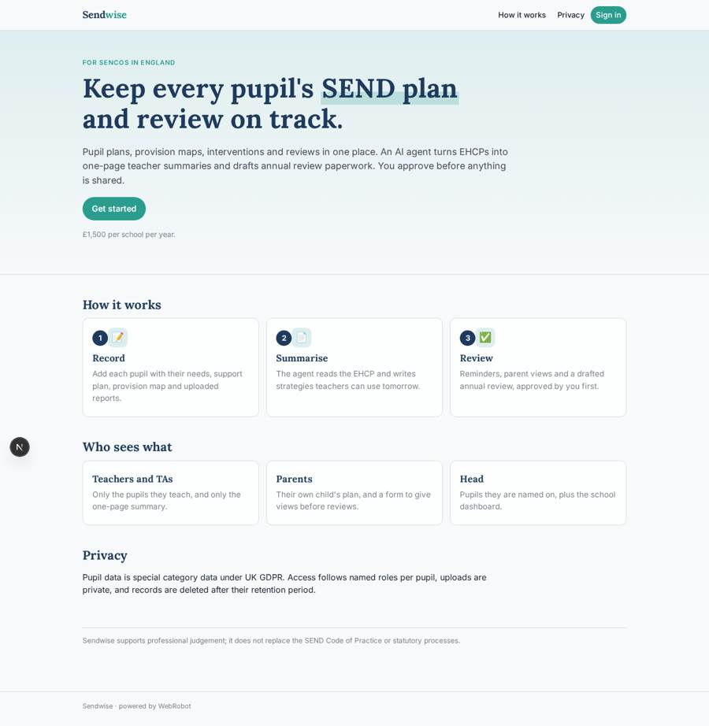
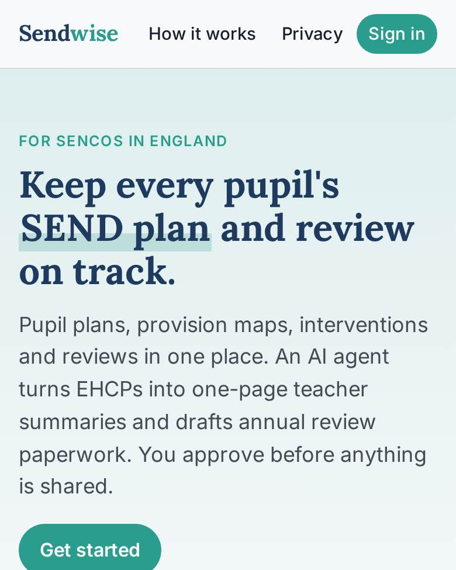
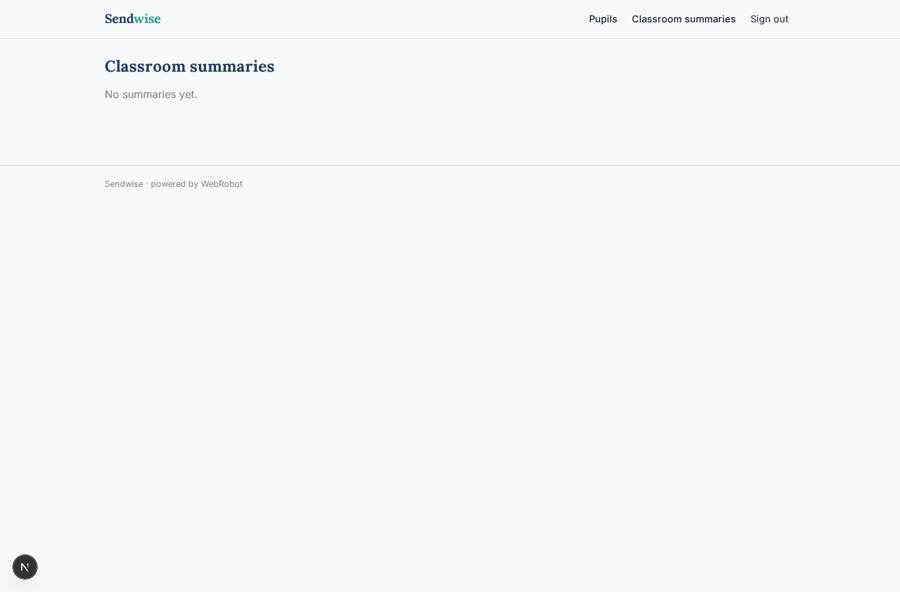
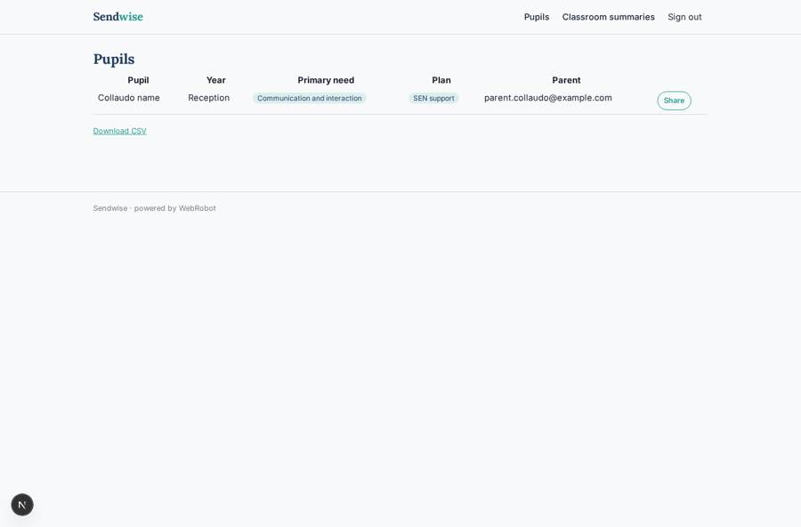
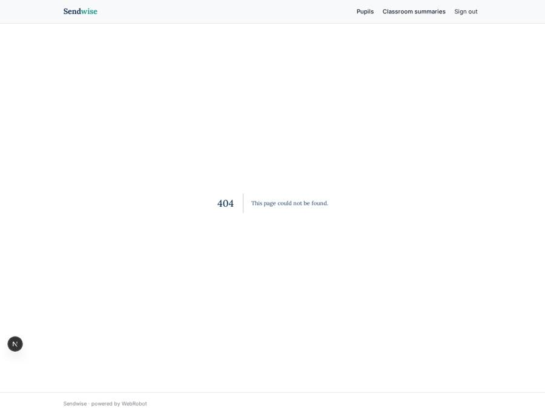

# Sendwise

_SEND coordination for English schools: plans, reviews and EHCP summaries in one place._

**Sector:** Sanità, istruzione, energia, gov · **Manifest:** valid (schema + runtime contract) · **Functional test:** 17 failure(s) (10 checks passed)

## Description given to the app builder

We need Sendwise, a platform for SEND coordinators in schools in England. A school signs up and adds staff; roles are SENCo, teacher, teaching assistant, head and governor. The SENCo creates a record for each pupil with special educational needs: needs category, support plan, provision map, interventions, reviews, and uploaded EHCPs and specialist reports. An agent reads the EHCP and produces a one-page summary for teachers with strategies to use in class, and drafts annual review paperwork, which the SENCo approves before sharing. Teachers see only pupils they teach; parents can view their child's plan and give views through a form before reviews. Email reminders for review deadlines and intervention check-ins. Dashboards compare the school's figures with DfE SEN statistics. We need pupil data synced from the school MIS (SIMS, Arbor) through an OAuth integration provider rather than by hand. Pricing: £1,500 per school per year. English only, sensitive data handled under UK GDPR.

## Functional test: what did not pass

- **form can be filled (options, uploads)** (form add_document): required pupil (options from collection:pupils) has no option to choose
- **form can be filled (options, uploads)** (form add_intervention): required pupil (options from collection:pupils) has no option to choose
- **form can be filled (options, uploads)** (form add_review): required pupil (options from collection:pupils) has no option to choose
- **run started and report ready** (view assistant): required pupil (options from collection:pupils) has no option
- **page opened by a role allowed to** (view assistant): status 404, error page (as senco)
- **page opened by a role allowed to** (view runs): status 404, error page (as senco)
- **page opened by a role allowed to** (view add_pupil): status 404, error page (as senco)
- **page opened by a role allowed to** (view add_document): status 404, error page (as senco)
- **page opened by a role allowed to** (view add_intervention): status 404, error page (as senco)
- **page opened by a role allowed to** (view interventions): status 404, error page (as senco)
- **page opened by a role allowed to** (view add_review): status 404, error page (as senco)
- **page opened by a role allowed to** (view reviews): status 404, error page (as senco)
- **page opened by a role allowed to** (view approvals): status 404, error page (as senco)
- **page opened by a role allowed to** (view drafts): status 404, error page (as senco)
- **page opened by a role allowed to** (view parent_views_list): status 404, error page (as senco)
- **page opened by a role allowed to** (view dashboard): status 404, error page (as senco)
- **page opened by a role allowed to** (view account): status 404, error page (as senco)
- **form saves a record** (form parent_form): only role parent may fill it, and the test cannot hold that role _(warning)_

## Navigation recording

Signed in as the app's admin, the recorder opened 3 menu page(s): Pupil assistant, Past runs, School dashboard.
- agent run did not open: assistant: the run did not open
- data page empty: runs (history)

Empty data pages are mostly expected on the local runtime: agents are mocked there, so the collections they fill stay empty.

## Features not expressible today (spec.extensions)

- **mis_sync**: Pupil sync from SIMS or Arbor through an OAuth integration provider is not available yet (OAuth to other services is not supported). Until then the SENCo adds pupils with the form.
- **governor_view**: Governors are named on pupils but have no record access, by design under UK GDPR. A separate aggregate-only board report is not available yet.
- **parent_signup_role**: A parent who signs in also receives the SENCo signup role; their views are restricted by role, but a stricter separate signup path for parents is needed.
- **school_isolation**: Schools are separated by the SENCo who owns the records; a shared school workspace across several SENCos needs a school entity not yet available.

## Screenshots (interpretive runtime, test data)

### home-anon

### home-mobile

### summaries

### my_child

### pupils_list

### interventions

