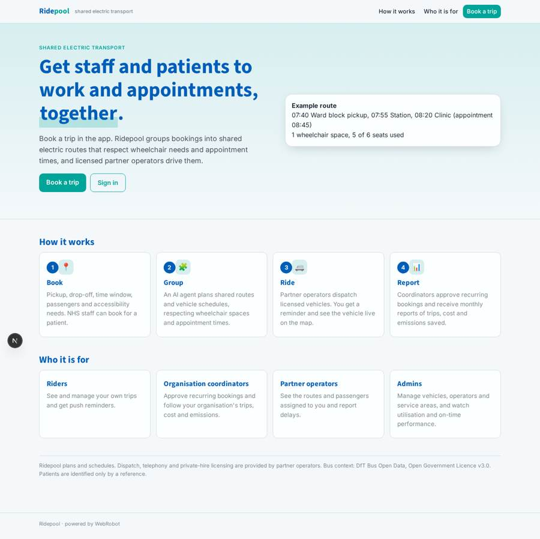
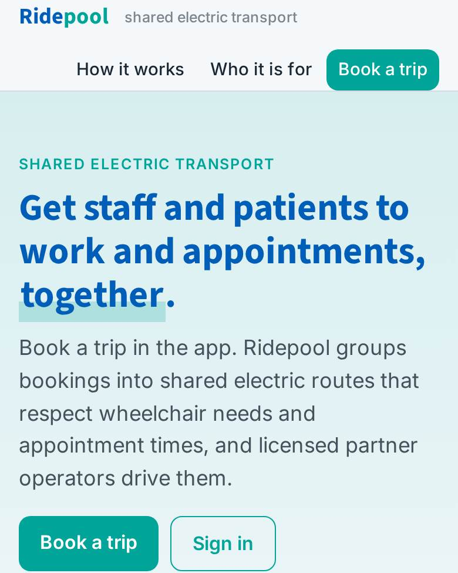
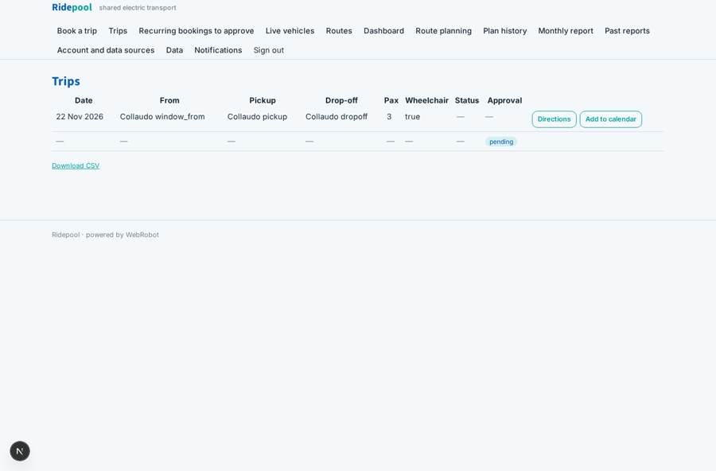
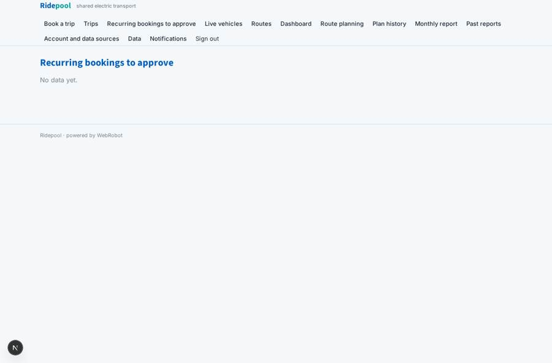
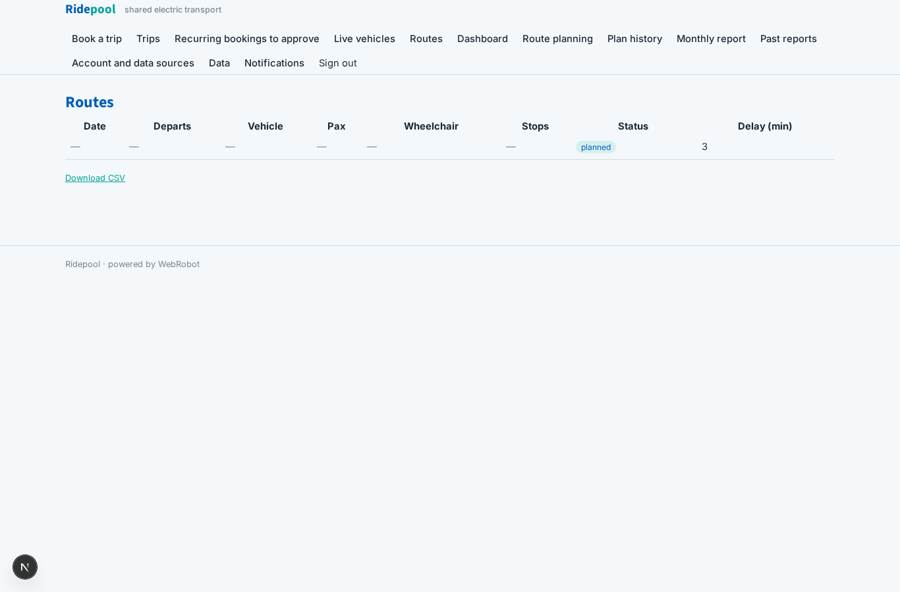
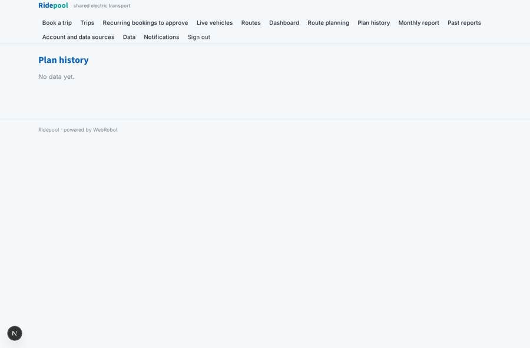

# Ridepool

_Shared electric transport for NHS staff and patients._

**Sector:** Sanità, istruzione, energia, gov · **Manifest:** valid (schema + runtime contract) · **Functional test:** passed (28 checks passed)

## Description given to the app builder

We need Ridepool, a platform for organisations, including NHS trusts, to arrange shared electric transport for staff and patients. Staff book trips in a mobile app; an agent groups bookings into routes and schedules vehicles. Driver dispatch, telephony and the licensed fleet are run by partners. Admins see dashboards; DfT Bus Open Data for context. Patients travelling to appointments can be booked by NHS staff on their behalf, and the agent respects wheelchair needs and appointment times when grouping trips. Admins manage vehicles, partner operators and service areas, and see dashboards of utilisation and on-time performance. Booking forms capture pickup and drop-off, time window, number of passengers and accessibility needs, and the app shows live vehicle position by GPS. Roles are rider, organisation coordinator, partner operator and admin; riders see their own trips, coordinators their organisation. The private-hire licensing for the operating side sits with partners. Coordinators approve recurring bookings and get monthly reports of trips, cost and emissions saved, emailed automatically. Riders get push reminders. Organisations pay per trip, invoiced monthly. English only.

## Functional test: what did not pass

- **template instance created and run** (template org_planner): reserved to coordinator/admin _(warning)_
- **template instance created and run** (template monthly_report): reserved to coordinator/admin _(warning)_
- **trigger has its effect** (trigger route_assigned): email to record.operator_email: no such recipient in the test (role nobody holds or empty field) _(warning)_
- **saved record shown where its collection is read** (view routes): a record was saved in routes (by admin) but the page does not show it (as coordinator) _(warning)_

## Navigation recording

Signed in as the app's admin, the recorder opened 7 menu page(s): Book a trip, Trips, Recurring bookings to approve, Live vehicles, Routes, Dashboard, Route planning.
- data page empty: approvals_queue (table)

Empty data pages are mostly expected on the local runtime: agents are mocked there, so the collections they fill stay empty.

## Features not expressible today (spec.extensions)

- **monthly_invoicing**: Per-trip invoicing of organisations is not available. The monthly report gives trips and cost as the invoice basis, and invoices are issued outside the app.
- **partner_dispatch**: Driver dispatch, telephony and private-hire licensing stay with partner operators. Operators see assigned routes, report delays and send vehicle positions to the telematics webhook. No dispatch or phone integration is built.
- **cross_organisation_pooling**: Each coordinator's planner groups that organisation's bookings, because agents may not read all customers' records. Pooling across organisations needs a separate design.
- **sms_notifications**: SMS and WhatsApp reminders are not available. Riders get push and email.

## Screenshots (interpretive runtime, test data)

### home-anon

### home-mobile

### trips

### approvals_queue

### routes

### plans

