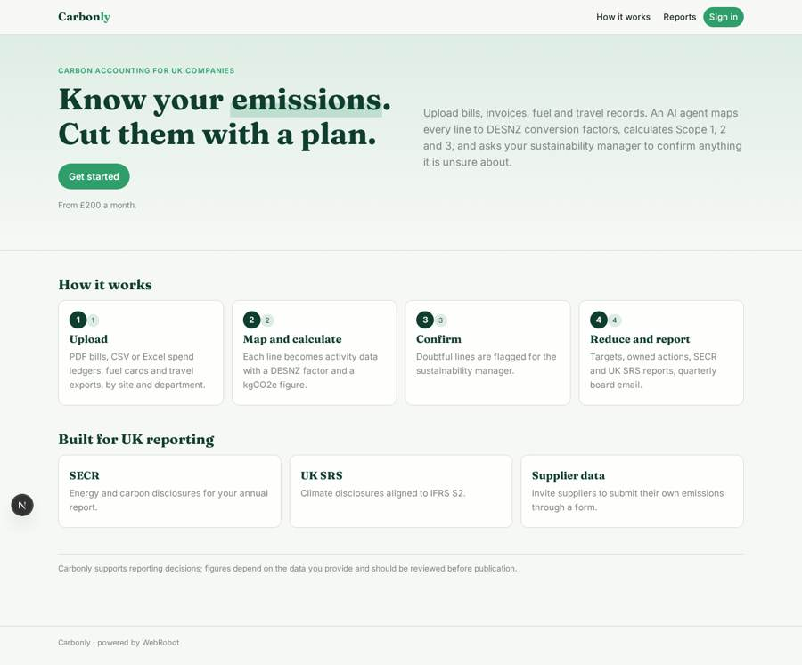
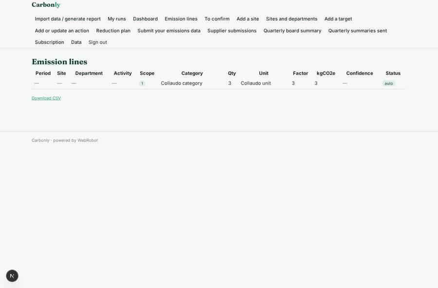
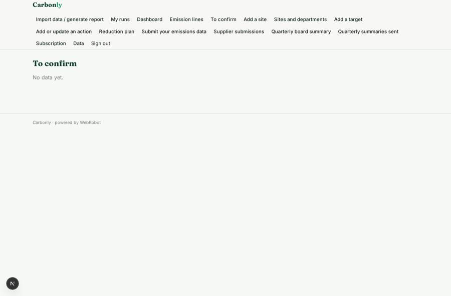
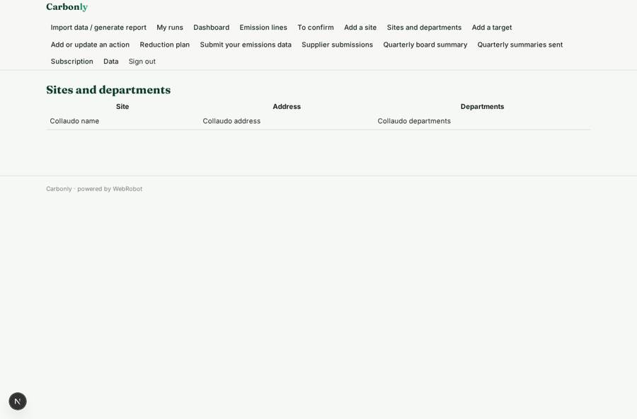
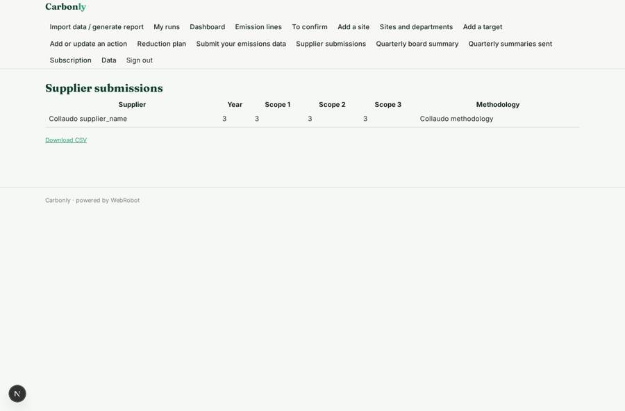

# Carbonly

_Carbon accounting and reduction management for companies._

**Sector:** Sanità, istruzione, energia, gov · **Manifest:** valid (schema + runtime contract) · **Functional test:** passed (35 checks passed)

## Description given to the app builder

I want Carbonly, carbon accounting and reduction management for companies. A company signs up with sites and departments and uploads spend data, energy bills, fuel records and travel as invoices, PDFs, CSV or Excel. An agent maps each line to activity data and the DESNZ greenhouse gas conversion factors, calculating Scope 1, 2 and 3 emissions, and flags anything it is unsure about for a sustainability manager to confirm. We want accounting-system connections through OAuth so spend flows in automatically. Dashboards show emissions by scope, site and category over time, with a reduction plan of targets and actions owners can update. The app generates reports in SECR and UK Sustainability Reporting Standards formats, exportable to CSV and PDF, and emails a quarterly summary to the board contact. Suppliers can be invited to submit their own emissions data via a form. Roles: admin, sustainability manager, contributor, supplier. Pricing from £200 a month through Stripe. English only.

## Navigation recording

Signed in as the app's admin, the recorder opened 7 menu page(s): Import data / generate report, My runs, Dashboard, Emission lines, To confirm, Add a site, Sites and departments.
- data page empty: review (table)

Empty data pages are mostly expected on the local runtime: agents are mocked there, so the collections they fill stay empty.

## Features not expressible today (spec.extensions)

- **accounting_oauth**: Accounting-system connections through OAuth (Xero, QuickBooks, Sage) are not available yet. Until then spend flows in through CSV or Excel exports uploaded in the import form.
- **pdf_export**: PDF export uses the printable report view (print to PDF); CSV export is on the tables.
- **supplier_invites**: Suppliers receive their invitation from the app admins (role supplier by invite) and submit data in the supplier form.

## Screenshots (interpretive runtime, test data)

### home-anon

### home-mobile

### lines

### review

### site_list

### supplier_data

