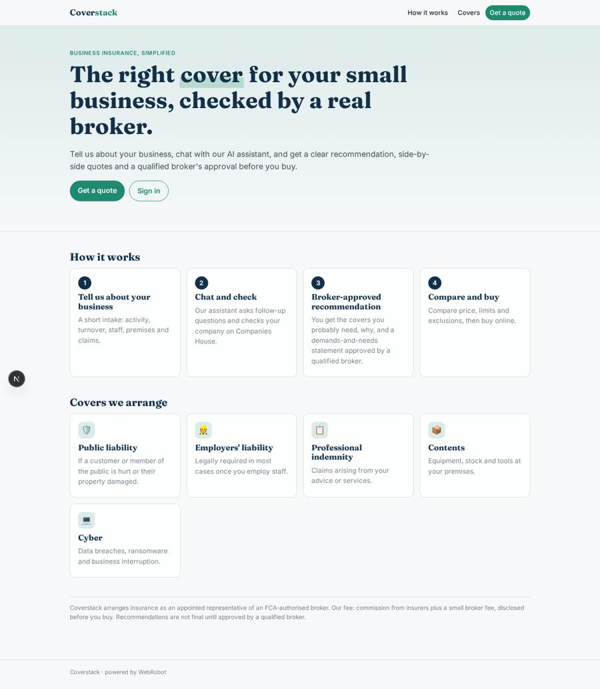
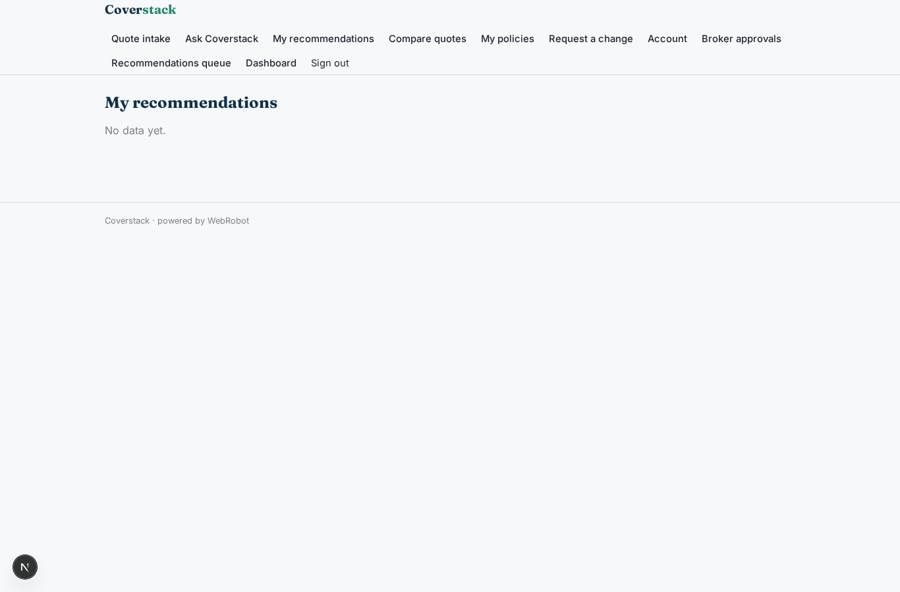
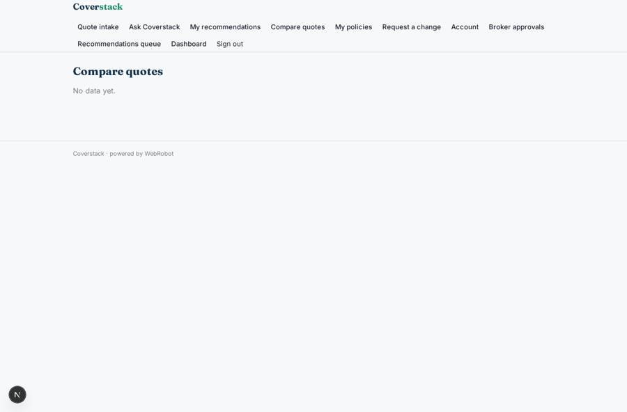
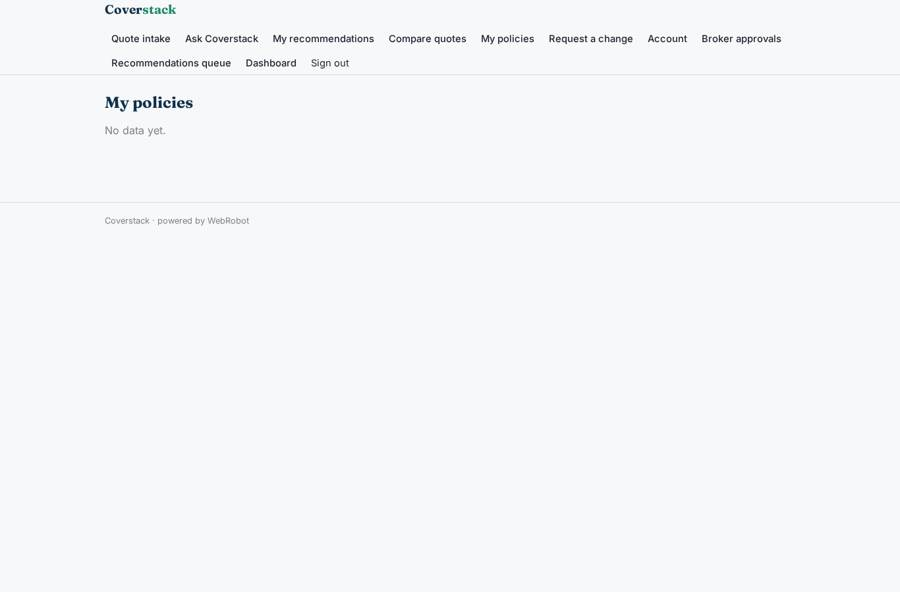
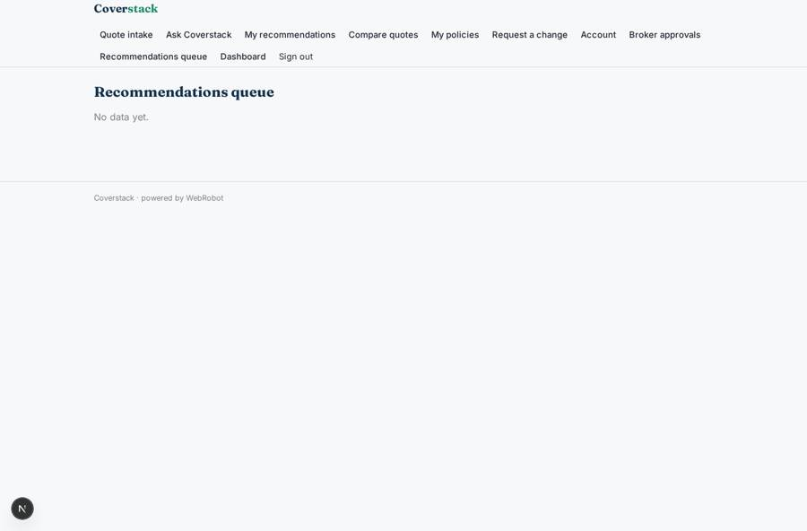

# Coverstack

_Business insurance, explained and arranged by an AI broker team._

**Sector:** Fintech, proptech, insurtech · **Manifest:** valid (schema + runtime contract) · **Functional test:** passed (15 checks passed)

## Description given to the app builder

We want Coverstack, an AI insurance broker for small businesses. Insurance distribution under FCA rules is the regulated part, done through our authorisation or as an appointed representative of a regulated broker; I need the software around it. A business owner signs up and fills a quote intake form: business activity, turnover, employees, premises, claims history, covers wanted (public liability, employers' liability, professional indemnity, contents, cyber). An agent asks follow-up questions in chat, checks the business on Companies House and recommends the covers it probably needs with an explanation. The software requests quotes from insurer panels through their APIs, compares price, limits and exclusions in a table and drafts a demands-and-needs statement following FCA ICOBS. A qualified broker reviews and approves the recommendation before the customer buys. Payment, including monthly instalments through a premium finance partner, is taken online; policy documents are emailed. Renewal reminders start sixty days before expiry and mid-term changes are handled by form. Roles: customer, broker, compliance, admin. Dashboards show quotes, conversion and renewals. Pricing: commission from insurers plus a small broker fee. English.

## Functional test: what did not pass

- **trigger has its effect** (trigger intake_notify): email to role:broker: no such recipient in the test (role nobody holds or empty field) _(warning)_
- **trigger has its effect** (trigger change_requested): email to role:broker: no such recipient in the test (role nobody holds or empty field) _(warning)_

## Navigation recording

Signed in as the app's admin, the recorder opened 7 menu page(s): Quote intake, Ask Coverstack, My recommendations, Compare quotes, My policies, Request a change, Account.
- form not sent: intake: Covers wanted is required
- data page empty: my_quotes (table)
- data page empty: my_policies (table)

Empty data pages are mostly expected on the local runtime: agents are mocked there, so the collections they fill stay empty.

## Design checks (linter)

- collection policies: view my_policies, a data block of dashboard, trigger renewal_60 read it, but nothing writes it — add a form view on it (the users fill their own records), an agent tool that writes or appends to it, or a trigger write; or, for a list the admins keep, make it ownedBy shared (admins fill it on the data page)

## Features not expressible today (spec.extensions)

- **insurer_panel_apis**: Requesting quotes from insurer panels through their APIs needs a contract and a specific API per insurer (hosts, keys, request formats). Not wired: until then quotes are saved from data supplied by the panel integration.
- **online_payment_and_premium_finance**: Taking the premium online, monthly instalments through a premium finance partner, and the broker fee plus insurer commission model are not available yet in the runtime billing.
- **policy_document_email**: Emailing policy documents as attachments is not available yet; only plain-text notifications are sent.
- **fca_regulatory_set_up**: FCA authorisation or appointed-representative status, ICOBS record keeping and complaints handling are the operator's regulatory responsibility.

## Screenshots (interpretive runtime, test data)

### home-anon

### home-mobile

### my_recommendations

### my_quotes

### my_policies

### broker_queue

