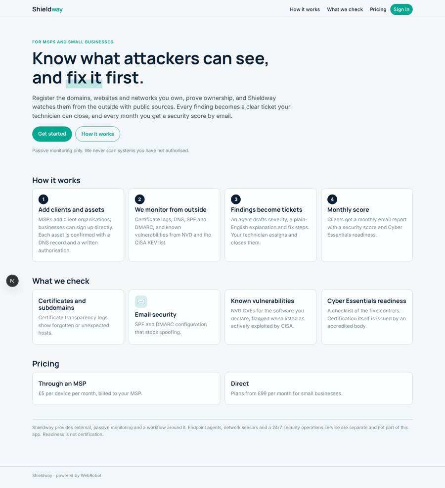
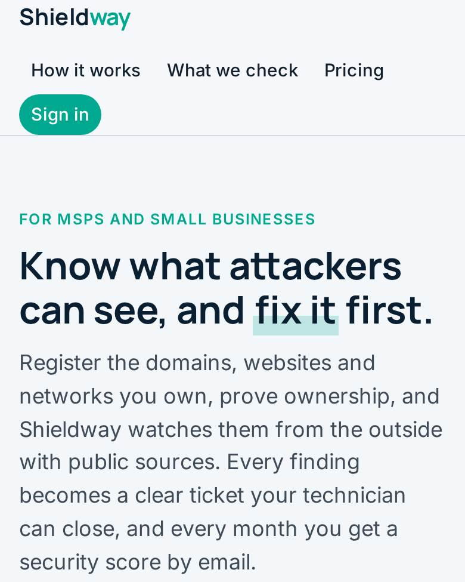
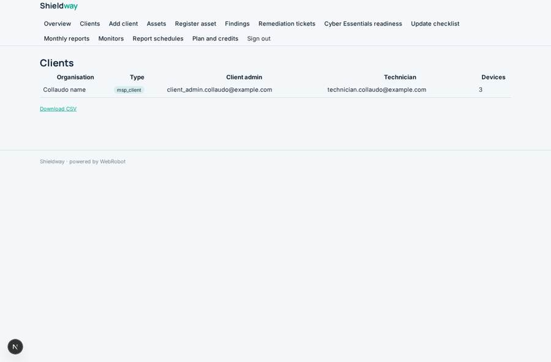
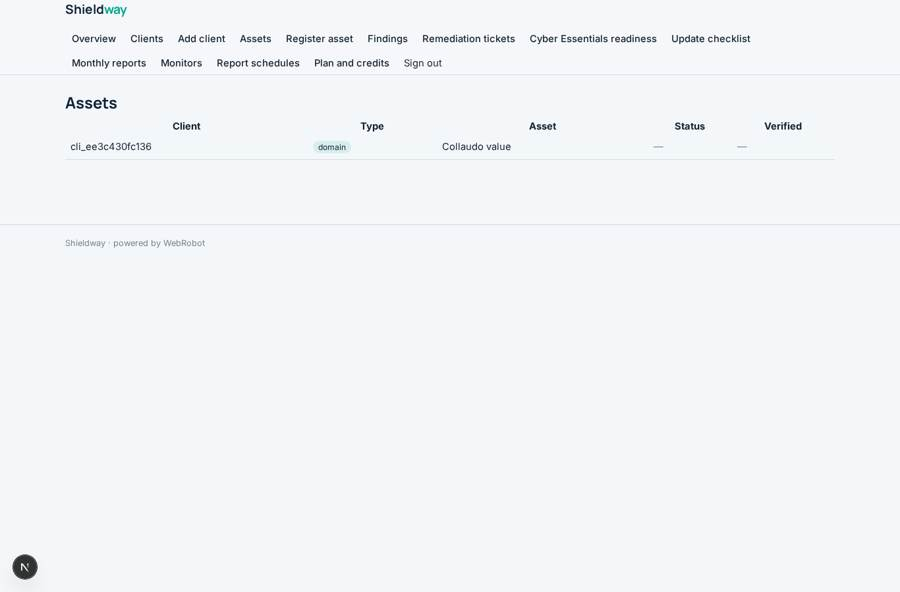
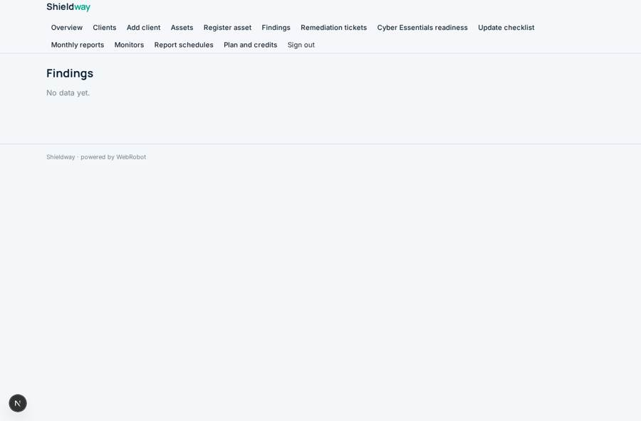
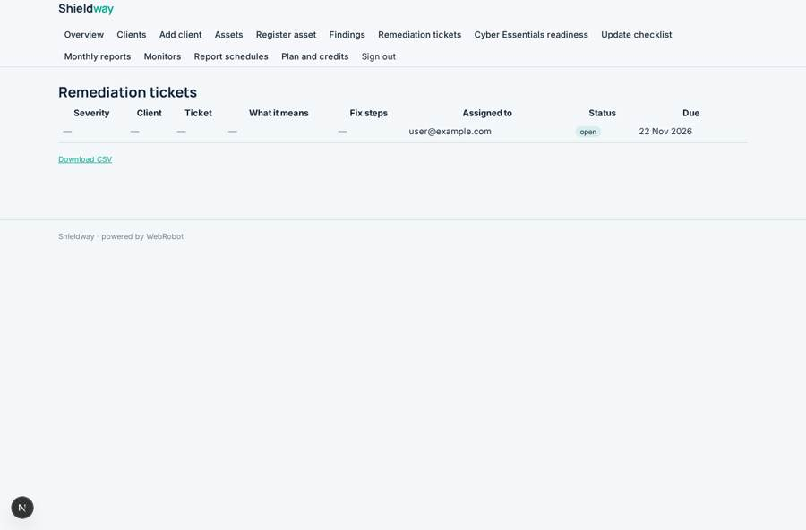

# Shieldway

_AI security monitoring for small businesses and the MSPs who look after them._

**Sector:** Data, media, cyber, devtools · **Manifest:** valid (schema + runtime contract) · **Functional test:** passed (23 checks passed)

## Description given to the app builder

I want an app called Shieldway, an AI security platform for small businesses and the managed service providers who look after them. An MSP signs up and adds client organisations; small businesses can also sign up directly. Each client registers assets it owns: domains, IP ranges, websites and email domains, confirmed with a DNS or file check and written authorisation. External monitors check them using passive public sources, certificate transparency logs, DNS records, SPF and DMARC, and known vulnerabilities from NVD and the CISA KEV list. The real product also installs endpoint agents and network sensors and offers a 24/7 security operations service with people; that software and service are outside the app, and I need the dashboard and workflow around them. Findings become remediation tickets with severity, plain-English explanation and fix steps; an agent drafts them, and the MSP technician assigns and closes them. A readiness checklist tracks Cyber Essentials controls, but certification itself needs an accredited body. Clients get monthly email reports with a security score. Roles: MSP admin, technician, client admin, client viewer; each client sees only its own data. Pricing: £5 per device per month via MSPs, direct plans from £99. English only.

## Functional test: what did not pass

- **trigger has its effect** (trigger ticket_opened): email to record.technician_email: no such recipient in the test (role nobody holds or empty field) _(warning)_

## Navigation recording

Signed in as the app's admin, the recorder opened 7 menu page(s): Overview, Clients, Add client, Assets, Register asset, Findings, Remediation tickets.
- data page empty: findings (table)

Empty data pages are mostly expected on the local runtime: agents are mocked there, so the collections they fill stay empty.

## Features not expressible today (spec.extensions)

- **per_device_msp_billing**: £5 per device per month for MSPs needs usage-based invoicing from the devices count of each client; here the devices field is recorded and MSPs buy credits or a plan. Per-device invoicing must be handled outside the app.
- **file_ownership_check**: Ownership checks by a file on the website are reviewed by a person (status needs_review); only the DNS TXT check is automatic, because agents can only call a fixed list of public hosts.
- **endpoint_agents_and_sensors**: Endpoint agents, network sensors and the 24/7 security operations service are outside this app; their findings could later arrive on a webhook trigger into the findings collection.
- **cyber_essentials_certification**: The checklist tracks readiness only; certification needs an accredited certification body.
- **role_note**: Everyone who signs up holds the msp_admin role, including direct small businesses (their own client record); client admins and viewers also get their derived role. Data stays isolated per owner and per client through access rules.

## Screenshots (interpretive runtime, test data)

### home-anon

### home-mobile

### clients

### assets

### findings

### tickets

