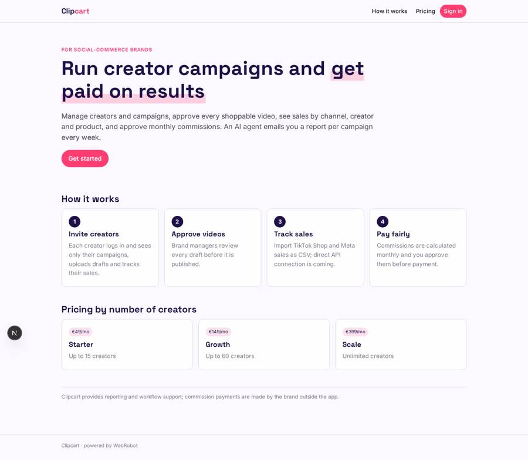
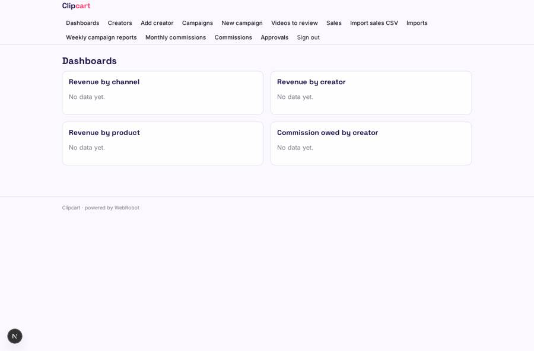
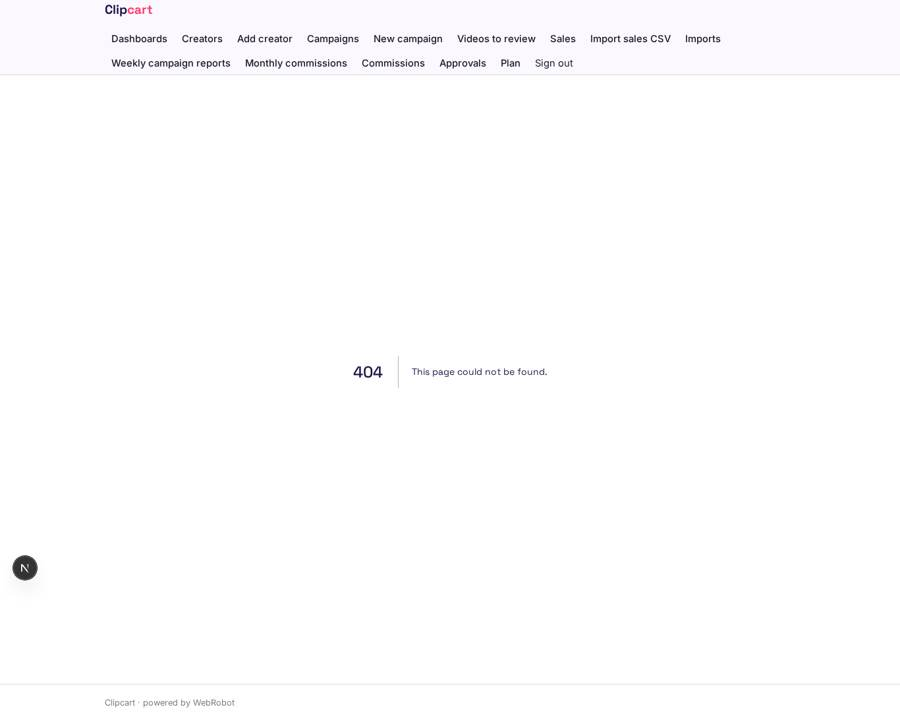
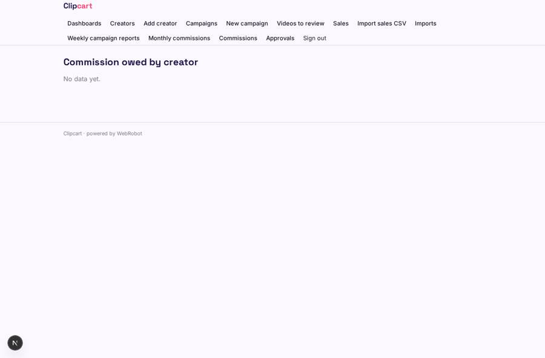
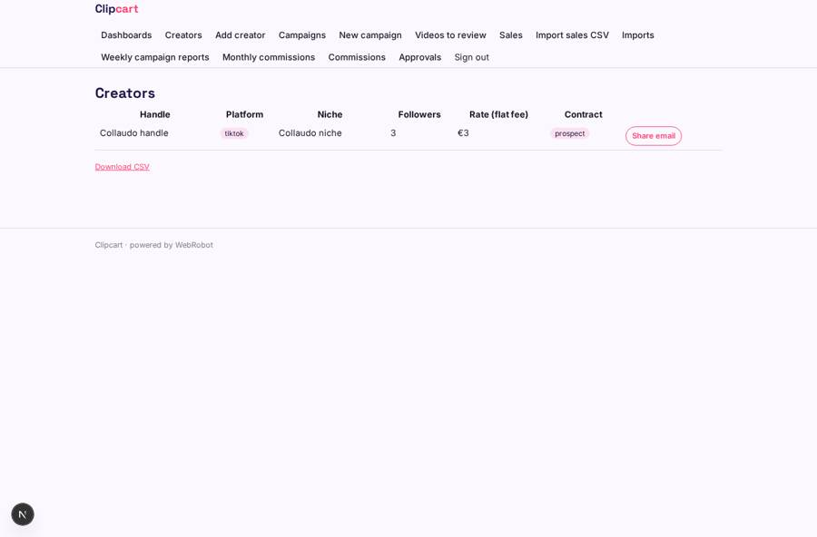

# Clipcart

_Creator campaigns, shoppable video approvals and commissions in one place._

**Sector:** Consumer, travel, retail · **Manifest:** valid (schema + runtime contract) · **Functional test:** passed (30 checks passed)

## Description given to the app builder

I want an app called Clipcart for brands selling through social commerce and creators. A brand signs up and invites its team. It manages creators (handle, platform, niche, followers, rate, contract status) and campaigns (product, dates, budget, deliverables, commission rate), and each creator gets their own login to see only their campaigns, upload drafts of shoppable videos and see their sales. Brand managers approve each video before it is published. Sales and video performance should come from TikTok Shop and Meta through their APIs with OAuth per brand and partner approval; until then brands import sales as CSV. Video processing (trimming, captions, product tags) is part of the product. An agent writes a weekly report per campaign: sales per creator, cost per sale, best videos, and which creators to rebook, sent by email to the brand. Dashboards: revenue by channel, creator and product, commission owed. Commissions due to creators are calculated monthly and the brand approves them before payment. Pricing: monthly subscription by number of creators managed. English.

## Functional test: what did not pass

- **form saves a record** (form upload_video): only role creator may fill it, and the test cannot hold that role _(warning)_
- **trigger has its effect** (trigger video_submitted): email to record.brand_email: no such recipient in the test (role nobody holds or empty field) _(warning)_
- **saved record shown where its collection is read** (view my_campaigns): a record was saved in campaigns (by user) but the page does not show it (as creator) _(warning)_
- **saved record shown where its collection is read** (view my_videos): a record was saved in videos (by user) but the page does not show it (as creator) _(warning)_

## Navigation recording

Signed in as the app's admin, the recorder opened 7 menu page(s): Dashboards, Creators, Add creator, Campaigns, New campaign, Videos to review, Sales.
- data page empty: dashboard (dashboard)
- data page empty: sales (table)

Empty data pages are mostly expected on the local runtime: agents are mocked there, so the collections they fill stay empty.

## Features not expressible today (spec.extensions)

- **social_apis_oauth**: TikTok Shop and Meta sales and video performance via OAuth per brand (needs partner approval) is not available yet; brands import CSV for now.
- **video_processing**: Trimming, captions and product tags are not available yet; creators attach notes and drafts, and a processing service must be integrated.
- **creator_payouts**: Payments to creators are not executed by the app; the brand pays outside Clipcart after approving commissions.
- **brand_team_invites**: Team access is by listing member emails on each record; automatic brand workspaces and invitations would need a dedicated feature.

## Screenshots (interpretive runtime, test data)

### home-anon

### home-mobile

### dashboard

### my_campaigns

### commissions_due

### creators

