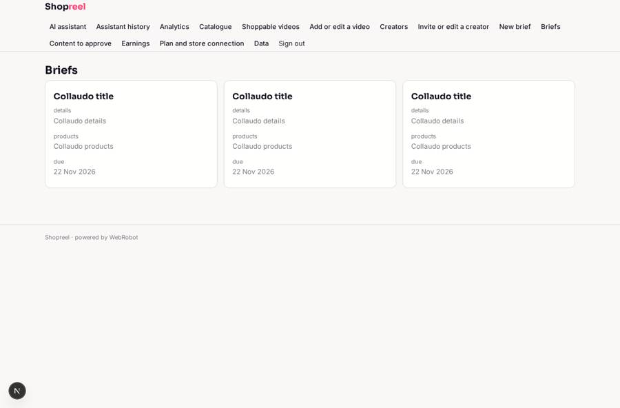
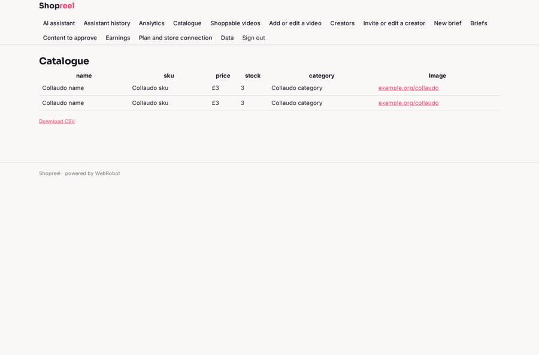
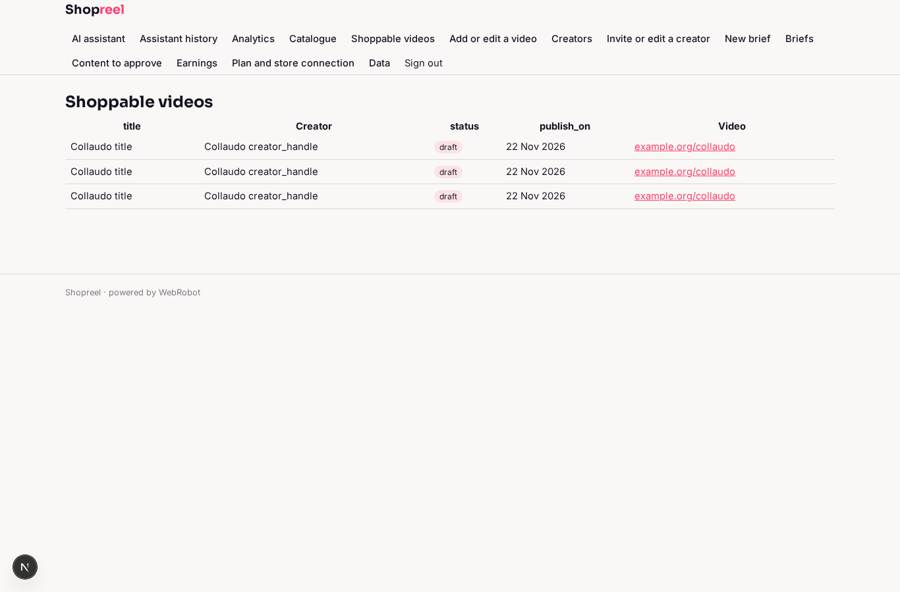
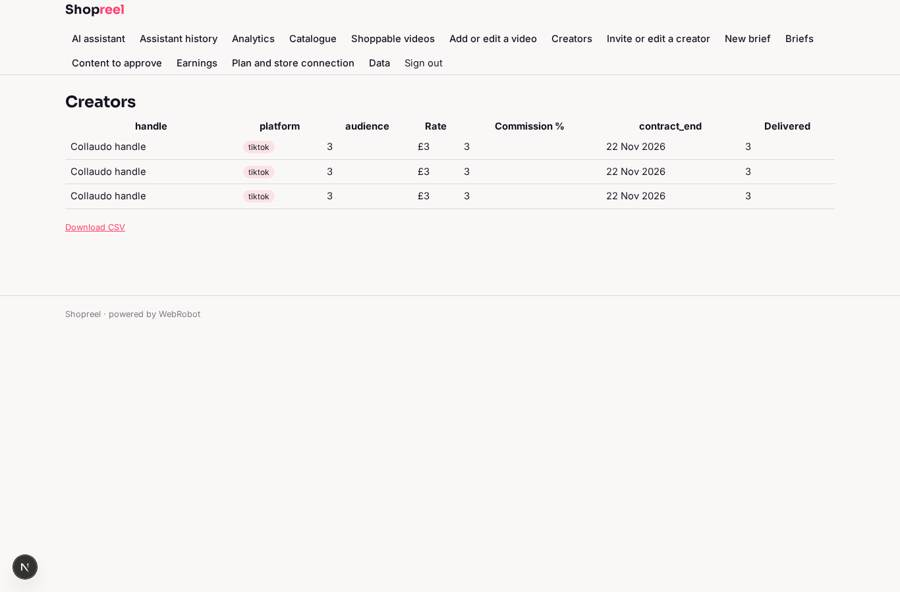

# Shopreel

_Shoppable video, creators and sales analytics for brands._

**Sector:** Data, media, cyber, devtools · **Manifest:** valid (schema + runtime contract) · **Functional test:** passed (44 checks passed)

## Description given to the app builder

We need an app called Shopreel for brands to manage social commerce: shoppable videos, creators and sales analytics. A brand signs up and connects its e-commerce store (Shopify, WooCommerce) and its TikTok and Instagram accounts through OAuth, as the real product does; social data comes only from official APIs, never scraping. The product catalogue syncs with name, price, stock and images. Brands upload short videos, tag products at timestamps and publish shoppable videos to their site and social channels; the real product processes and transcodes video, and I want that included. A creator directory stores each creator's handle, audience, rates, contract and content delivered; brands invite creators, who log in to see briefs, upload content and track their commission. Content from creators needs brand approval before publishing. An agent writes captions and suggests which products to feature based on stock and past performance. Dashboards show views, clicks, add-to-cart and revenue per video, creator and product. Creators get monthly earnings statements by email. Roles: brand admin, marketer, creator. Pricing: £199 a month plus a percentage of attributed sales. English only.

## Functional test: what did not pass

- **form saves a record** (form submit_content): only role creator may fill it, and the test cannot hold that role _(warning)_
- **saved record shown where its collection is read** (view my_content): a record was saved in submissions (by admin) but the page does not show it (as creator) _(warning)_

## Navigation recording

Signed in as the app's admin, the recorder opened 7 menu page(s): AI assistant, Assistant history, Analytics, Catalogue, Shoppable videos, Add or edit a video, Creators.
No issue found.

Empty data pages are mostly expected on the local runtime: agents are mocked there, so the collections they fill stay empty.

## Features not expressible today (spec.extensions)

- **oauth_social_accounts**: Connecting TikTok and Instagram (and Shopify/WooCommerce) through OAuth is not available yet. Shopify connects with an API key on the account page. Official-API social metrics must arrive through the performance webhook until OAuth exists.
- **woocommerce_sync**: WooCommerce stores live on arbitrary hosts, which the egress list cannot cover yet; only Shopify catalogue sync is included.
- **video_upload_transcoding**: Video file upload, processing and transcoding are not available: file fields accept documents and images only and agents cannot run code. Videos are added as links to hosted files, with product tags at timestamps stored on the video.
- **publish_to_channels**: Publishing shoppable videos to the brand site and to TikTok/Instagram needs OAuth and an embed widget. For now status and channels are recorded on the video.
- **sales_percentage**: The percentage of attributed sales on top of the £199 monthly plan is not supported by billing; it must be invoiced by the owner from the earnings and performance data.
- **brand_isolation**: Records are shared by the brand's admin and marketers inside one app; one app instance serves one brand.

## Screenshots (interpretive runtime, test data)

### home-anon

### home-mobile

### briefs

### products

### videos

### creators

