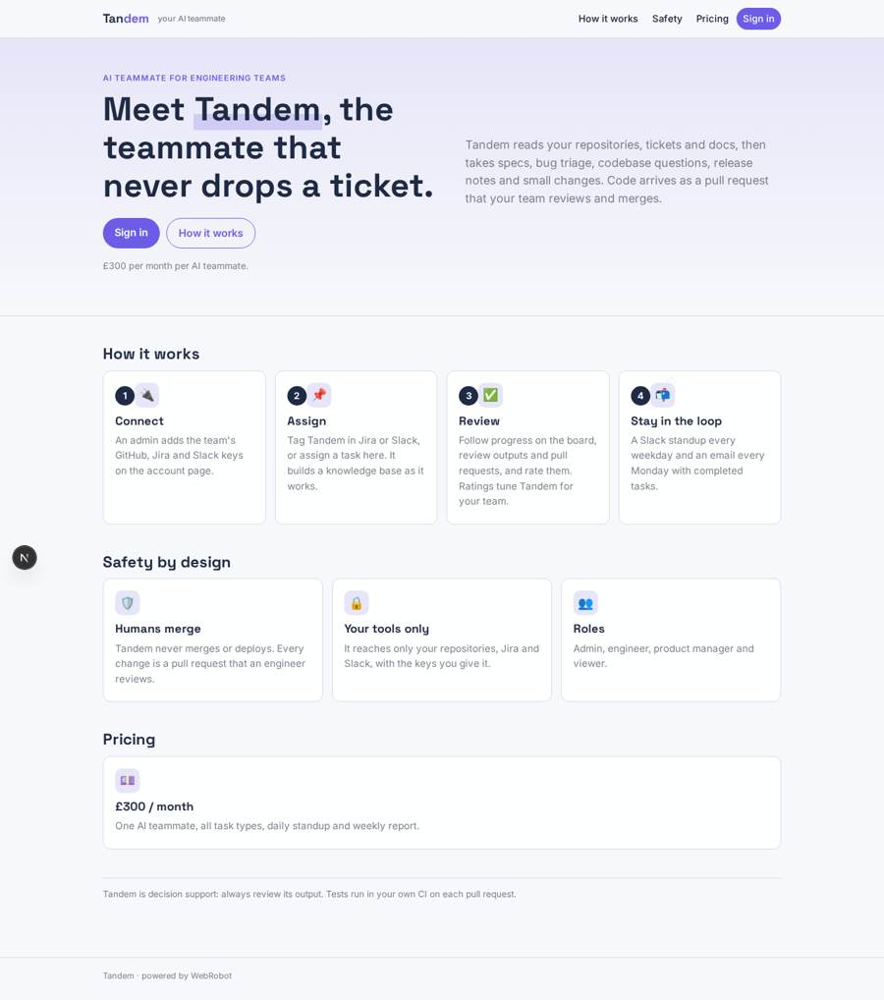
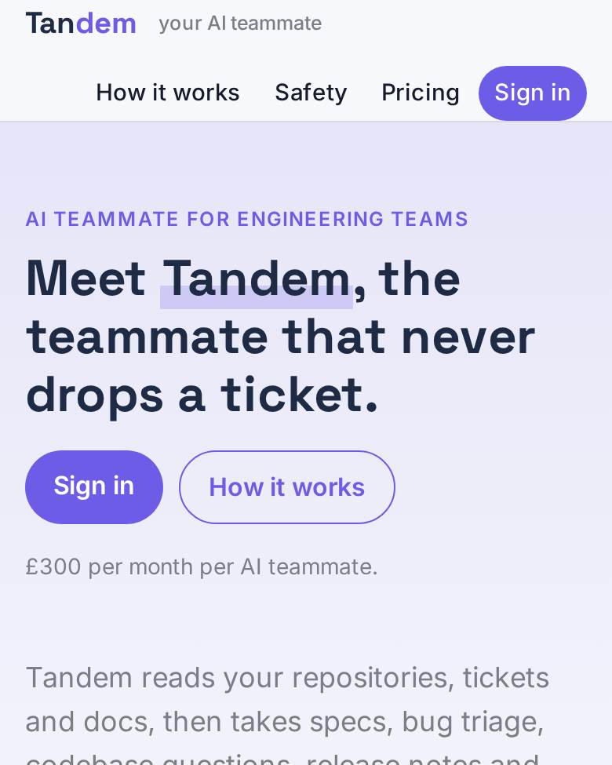
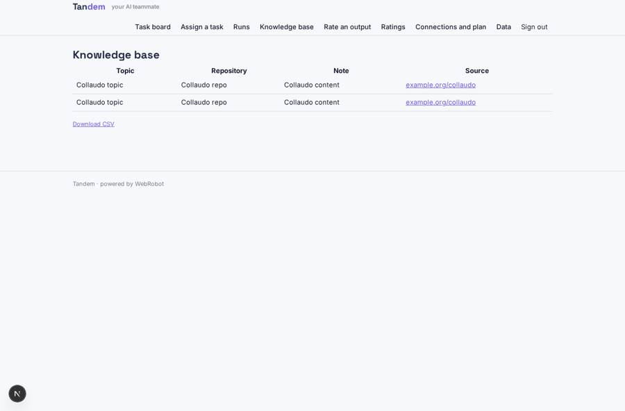
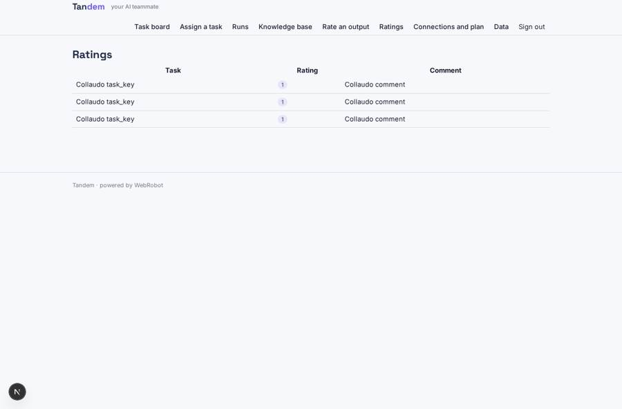
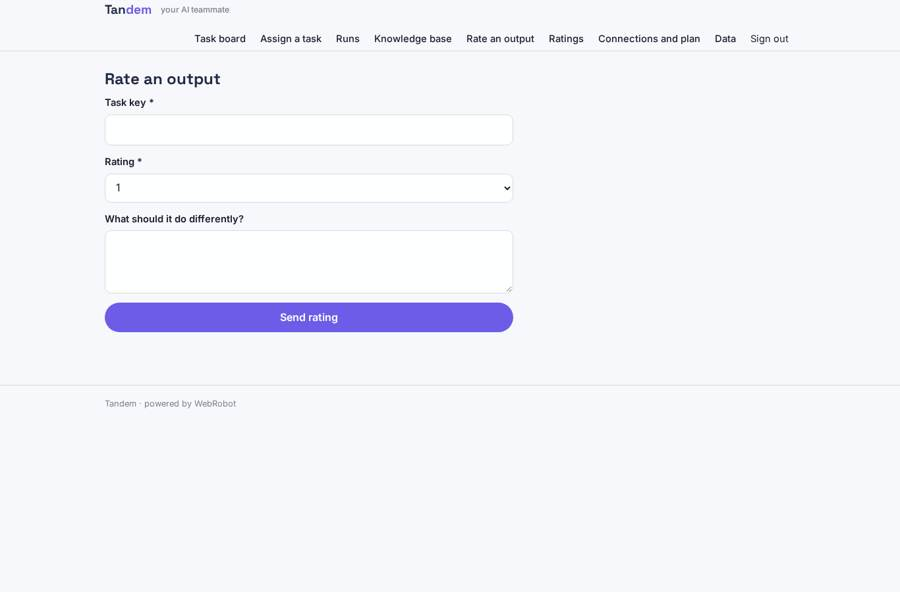
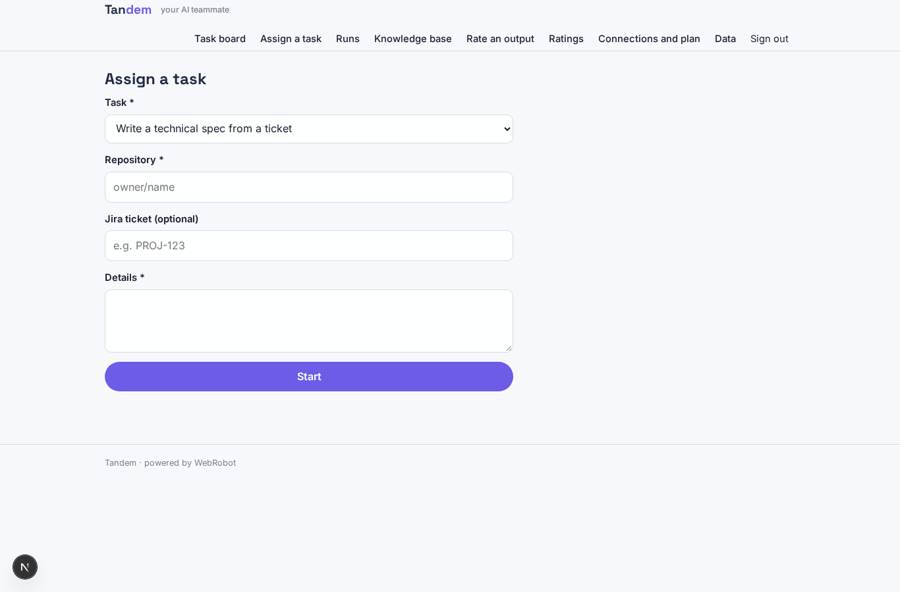

# Tandem

_An AI teammate for your whole development lifecycle._

**Sector:** Data, media, cyber, devtools · **Manifest:** valid (schema + runtime contract) · **Functional test:** passed (21 checks passed)

## Description given to the app builder

I want an app called Tandem, an AI team member that works across a software team's development lifecycle. A team signs up and connects GitHub, Jira and Slack through OAuth, as the real product does. The AI teammate reads the repository, tickets and documentation and builds a knowledge base. Team members assign it tasks in Jira or Slack: write a technical spec from a ticket, triage new bugs, answer questions about the codebase, draft release notes, or implement small changes. For code changes the real product executes code in the customer repository and runs tests; I want that, with the agent opening a pull request that a human must review and merge. It never merges or deploys by itself. A task board shows what the agent is working on, its status, time spent and links to outputs. Engineers rate each output, and ratings tune its behaviour per team. Every day the agent posts a standup summary in Slack; every week, an email with completed tasks. Roles: admin, engineer, product manager, viewer; access follows repository permissions. Pricing: £300 a month per AI teammate. English only. Only the customer's own repositories and tools.

## Navigation recording

Signed in as the app's admin, the recorder opened 7 menu page(s): Task board, Assign a task, Runs, Knowledge base, Rate an output, Ratings, Connections and plan.
No issue found.

Empty data pages are mostly expected on the local runtime: agents are mocked there, so the collections they fill stay empty.

## Features not expressible today (spec.extensions)

- **oauth_connections**: OAuth sign-in to GitHub, Jira and Slack is not available yet. Admins paste an API token for each (fine-grained GitHub token, Atlassian API token, Slack bot token) on the account page.
- **code_execution**: The agent cannot run code or tests on the platform. It commits to a tandem/* branch and opens a pull request through the GitHub API; tests run in the customer's own CI and the agent reads the check results.
- **repository_permissions**: Access cannot yet mirror per-repository GitHub permissions. The agent can reach what its token reaches, and app roles (admin, engineer, product manager, viewer) govern who sees the board. Use a token scoped to the intended repositories.
- **inbound_assignment**: Tasks assigned in Jira or Slack arrive through a Jira automation rule or Slack workflow that POSTs {task_key, title, type, source, requester, jira_key, repo, channel, details, status:'queued'} to /api/hooks/jira_hook with the app's hook secret. @mention listening in Slack is not available.
- **merge_protection**: Tandem is told never to merge and has no merge tool, but GitHub enforces it: enable branch protection with required reviews and give the token no merge rights on protected branches.
- **rating_tuning**: Ratings tune behaviour per team because the agent reads them at the start of each task; there is no model fine-tuning.

## Screenshots (interpretive runtime, test data)

### home-anon

### home-mobile

### knowledge

### ratings_list

### rate

### new_task

