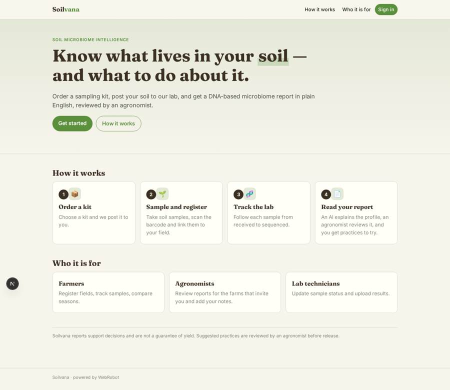
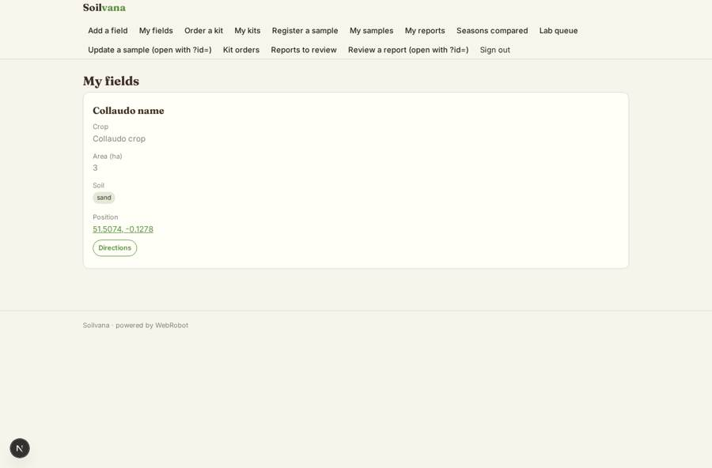
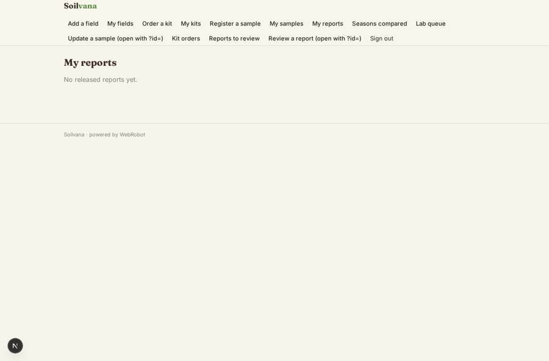
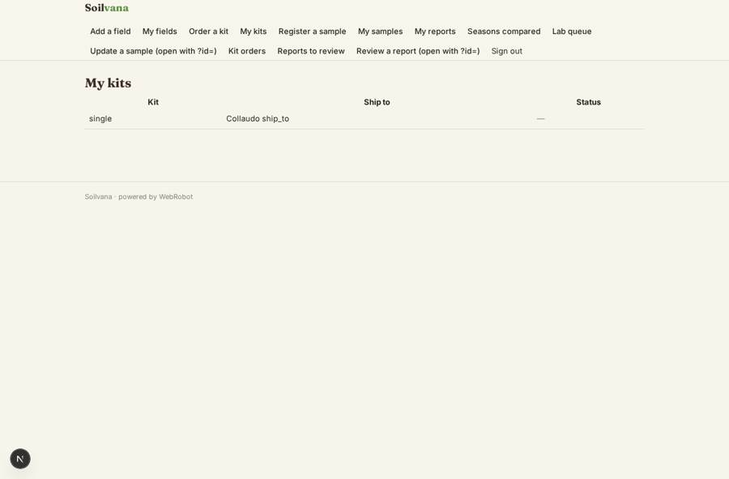
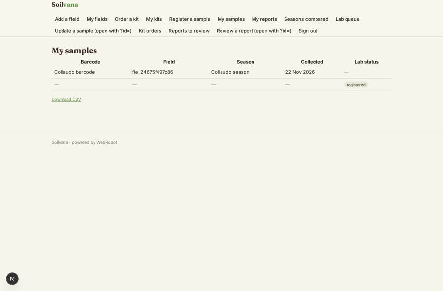

# Soilvana

_Soil microbiome intelligence from DNA sequencing and AI._

**Sector:** Sanità, istruzione, energia, gov · **Manifest:** valid (schema + runtime contract) · **Functional test:** passed (26 checks passed)

## Description given to the app builder

We need Soilvana, soil microbiome intelligence from DNA sequencing and AI. Farmers order a sampling kit, take soil samples and post them to our lab; the lab sequencing is physical deep tech and is ours, and I need the software around it. Farmers sign up, register fields and samples with a barcode, and track them through the lab. When results arrive, an agent explains the microbiome profile in plain English and suggests management practices, which an agronomist reviews before release. Dashboards compare fields over seasons. Kits and reports are paid through Stripe. Roles are farmer, agronomist, lab technician and admin; lab technicians update sample status and upload result files, farmers see only their fields, and agronomists see farms that invite them. Farmers get email when results are ready and a reminder to resample the following season. Pricing per kit, with a seasonal subscription for multiple fields. Agronomists can add their own notes to each report. English only.

## Functional test: what did not pass

- **trigger has its effect** (trigger report_for_review): email to record.agronomist_email: no such recipient in the test (role nobody holds or empty field) _(warning)_
- **saved record shown where its collection is read** (view review_queue): a record was saved in reports (by admin) but the page does not show it (as agronomist) _(warning)_

## Navigation recording

Signed in as the app's admin, the recorder opened 7 menu page(s): Add a field, My fields, Order a kit, My kits, Register a sample, My samples, My reports.
No issue found.

Empty data pages are mostly expected on the local runtime: agents are mocked there, so the collections they fill stay empty.

## Screenshots (interpretive runtime, test data)

### home-anon

### home-mobile

### my_fields

### my_reports

### my_kits

### my_samples

