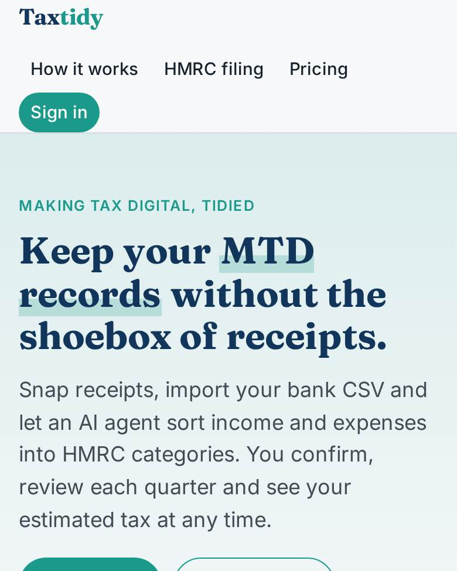
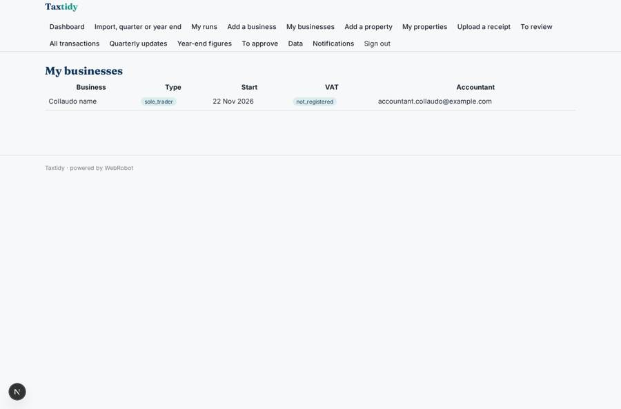
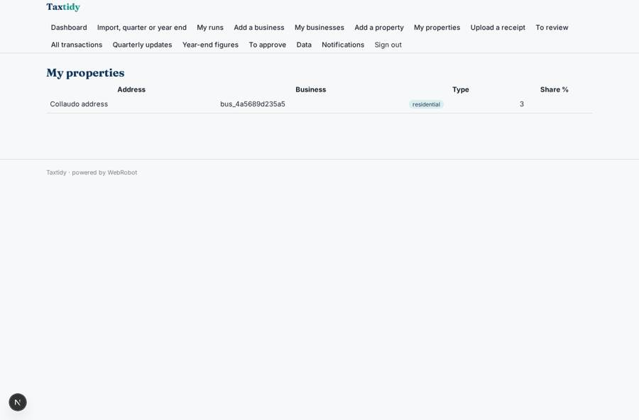
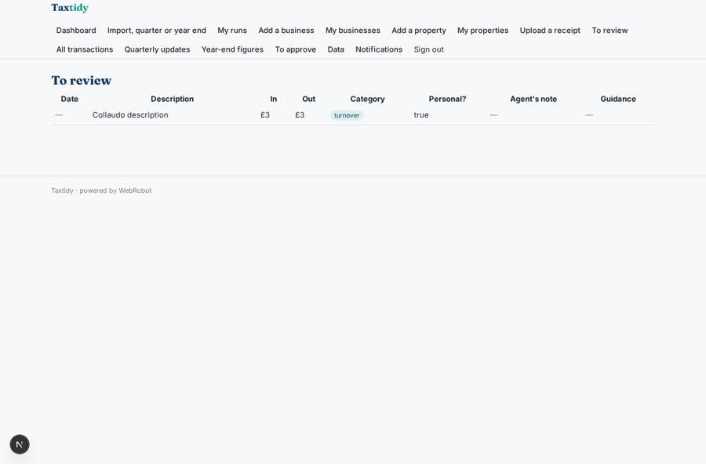
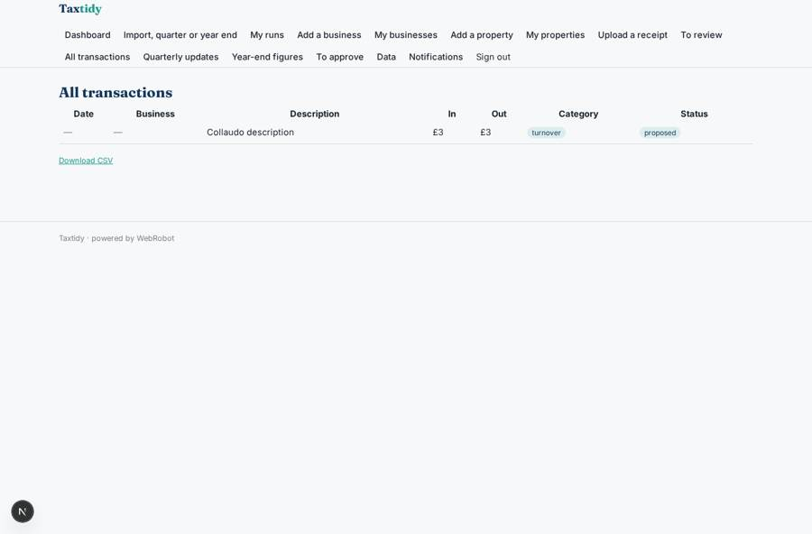

# Taxtidy

_Digital records and Making Tax Digital updates for sole traders and landlords._

**Sector:** B2B AI and SaaS · **Manifest:** valid (schema + runtime contract) · **Functional test:** passed (23 checks passed)

## Description given to the app builder

We need Taxtidy for sole traders and landlords who must keep digital records and file self-assessment under Making Tax Digital. The filing is the part outside what I expect the builder to cover: submitting quarterly updates and the final declaration to HMRC requires HMRC-recognised software and production approval for the MTD APIs; I need the software around it and a clear hook for that submission. A user signs up, enters their businesses and properties through a form (type, start date, accounting period, VAT status), uploads receipts and invoices from their phone, and imports bank transactions by CSV. An agent extracts and categorises income and expenses into HMRC categories, flags personal items, suggests allowable expenses with guidance from gov.uk, and asks the user to confirm. Each quarter it prepares the update summary for the user to review and approve; at year end it prepares the final figures and an estimate of tax due. Accountants can be invited to see and edit their clients' records. Email reminders before quarterly and annual deadlines and for missing receipts. Dashboard of income, expenses and estimated tax. Pricing: monthly subscription via Stripe, cheaper for a single income source. English.

## Navigation recording

Signed in as the app's admin, the recorder opened 7 menu page(s): Dashboard, Import, quarter or year end, My runs, Add a business, My businesses, Add a property, My properties.
- agent run did not open: assistant: the run did not open
- data page empty: runs (history)
- form not sent: business_form: VAT status is required

Empty data pages are mostly expected on the local runtime: agents are mocked there, so the collections they fill stay empty.

## Features not expressible today (spec.extensions)

- **hmrc_submission**: Submitting quarterly updates and the final declaration to HMRC needs HMRC-recognised software and production approval for the MTD APIs, plus OAuth sign-in to HMRC (Government Gateway). Not available in the builder. Hook: the approvals quarter_approval and final_approval and the triggers quarter_approved and final_approved mark figures as approved and ready to submit; an external approved connector would read the approved quarter_updates / final_returns records and set status to submitted.
- **scottish_rates_and_plan_gating**: The tax estimate uses England, Wales and Northern Ireland rates only; Scottish rates, dividends, savings and student loans are not modelled. Plan gating of agent runs (requiring an active subscription) is to be configured by the owner.

## Screenshots (interpretive runtime, test data)

### home-anon

### home-mobile

### businesses

### properties

### to_review

### transactions

