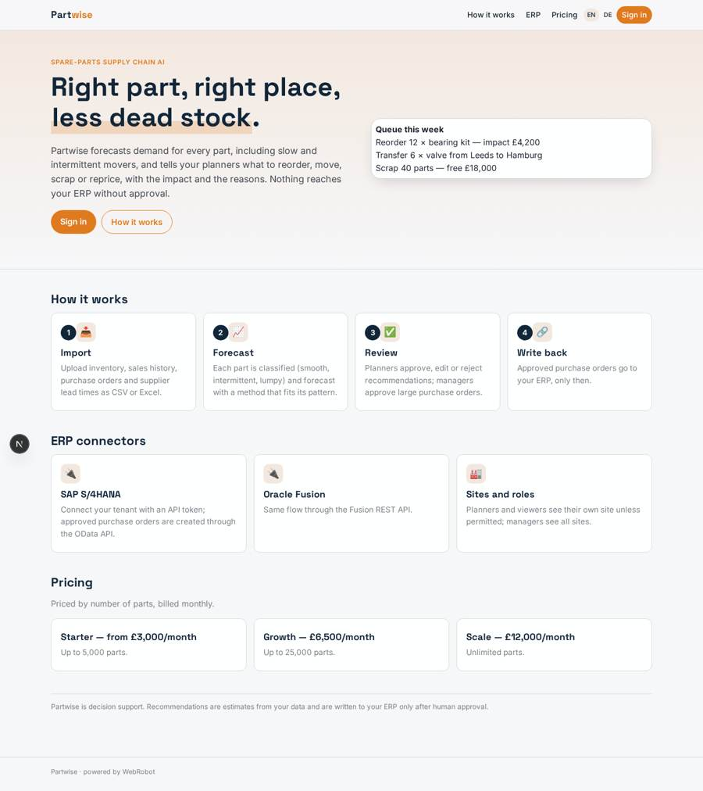
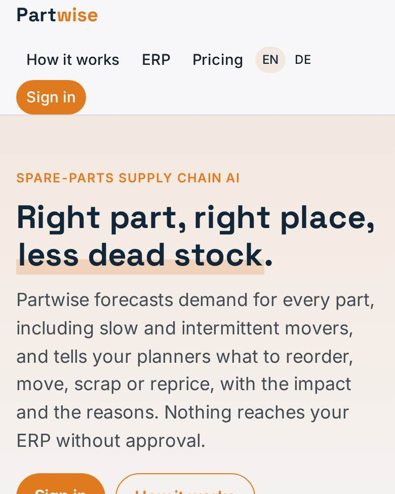
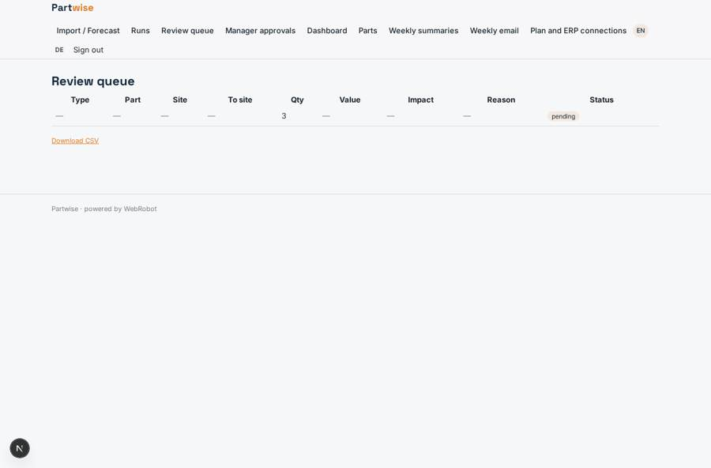
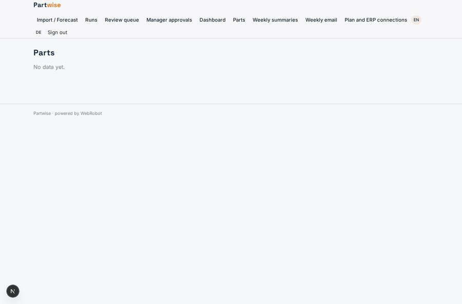
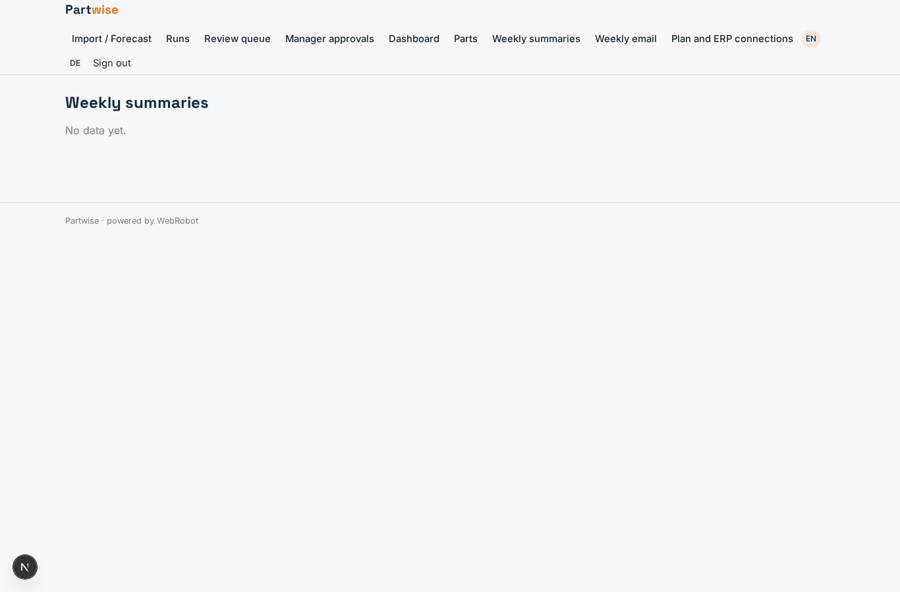
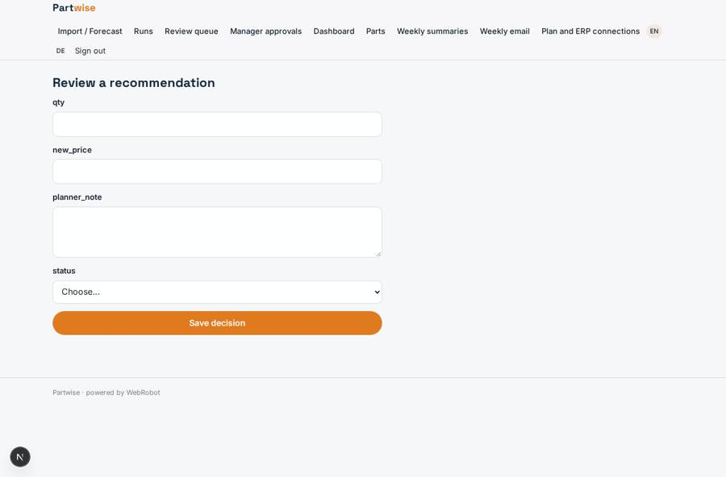

# Partwise

_The AI operating system for spare-parts supply chains._

**Sector:** Data, media, cyber, devtools · **Manifest:** valid (schema + runtime contract) · **Functional test:** passed (16 checks passed)

## Description given to the app builder

I want an app called Partwise, an AI operating system for spare-parts supply chains in industrial and equipment companies. A company signs up and imports inventory, sales history, purchase orders and supplier lead times by CSV or Excel; the real product connects directly to ERPs such as SAP and Oracle, and I want those connectors too. Each part stores number, description, location, stock, cost, price, lead time, supplier and installed-base data. An agent forecasts demand per part, including slow and intermittent movers, and the real product uses deep forecasting models for this. It then recommends reorder quantities, stock transfers between warehouses, parts to scrap and price changes, each with expected impact and reasons. Planners review recommendations in a queue and approve, edit or reject them; approved purchase orders above a value threshold need a manager's approval too. Nothing is written back to the ERP without approval. Dashboards show service level, stock value, dead stock, forecast accuracy and savings achieved. A weekly email summarises recommendations waiting. Roles: admin, planner, manager, viewer; each site sees its own stock unless permitted. Pricing: from £3,000 a month by number of parts. English and German.

## Navigation recording

Signed in as the app's admin, the recorder opened 7 menu page(s): Import / Forecast, Runs, Review queue, Manager approvals, Dashboard, Parts, Weekly summaries.
- data page empty: parts (table)
- data page empty: digests (table)

Empty data pages are mostly expected on the local runtime: agents are mocked there, so the collections they fill stay empty.

## Features not expressible today (spec.extensions)

- **deep_forecasting**: Deep-learning forecasting models are not available yet; forecasts use Croston/SBA intermittent-demand methods with safety stock in a sandboxed slot.
- **erp_oauth_and_direct_connectors**: ERP connection is limited to API tokens over HTTPS (SAP OData, Oracle Fusion REST). OAuth sign-in, RFC/IDoc, database-level and scheduled bulk ERP sync are not available yet; data comes in by CSV/Excel upload.
- **threshold_setting**: The manager approval threshold (10,000 GBP) is fixed in the ERP writer's instructions; a per-company setting is not available yet.
- **queue_row_links**: Rows in the review queue do not yet open the edit form directly; planners open /v/review?id=<record> from the record.

## Screenshots (interpretive runtime, test data)

### home-anon

### home-mobile

### queue

### parts

### digests

### review

