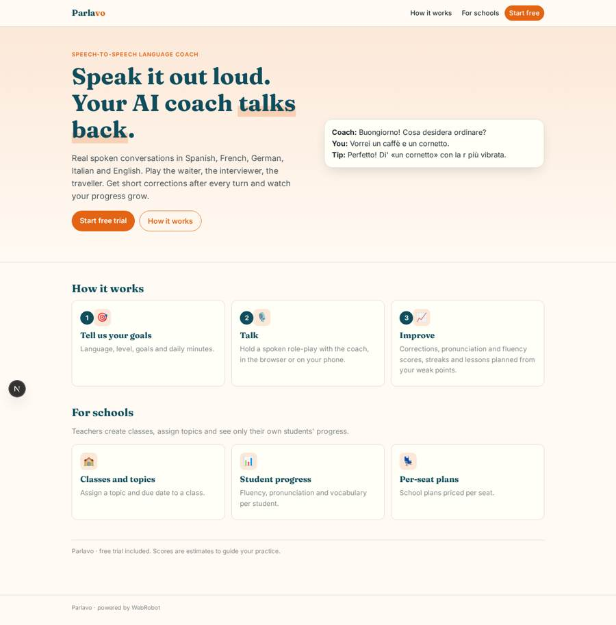
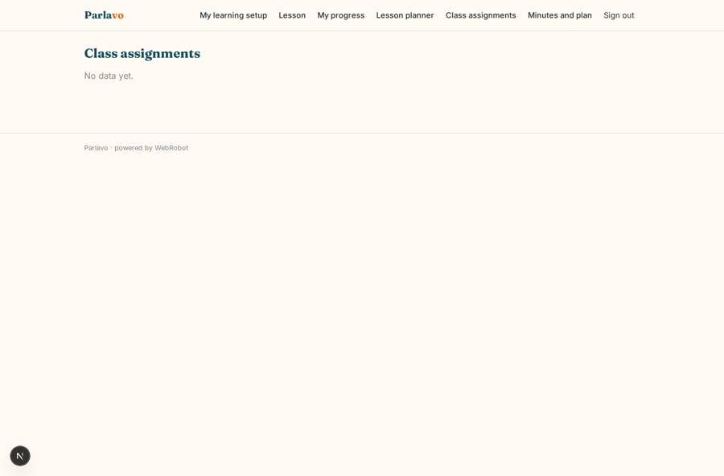
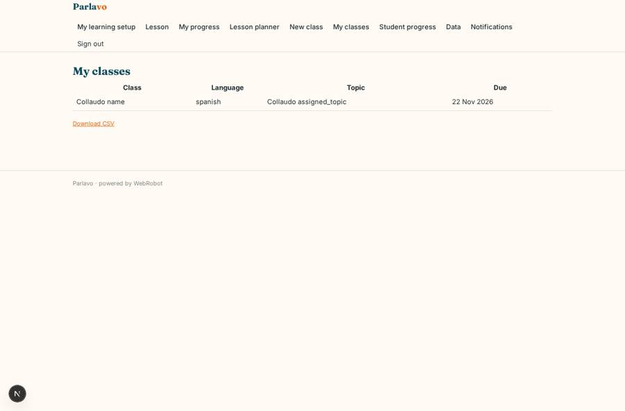
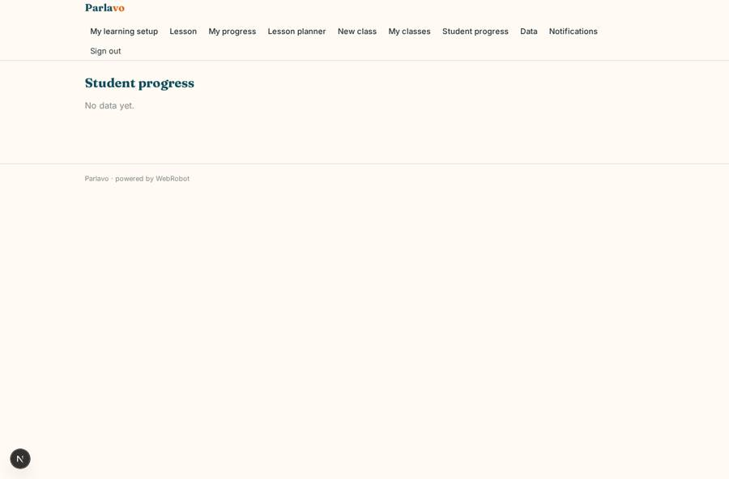
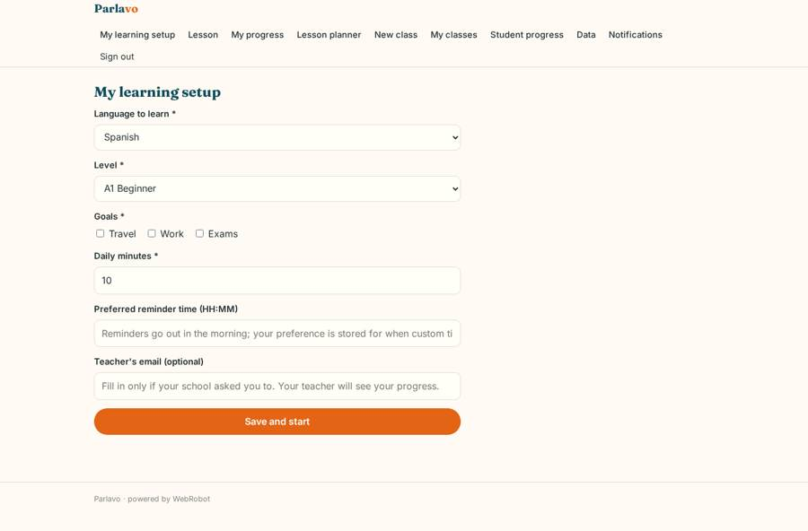

# Parlavo

_Speak it out loud. Your AI language coach talks back._

**Sector:** Consumer, travel, retail · **Manifest:** valid (schema + runtime contract) · **Functional test:** passed (18 checks passed)

## Description given to the app builder

We need an app called Parlavo, a speech-to-speech AI language coach. Learners sign up, pick a target language (Spanish, French, German, Italian, English), their level, goals (travel, work, exams) and daily minutes. Each lesson is a spoken conversation in the browser or phone app: the learner talks, the AI coach replies by voice in real time, with low latency, playing roles such as a waiter or an interviewer. After each turn the app scores pronunciation per word and fluency, and the coach gives short corrections. Learners see a progress page with vocabulary learned, pronunciation scores over time, streaks and next lessons; an agent plans the next lessons from weak points. Push and email reminders at the learner's chosen time. Teachers in schools can create classes, assign topics and see their students' progress only. Content is from our own corpora; speech recognition and voice come from model APIs. Pricing: free trial, monthly subscription with minute credits, and school plans per seat. Interface in English, with lessons in the five languages.

## Functional test: what did not pass

- **saved record shown where its collection is read** (view assignments): a record was saved in classes (by admin) but the page does not show it (as user) _(warning)_

## Navigation recording

Signed in as the app's admin, the recorder opened 7 menu page(s): My learning setup, Lesson, My progress, Lesson planner, New class, My classes, Student progress.
- form not sent: onboarding: Goals is required
- data page empty: class_progress (table)

Empty data pages are mostly expected on the local runtime: agents are mocked there, so the collections they fill stay empty.

## Features not expressible today (spec.extensions)

- **realtime_voice**: Not yet available: low-latency streaming speech-to-speech (speech recognition and synthesized voice from model APIs) in the lesson. The lesson chat takes voice input through the microphone and the coach replies as text; the voice reply needs a speech integration.
- **pronunciation_scoring**: Not yet available: per-word acoustic pronunciation scoring from audio. Until it is connected, the coach logs fluency estimated from the transcript and pronunciation only when a recognition score is supplied.
- **custom_reminder_time**: Reminders go out at a fixed morning hour on the planned lesson day (email and, with the phone app, push). The learner's preferred time is stored in the profile but cannot yet schedule per-user times.
- **school_seat_management**: School plans are priced per seat through the school_seat plan; bulk seat assignment and class-code joining are not available. Teachers list their students' emails in the class, and students name their teacher's email in their setup.

## Screenshots (interpretive runtime, test data)

### home-anon

### home-mobile

### assignments

### classes

### class_progress

### onboarding

