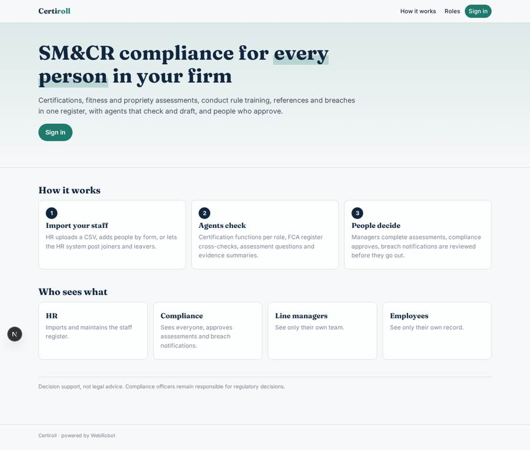
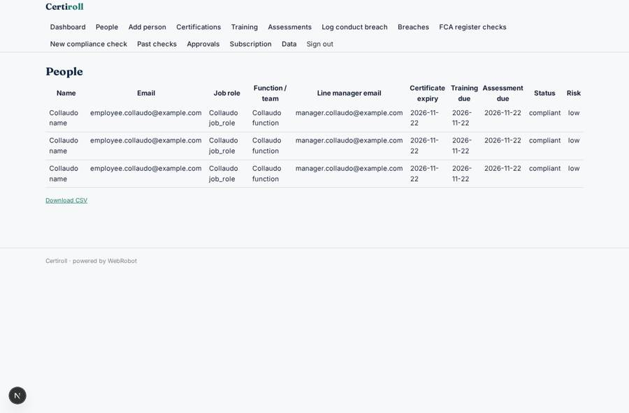
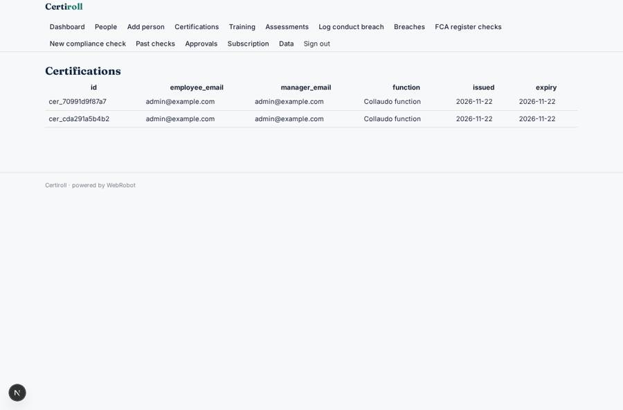
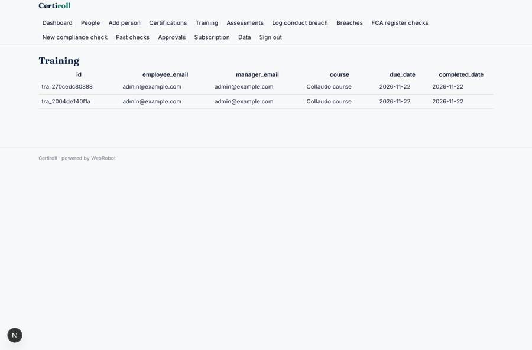
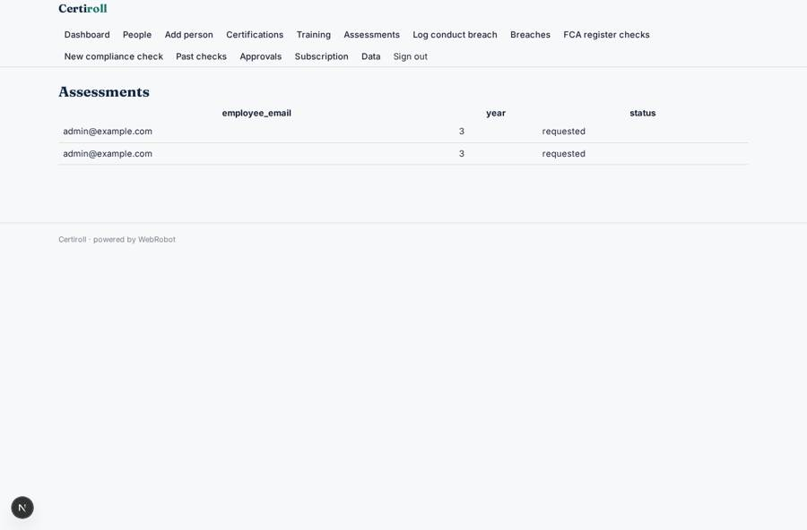

# Certiroll

_SM&CR workforce compliance, always audit-ready._

**Sector:** B2B AI and SaaS · **Manifest:** valid (schema + runtime contract) · **Functional test:** passed (37 checks passed)

## Description given to the app builder

We need Certiroll, which manages workforce compliance for financial services firms under the Senior Managers and Certification Regime. The firm signs up; HR, compliance and line managers are the roles, and a line manager sees only their team, employees see only themselves. HR imports staff by CSV (job role, function, start date, certification functions, training due dates) or adds them by form. Each person has a record with certifications, annual fitness and propriety assessments, conduct rule training, regulatory references and breaches. An agent checks which certification functions each role needs, cross-checks senior managers against the public FCA register, drafts the annual assessment questions and summarises the evidence; the manager completes the assessment and compliance approves. Conduct breaches are logged through a form and an agent drafts the notification for compliance to review. Date-based email reminders for renewals, training and assessments, with escalation when overdue. Dashboards show coverage, overdue items and risk by team. The real product syncs live with the HR system and payroll so that joiners and leavers update automatically, connected by OAuth, so I want that too. Pricing: subscription per employee per month via Stripe. English.

## Functional test: what did not pass

- **form saves a record** (form complete_assessment): only role manager may fill it, and the test cannot hold that role _(warning)_
- **trigger has its effect** (trigger breach_alert): email to role:compliance: no such recipient in the test (role nobody holds or empty field) _(warning)_

## Navigation recording

Signed in as the app's admin, the recorder opened 7 menu page(s): Dashboard, People, Add person, Certifications, Training, Assessments, Log conduct breach.
No issue found.

Empty data pages are mostly expected on the local runtime: agents are mocked there, so the collections they fill stay empty.

## Features not expressible today (spec.extensions)

- **oauth_hr_payroll_sync**: Live OAuth connection to the HR system and payroll is not available yet. Interim: HR imports a CSV on the admin data page, or the HR system posts joiners and leavers to the hr_sync webhook (POST /api/hooks/hr_sync with the app's hook secret).
- **per_employee_billing**: Stripe billing per employee per month (metered seats) is not available yet. Plans are priced per headcount band instead; the firm picks the band that covers its staff.
- **fca_register_api**: FCA register cross-check reads the public Register pages through the WebRobot MCP; the official Register API needs a key and two headers, which http tools cannot send yet.

## Screenshots (interpretive runtime, test data)

### home-anon

### home-mobile

### people

### certs

### trainings

### assessments_list

