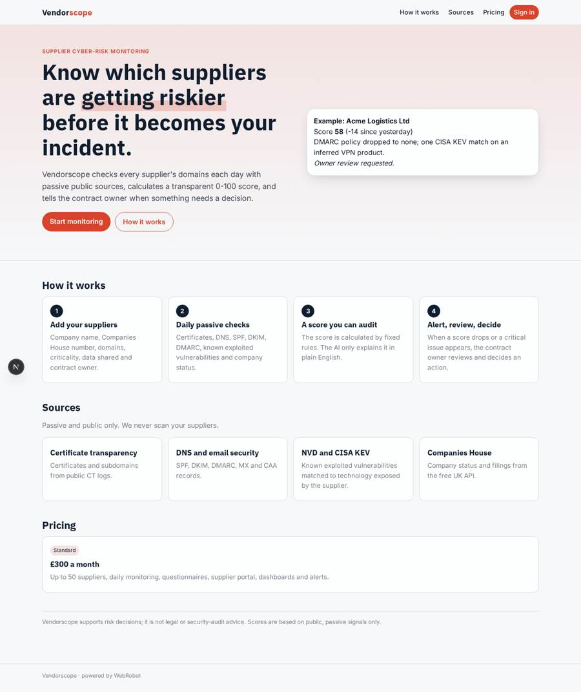
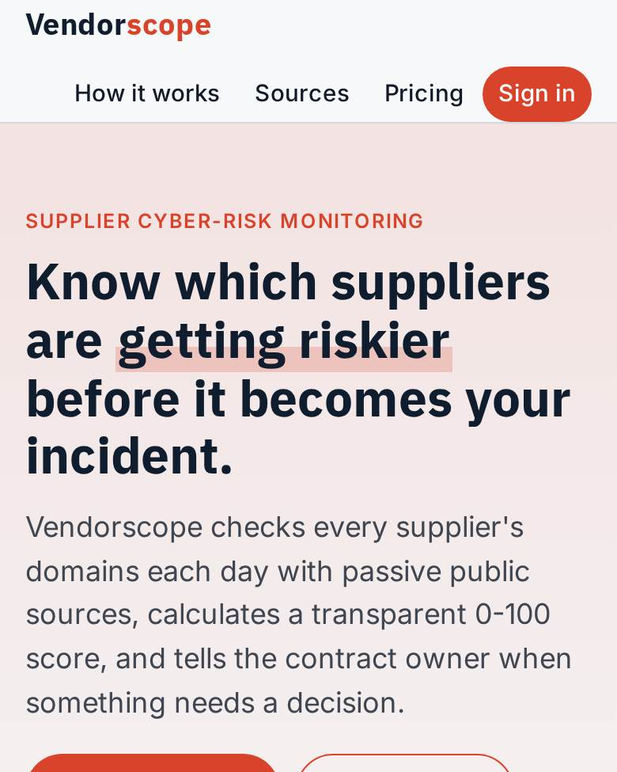
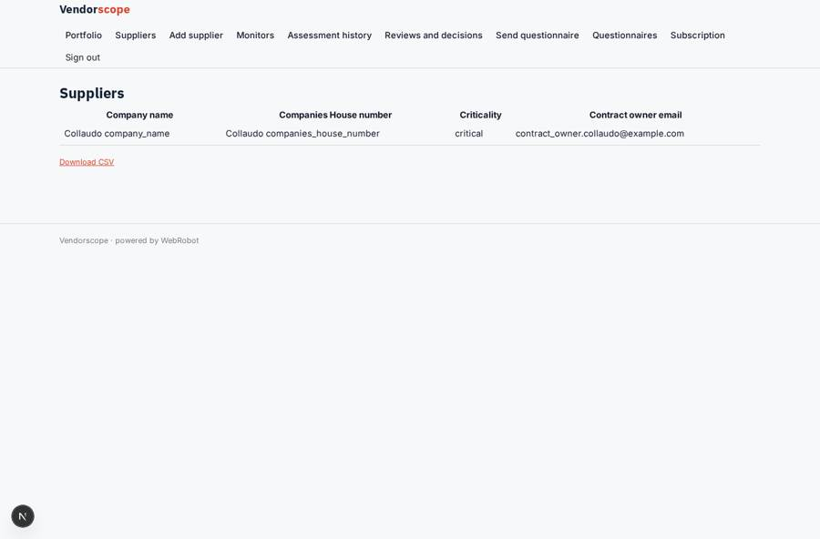
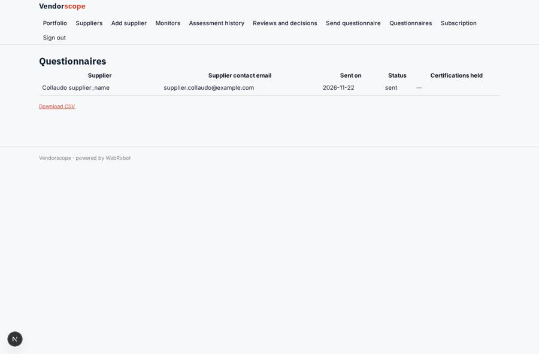
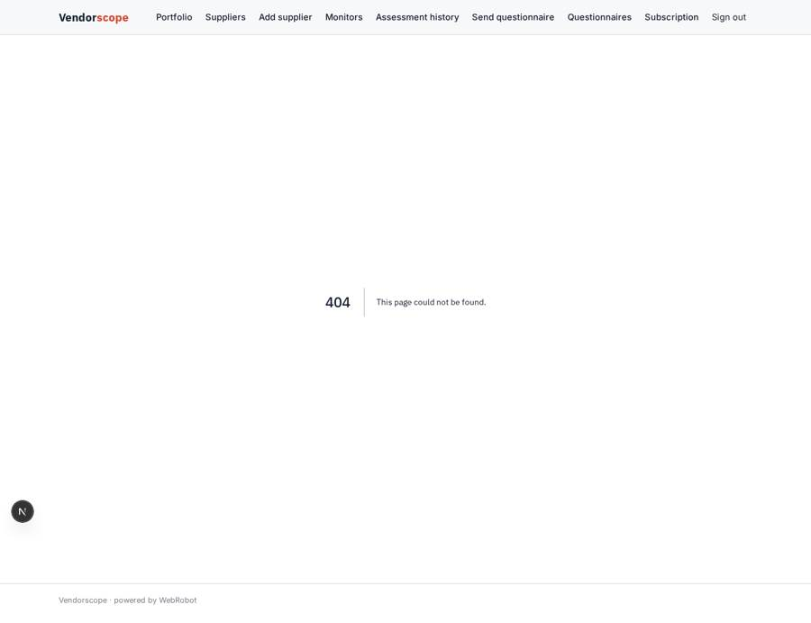
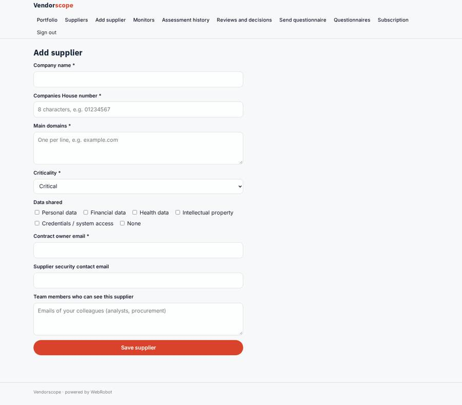

# Vendorscope

_Continuous cyber-risk monitoring of your suppliers._

**Sector:** Data, media, cyber, devtools · **Manifest:** valid (schema + runtime contract) · **Functional test:** passed (21 checks passed)

## Description given to the app builder

I want an app called Vendorscope for continuous cyber-risk monitoring of a company's suppliers. A procurement or security team signs up and adds suppliers with company name, Companies House number, main domains, criticality, data shared and contract owner. Scheduled monitors check each supplier's domains every day using passive public sources only: certificate transparency logs, DNS, SPF, DKIM and DMARC records, TLS configuration, and known exploited vulnerabilities from NVD and the CISA KEV list matched to exposed technology. Company status and filings come from the free Companies House API; breach and exposure data from paid sources only if we have a paid API key. A deterministic score from 0 to 100 is calculated from these checks; the AI only explains it in plain English. Suppliers receive a security questionnaire form by email and fill it in a supplier portal; reminders go out after seven days. When a score drops or a critical issue appears, the supplier owner gets an alert and must review and decide an action. Dashboards show portfolio risk, worst suppliers and trends. Roles: admin, risk analyst, contract owner, supplier. Pricing: £300 a month for 50 suppliers. English only.

## Functional test: what did not pass

- **form saves a record** (form portal): only role supplier may fill it, and the test cannot hold that role _(warning)_

## Navigation recording

Signed in as the app's admin, the recorder opened 7 menu page(s): Portfolio, Suppliers, Add supplier, Monitors, Assessment history, Reviews and decisions, Send questionnaire.
- data page empty: assessments (history)

Empty data pages are mostly expected on the local runtime: agents are mocked there, so the collections they fill stay empty.

## Features not expressible today (spec.extensions)

- **companies_house_key**: The admins must set one Companies House API key (provider companies_house, scope org, declared in spec.data.credentials). The API uses HTTP Basic with the key as username and an empty password, so the stored secret must be base64('<key>:').
- **paid_breach_data**: Breach and exposure data from a paid vendor is not connected: no vendor was named. When one is chosen, add an org-scoped API key credential and an http tool; until then the monitor reports it as not checked.
- **tls_grading**: Full TLS protocol and cipher grading needs an active or third-party scanner, which would not be passive. The monitor only uses certificate evidence from CT logs.
- **seat_quota**: The plan covers up to 50 suppliers, enforced by the monitor template limit (50 per user). Per-plan supplier quotas beyond that are not modelled.

## Screenshots (interpretive runtime, test data)

### home-anon

### home-mobile

### suppliers

### questionnaires

### my_requests

### add_supplier

