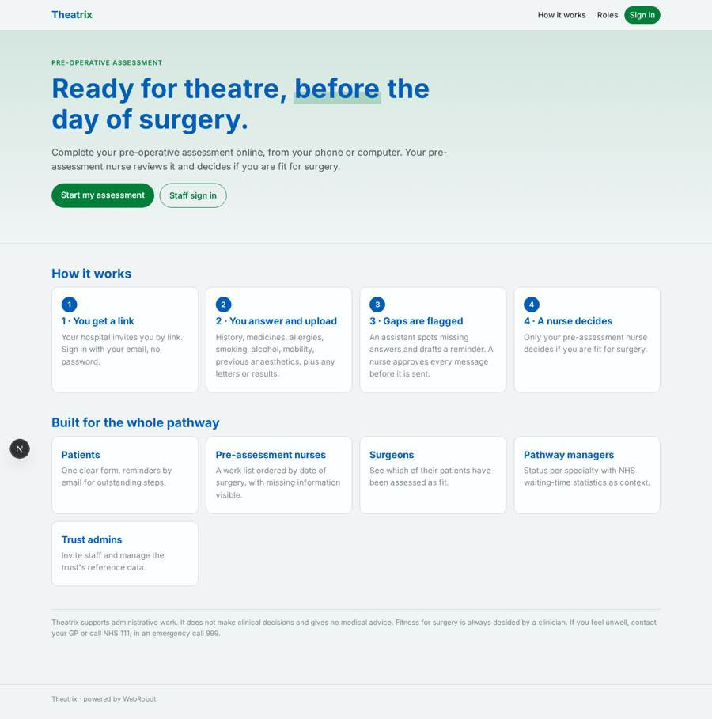
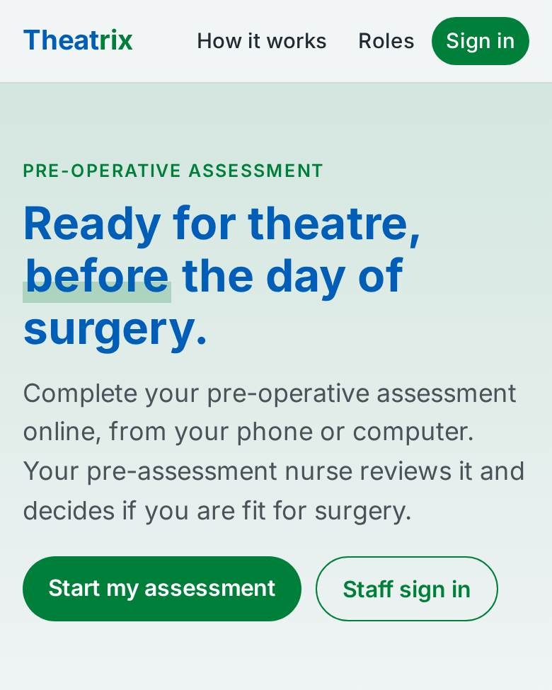
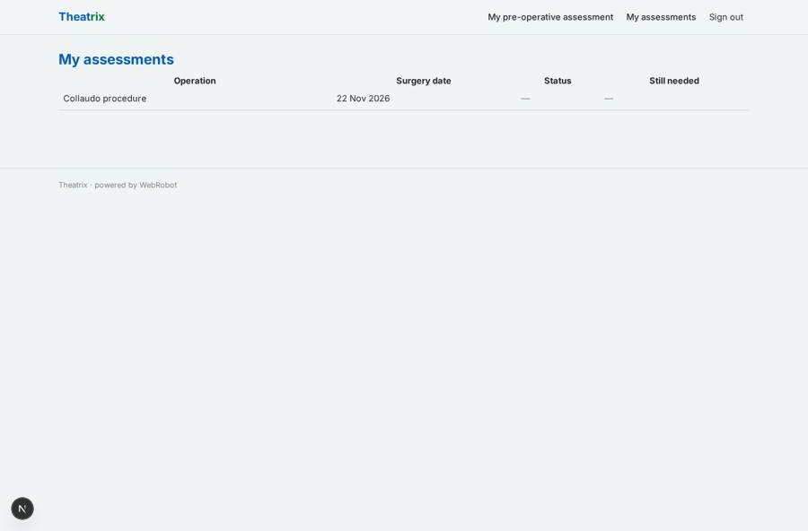
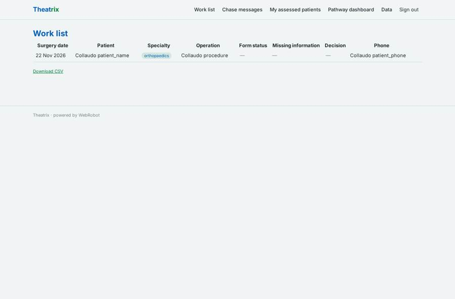
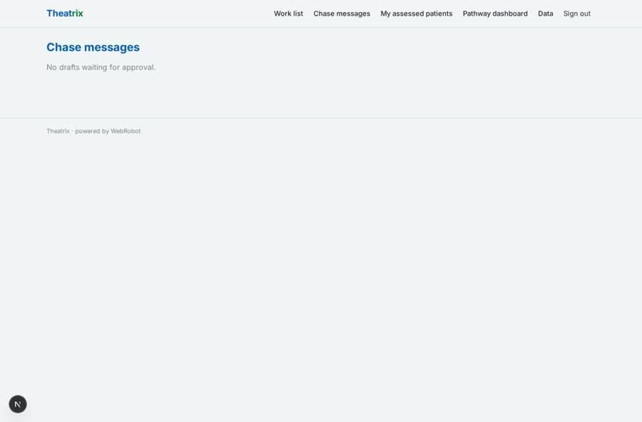
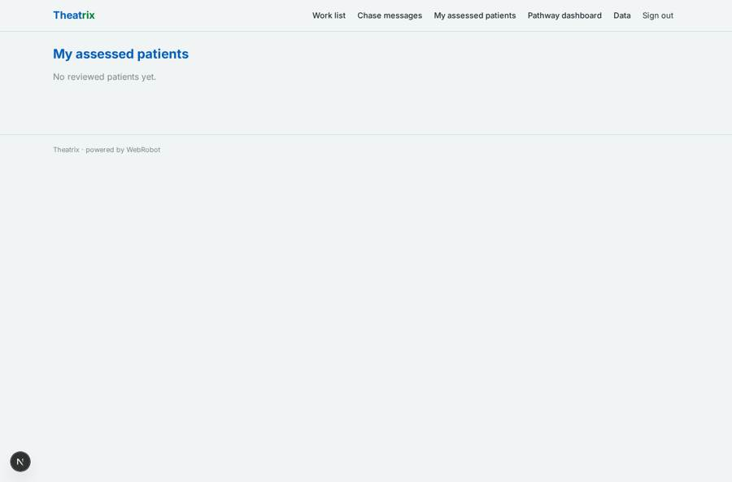

# Theatrix

_Pre-operative assessment, ready before the day of surgery._

**Sector:** Sanità, istruzione, energia, gov · **Manifest:** valid (schema + runtime contract) · **Functional test:** passed (15 checks passed)

## Description given to the app builder

We need Theatrix, software that streamlines surgical pathways before an operation. Patients on a hospital waiting list receive a link, complete a pre-operative assessment questionnaire (history, medications, allergies, smoking, alcohol, mobility, anaesthetic history) and upload documents. The predictive part estimates readiness and risk of cancellation; that clinical prediction is regulated software as a medical device and needs a DCB0129 safety case, so the validation and regulatory work are ours. It also needs integration with the hospital's patient administration and theatre scheduling systems, trust by trust. I need the software around this. Pre-assessment nurses see a work list ordered by date of surgery and missing information; they decide fitness for surgery, never the agent, which only flags incomplete forms and drafts the chase messages. Patients get reminders by email and SMS for outstanding steps. Managers see dashboards of pathway status per specialty, with NHS waiting-time statistics as context. Roles: patient, nurse, surgeon, pathway manager, trust admin. Priced per trust per year. English only.

## Functional test: what did not pass

- **form saves a record** (form review): only role nurse may fill it, and the test cannot hold that role _(warning)_
- **form saves a record** (form chase_review): only role nurse may fill it, and the test cannot hold that role _(warning)_
- **page opened by a role allowed to** (view review): only role nurse may open it, the test cannot hold it _(warning)_
- **page opened by a role allowed to** (view chase_review): only role nurse may open it, the test cannot hold it _(warning)_

## Navigation recording

Signed in as the app's admin, the recorder opened 4 menu page(s): Work list, Chase messages, My assessed patients, Pathway dashboard.
No issue found.

Empty data pages are mostly expected on the local runtime: agents are mocked there, so the collections they fill stay empty.

## Features not expressible today (spec.extensions)

- **pas_theatre_integration**: Integration with each trust's patient administration system and theatre scheduling system (waiting-list import, surgery dates, write-back of decisions) is trust-specific and not available in the manifest. Until built, patients enter the surgery date from their letter and admins load reference data on /admin/data.
- **sms_reminders**: SMS reminders are not available yet; reminders go by email only.
- **readiness_risk_prediction**: The readiness and cancellation-risk prediction is regulated software as a medical device (DCB0129 safety case, clinical validation) and is deliberately NOT part of this manifest or of the agent, which only checks completeness and drafts messages.
- **per_trust_licensing**: Pricing is per trust per year by contract, outside the app's credits and Stripe packs. Deploy one app instance per trust so each trust's patient data stays separate.
- **patient_invite_link**: Patients receive the sign-in link from the trust; bulk invitations generated from the waiting list need the PAS integration.
- **nhs_stats_import**: NHS England RTT statistics are loaded into rtt_stats as CSV by the trust admin; no automatic feed.
- **clinical_governance**: DCB0160 clinical safety, DPIA, DSPT and NHS data-security assurance for the trust deployment are the customer's and vendor's governance work.

## Screenshots (interpretive runtime, test data)

### home-anon

### home-mobile

### my_assessments

### worklist

### chase_queue

### surgeon_list

