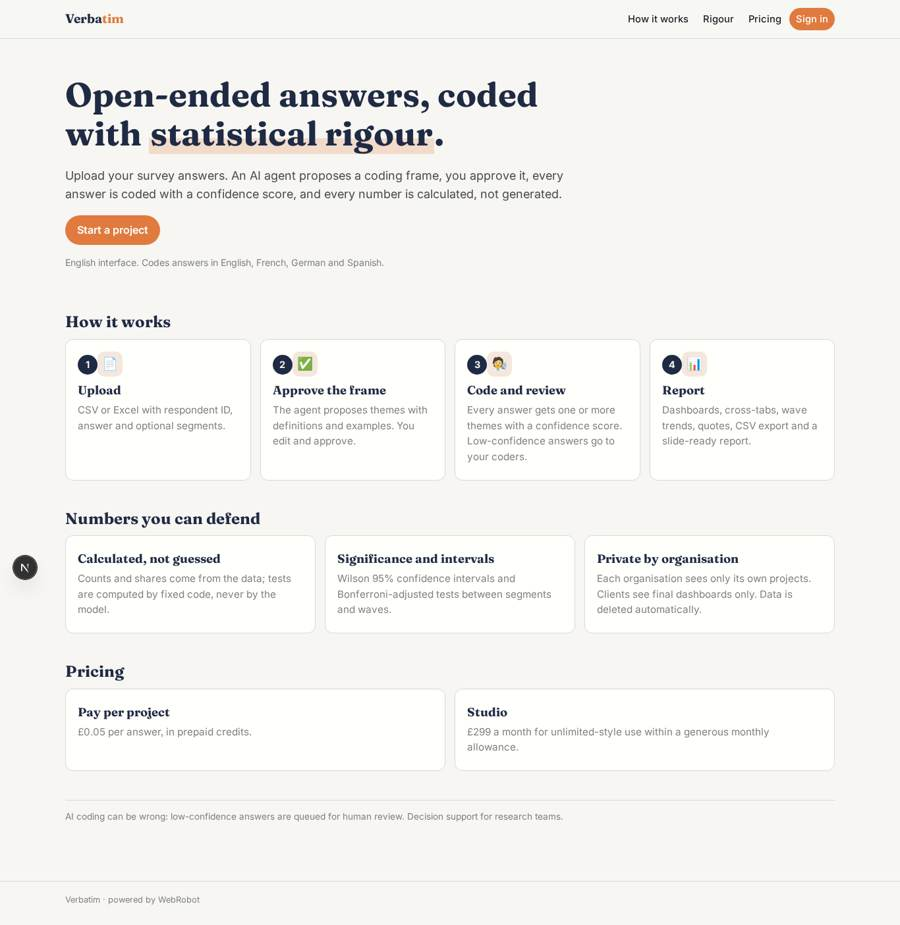
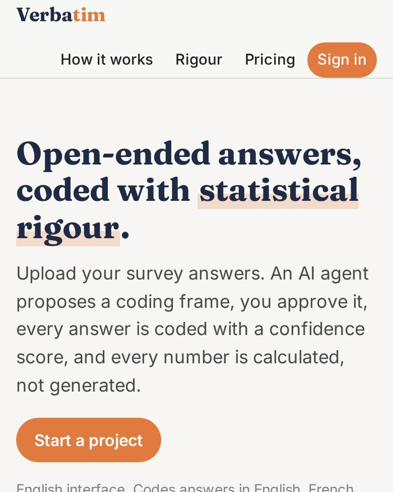
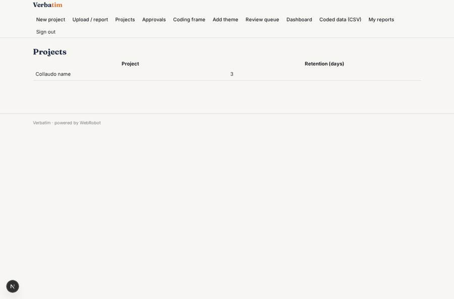
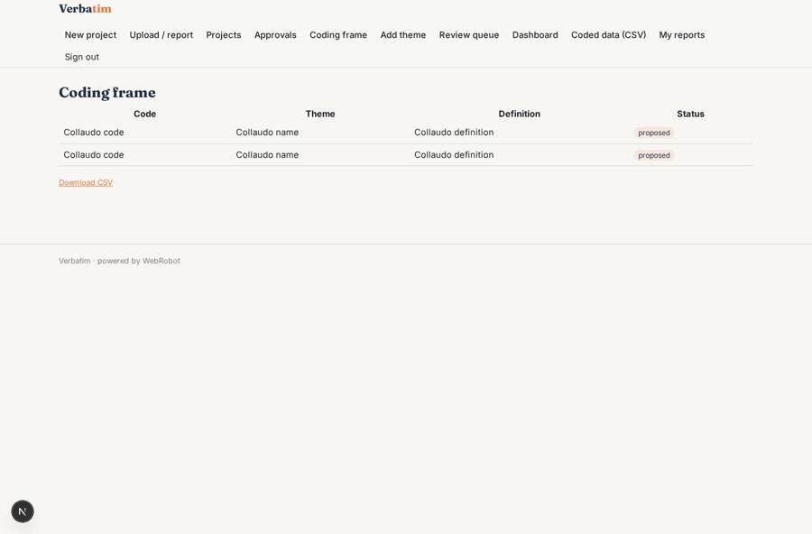
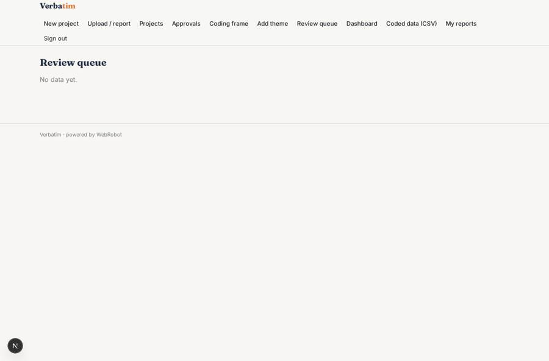
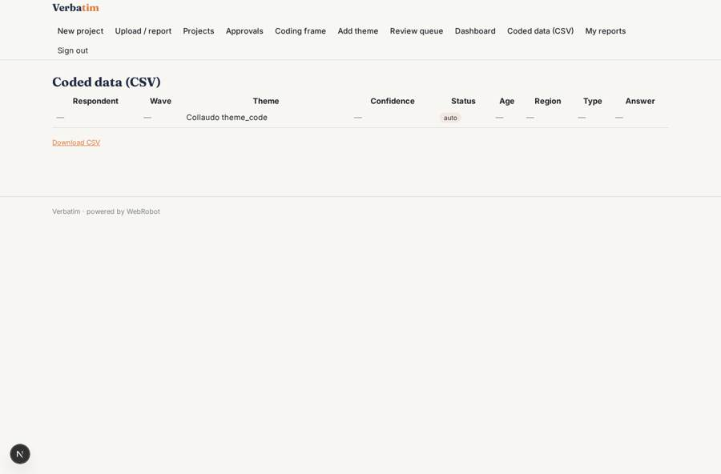

# Verbatim

_Open-ended answers, coded with statistical rigour._

**Sector:** Data, media, cyber, devtools · **Manifest:** valid (schema + runtime contract) · **Functional test:** passed (22 checks passed)

## Description given to the app builder

I want an app called Verbatim for analysing open-ended survey answers and other free text with statistical rigour. A research or insight team signs up and creates a project, then uploads CSV or Excel files with respondent ID, open answer and optional segments such as age band, region or customer type. An agent reads a sample, proposes a coding frame of themes with definitions and examples, and the researcher edits and approves it before coding starts. The agent then assigns every answer to one or more themes with a confidence score; low-confidence answers go to a human review queue. Counts, percentages and differences between segments are calculated deterministically in SQL, not by the model, with significance tests and confidence intervals. The dashboard shows theme frequencies, cross-tabs by segment, trends between survey waves and example quotes per theme. Users can export coded data and charts to CSV and a slide-ready report. Roles: project owner, coders who review, client viewers who only see the final dashboards; each organisation sees only its own projects. Data is deleted automatically after a retention period chosen per project. Pricing: pay per project at £0.05 per answer, or £299 a month subscription. English, with support for coding answers in French, German and Spanish.

## Navigation recording

Signed in as the app's admin, the recorder opened 7 menu page(s): New project, Upload / report, Projects, Approvals, Coding frame, Add theme, Review queue.
- data page empty: review_queue (table)

Empty data pages are mostly expected on the local runtime: agents are mocked there, so the collections they fill stay empty.

## Features not expressible today (spec.extensions)

- **per_project_retention**: Retention is set per project in the project form (retention_days), but automatic deletion currently applies a platform-wide collection limit of 365 days on answers and codings; per-project deletion dates are not yet enforceable from the manifest.
- **segment_crosstab_in_db**: The dashboard aggregates one field at a time (theme, wave, one segment); full theme-by-segment cross-tabs with significance tests are produced in the analyst report through the stats slot, not as a live two-way table.
- **spreadsheet_slides_export**: Slide-ready output is the printable report with chart blocks (PDF/print); native PPTX export and chart image download are not available yet.

## Screenshots (interpretive runtime, test data)

### home-anon

### home-mobile

### projects

### themes

### review_queue

### coded_data

