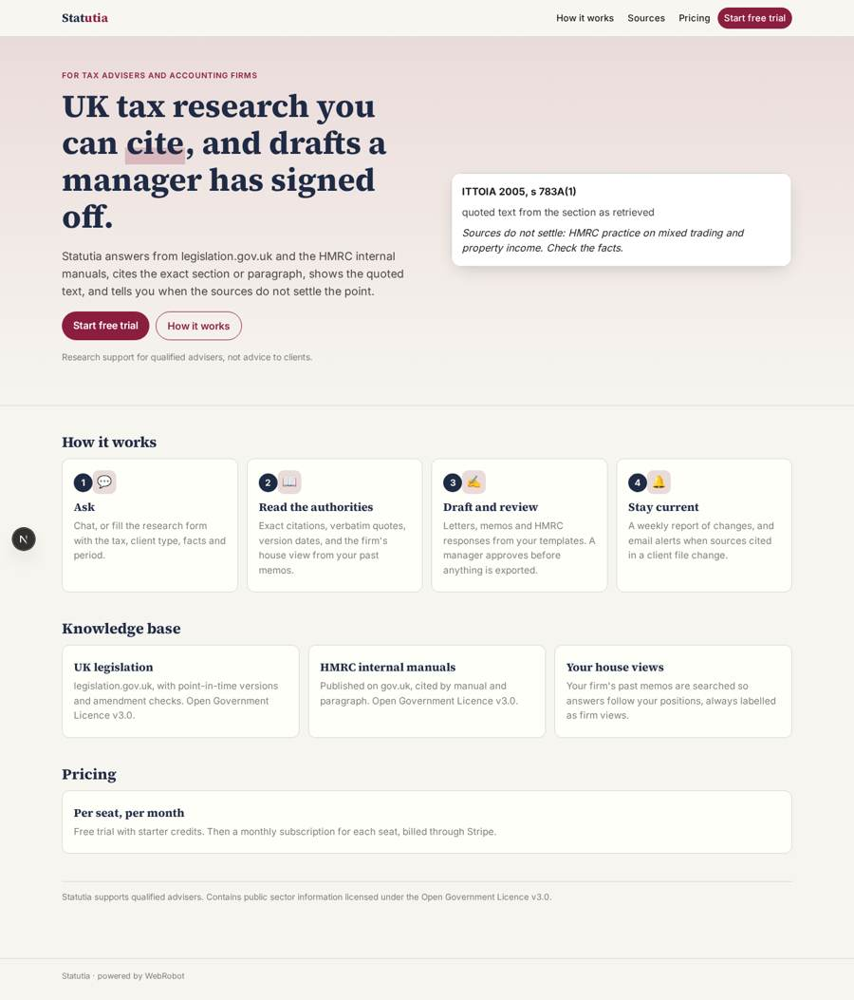
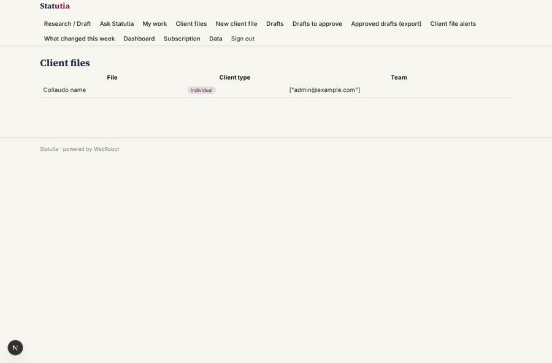
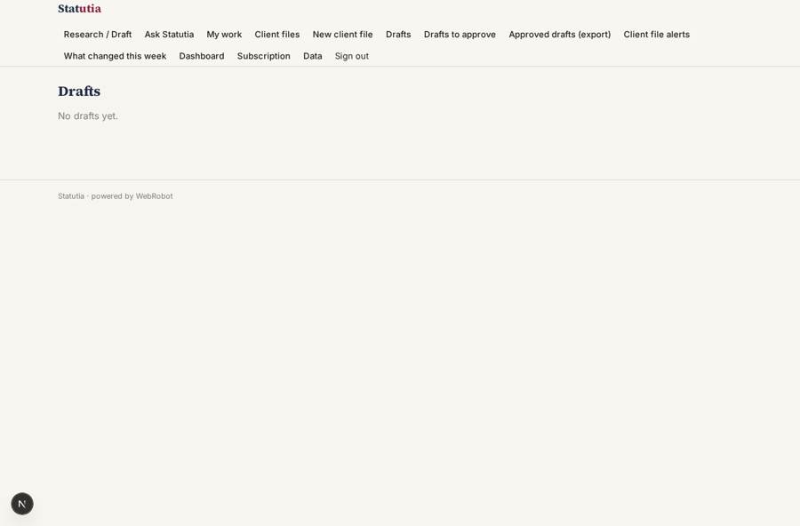
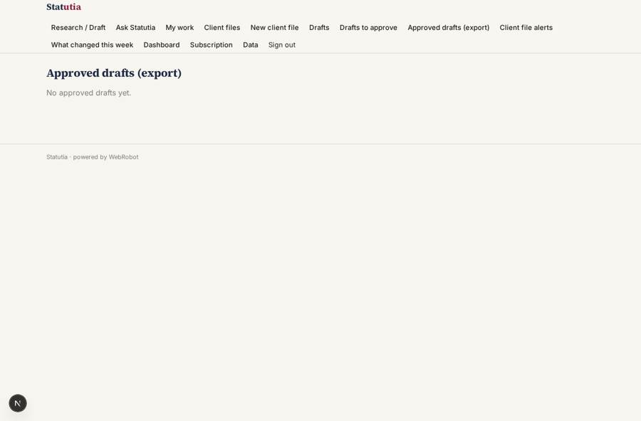
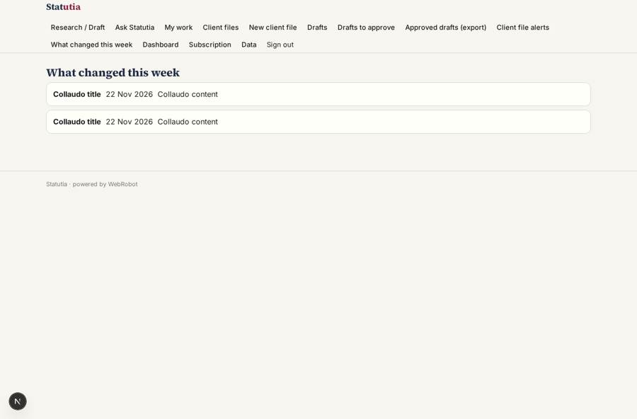

# Statutia

_Source-grounded UK tax research and drafting for advisers._

**Sector:** B2B AI and SaaS · **Manifest:** valid (schema + runtime contract) · **Functional test:** 1 failure(s) (18 checks passed)

## Description given to the app builder

I want Statutia, a source-grounded research and drafting assistant for tax advisers and accounting firms. The firm signs up; partners, managers and juniors are the roles, and each client file is visible only to the team on it. The knowledge base is UK tax legislation from legislation.gov.uk and the HMRC internal manuals published on gov.uk, both under the Open Government Licence and refreshed weekly by a scheduled agent that reports what changed. A user asks a question in a chat or fills a research form (tax, client type, facts, period); the agent answers with citations to the exact section or manual paragraph, shows the quoted text, and says when the sources do not settle the point. It drafts advice letters, technical memos and responses to HMRC enquiries from the firm's templates, and every draft must be reviewed and approved by a manager before export. Firms can upload their own past memos so answers follow house views. Alerts by email when legislation or manuals cited in a client file change. Dashboards show research volume, time saved and open drafts. Pricing: per-seat monthly subscription via Stripe, with a free trial. English.

## Functional test: what did not pass

- **template instance created and run** (template file_watch): create: 400 file is required

## Navigation recording

Signed in as the app's admin, the recorder opened 7 menu page(s): Research / Draft, Ask Statutia, My work, Client files, New client file, Drafts, Drafts to approve.
No issue found.

Empty data pages are mostly expected on the local runtime: agents are mocked there, so the collections they fill stay empty.

## Features not expressible today (spec.extensions)

- **seat_billing_trial**: Per-seat quantity billing and a Stripe free-trial period are not expressible yet: the free trial is approximated by signup credits, and the seat plan is one subscription per user.
- **memo_upload**: Firms' past memos and templates are loaded by admins on the built-in data page (/admin/data, by hand or CSV). Self-service memo upload by partners is not available yet.
- **partner_approval**: The approval is decided by the manager role. Partners approving as well needs a combined reviewer role in the firm's invite setup.

## Screenshots (interpretive runtime, test data)

### home-anon

### home-mobile

### files

### drafts

### approved

### changes

