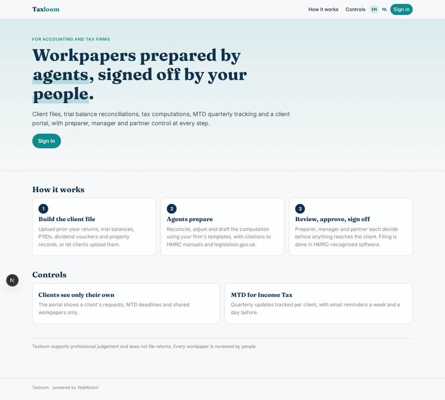
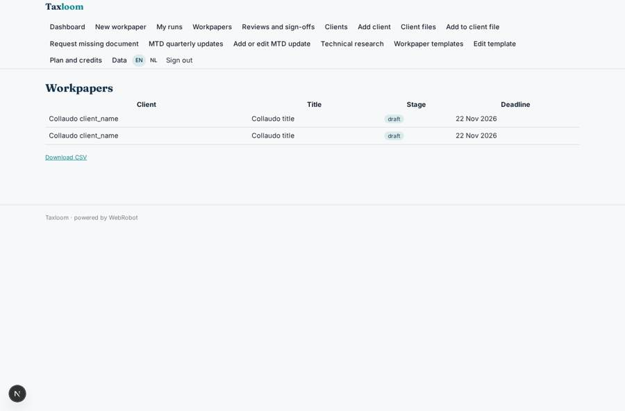
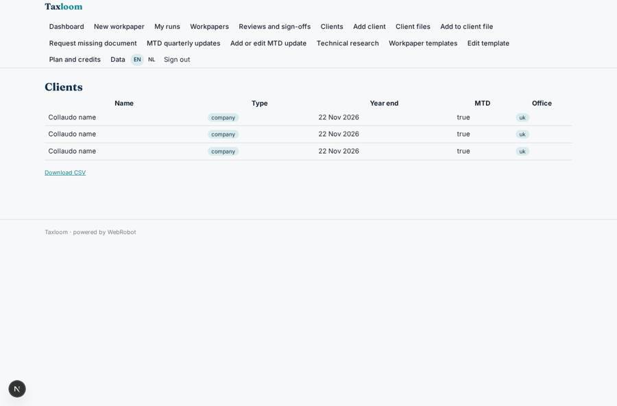
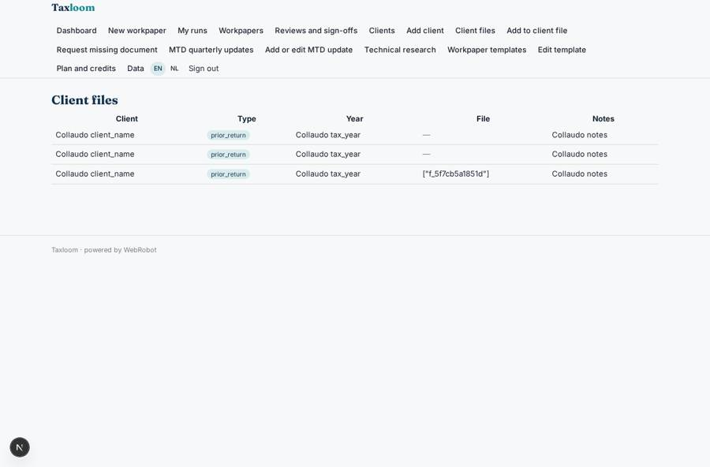
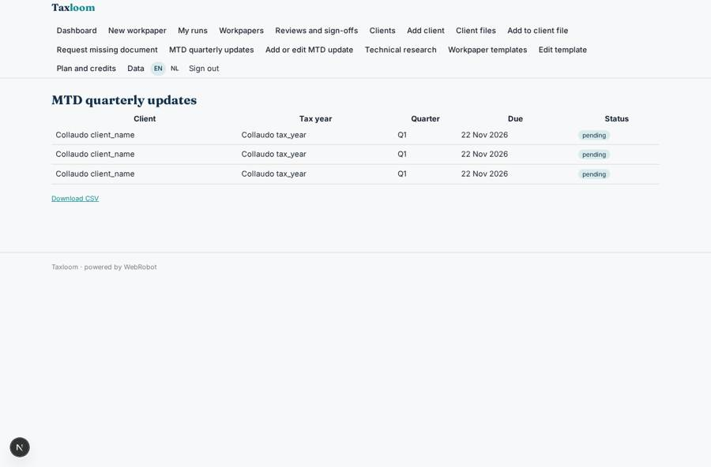

# Taxloom

_AI workpapers for accounting and tax firms, reviewed by your people._

**Sector:** Fintech, proptech, insurtech · **Manifest:** valid (schema + runtime contract) · **Functional test:** passed (50 checks passed)

## Description given to the app builder

I want Taxloom, an AI platform for accounting and tax firms. The firm signs up with roles for partner, manager, preparer and client. Each client has a file where the firm uploads prior-year returns, trial balances, P11Ds, dividend vouchers, property income records and correspondence; practice management and ledger software can be connected by OAuth to pull client lists and figures. Agents prepare workpapers step by step: they reconcile the trial balance, compute adjustments, draft the corporation tax computation or the self assessment working papers, and answer technical questions with citations to HMRC manuals and legislation.gov.uk. For Making Tax Digital for Income Tax from April 2026, the app tracks quarterly updates per client and reminds clients by email to submit records. A preparer reviews every workpaper, a manager approves, and the partner signs off before anything is shared; filing goes through HMRC-recognised software. Clients see only their own requests and upload missing documents through a portal. Dashboards show jobs by stage and deadlines. Templates for workpapers are editable per firm. Pricing: subscription per seat plus credits per return prepared. English, with Dutch for the Belgian office.

## Functional test: what did not pass

- **form saves a record** (form upload_document): only role client may fill it, and the test cannot hold that role _(warning)_
- **saved record shown where its collection is read** (view my_workpapers): a record was saved in workpapers (by admin-data, admin-data) but the page does not show it (as client) _(warning)_
- **saved record shown where its collection is read** (view my_requests): a record was saved in doc_requests (by admin-data, admin-data, admin) but the page does not show it (as client) _(warning)_

## Navigation recording

Signed in as the app's admin, the recorder opened 7 menu page(s): Dashboard, New workpaper, My runs, Workpapers, Reviews and sign-offs, Clients, Add client.
No issue found.

Empty data pages are mostly expected on the local runtime: agents are mocked there, so the collections they fill stay empty.

## Features not expressible today (spec.extensions)

- **oauth_connectors**: Connecting practice management and ledger software by OAuth (client lists, figures) is not available yet. Until then: import client lists as CSV on the data page and upload trial balances as files; an API-key connector can be added when the software offers one.
- **seat_pricing**: Per-seat billing is modelled as a monthly plan bought by each partner/admin; automatic seat counting per firm is not available.
- **hmrc_filing**: Filing and MTD submissions are done by the firm in HMRC-recognised software; Taxloom only prepares and tracks.

## Screenshots (interpretive runtime, test data)

### home-anon

### home-mobile

### workpapers_list

### clients_list

### files_list

### mtd

