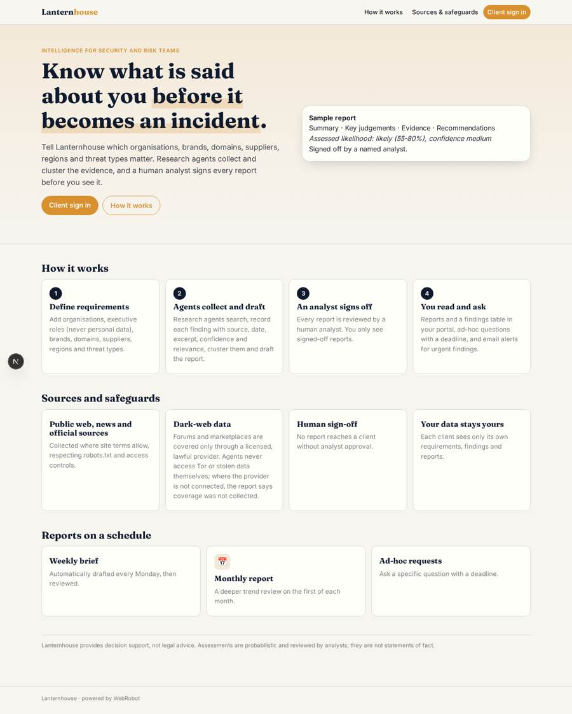
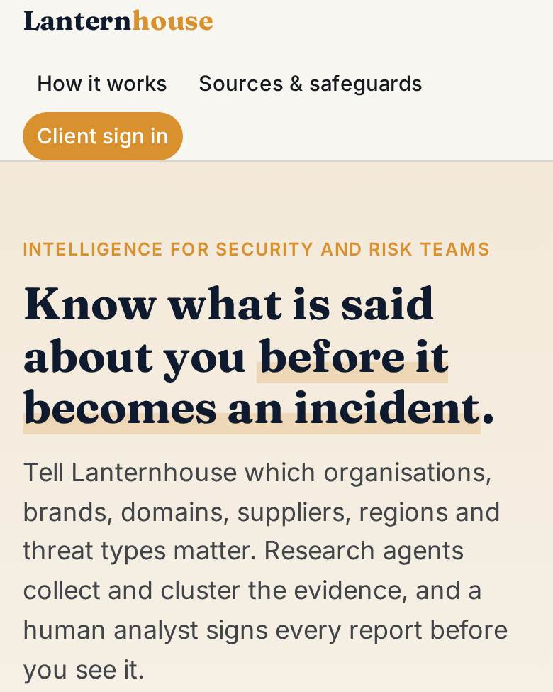
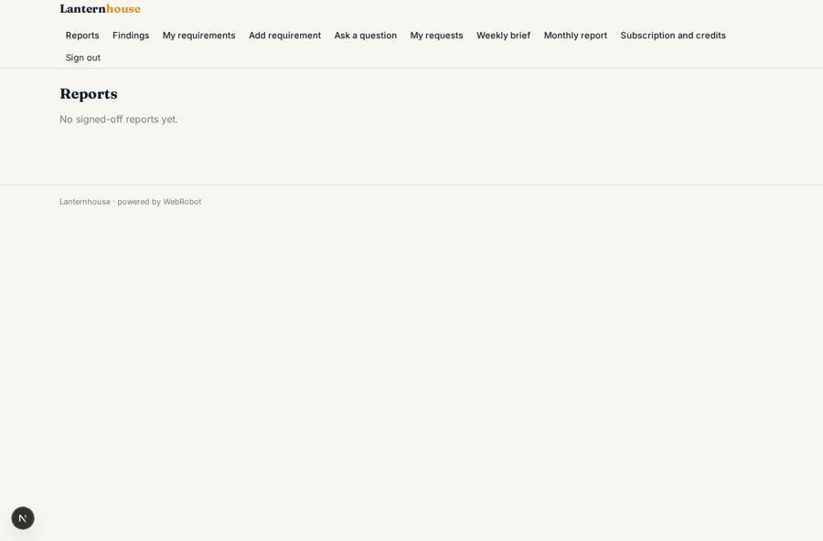
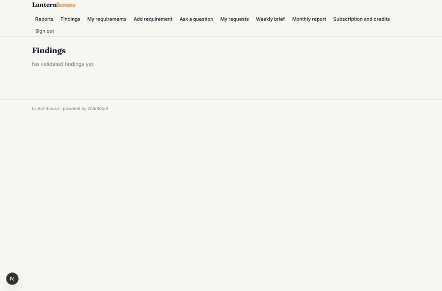
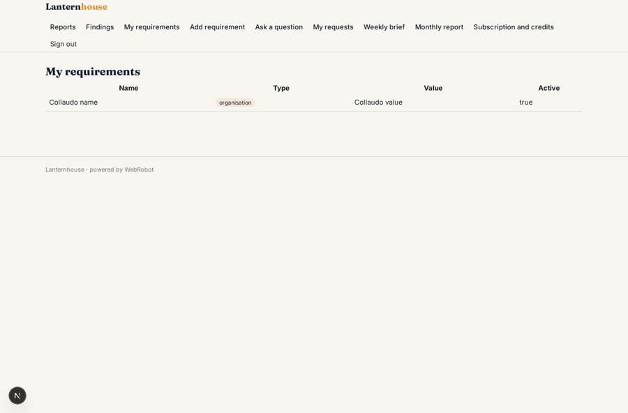
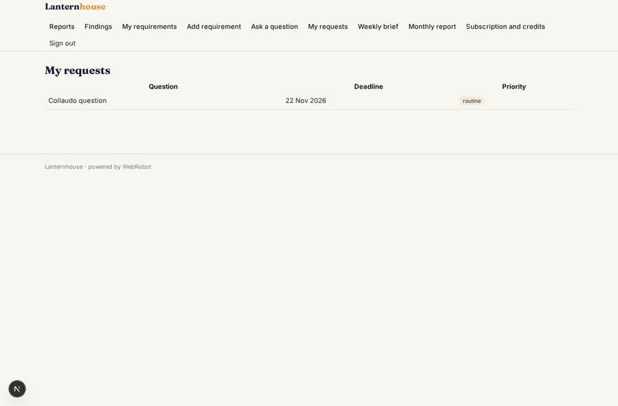

# Lanternhouse

_Open-source and lawfully sourced dark-web intelligence, signed off by a human analyst._

**Sector:** Data, media, cyber, devtools · **Manifest:** valid (schema + runtime contract) · **Functional test:** passed (26 checks passed)

## Description given to the app builder

I want an app called Lanternhouse, an agent platform that turns open-source and dark-web data into intelligence reports. A corporate security or risk team signs up and creates requirements: organisation names, executives' roles (not personal data), brands, domains, suppliers, regions and threat types. Teams of research agents search the public web, news and official sources where terms allow, and the real product also collects from dark-web forums and marketplaces over Tor, which is legally sensitive; I want that described, but it must only run through a licensed, lawful provider. Each finding has source, date, excerpt, confidence and relevance. Agents cluster findings, draft an intelligence report with summary, key judgements, evidence and recommendations, and assign an assessed likelihood. A human analyst reviews every report and signs it off before the client sees it. Clients get a portal with reports, a findings table, a request form for ad-hoc questions with a deadline, and email alerts for urgent findings. Scheduled weekly and monthly reports are produced automatically. Roles: admin, analyst, client reader; each client sees only its own requirements and reports. Pricing: monthly subscription from £2,500 plus ad-hoc requests. English only.

## Functional test: what did not pass

- **trigger has its effect** (trigger draft_ready): email to role:analyst: no such recipient in the test (role nobody holds or empty field) _(warning)_

## Navigation recording

Signed in as the app's admin, the recorder opened 5 menu page(s): Review queue, Review and sign off a report, Findings to validate, Validate a finding, Agent runs.
- data page empty: runs (history)

Empty data pages are mostly expected on the local runtime: agents are mocked there, so the collections they fill stay empty.

## Features not expressible today (spec.extensions)

- **licensed_darkweb_provider**: Dark-web forum and marketplace collection must run only through a licensed, lawful provider with a documented API. The provider, its host, terms, and an org-scoped API key are to be confirmed and added later as an http tool and egress host. Until then agents report that dark-web coverage was not collected. Legal review is required before enabling it.
- **draft_visibility**: Drafts and unvalidated findings are hidden from clients by view filters (status signed_off / validated). A separate draft store would give stronger isolation.
- **client_teams**: Each signed-up user sees its own records. Several readers in one client company sharing the same requirements would need a members list on the records; not configured yet.

## Screenshots (interpretive runtime, test data)

### home-anon

### home-mobile

### reports

### findings

### requirements

### my_requests

