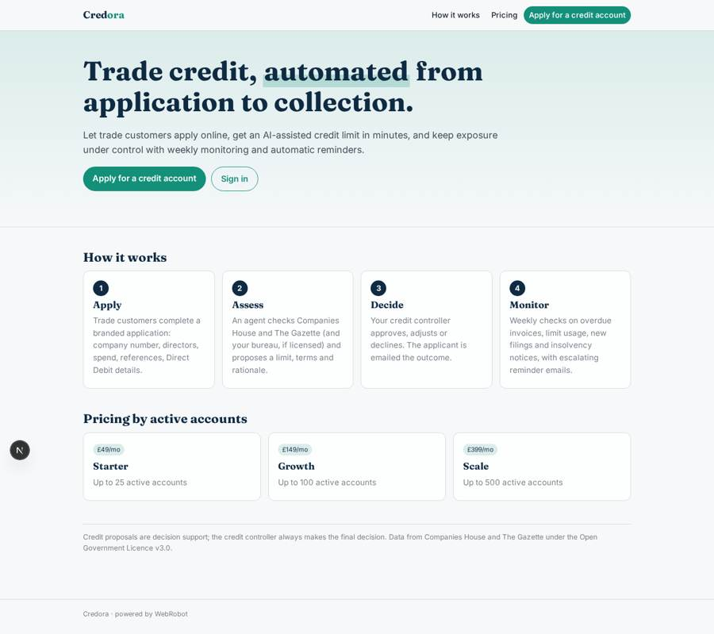
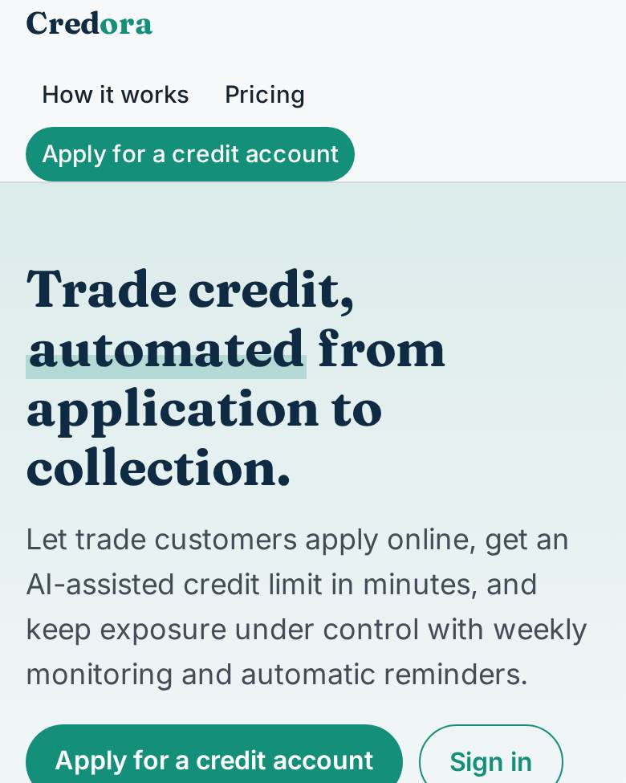
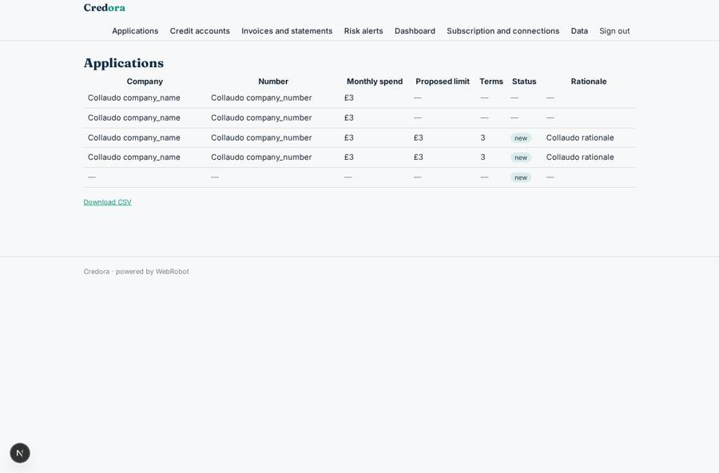
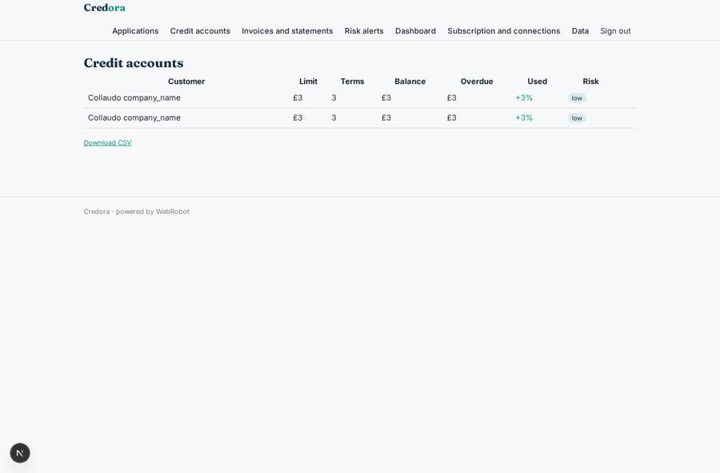
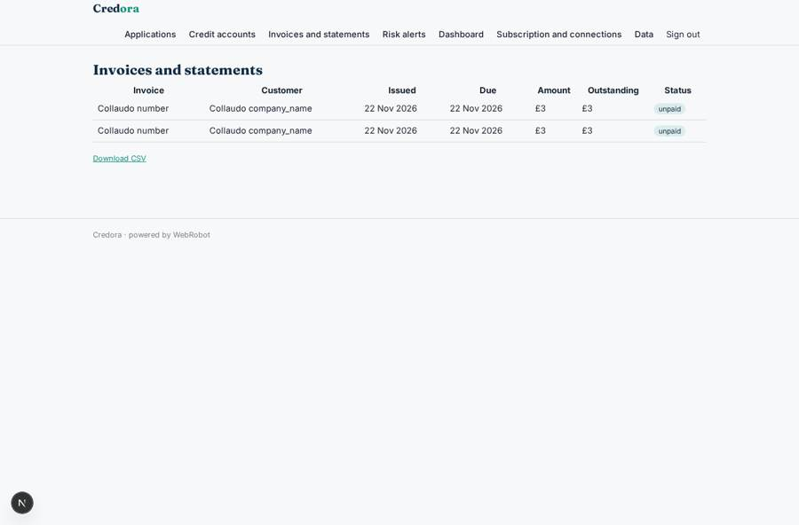
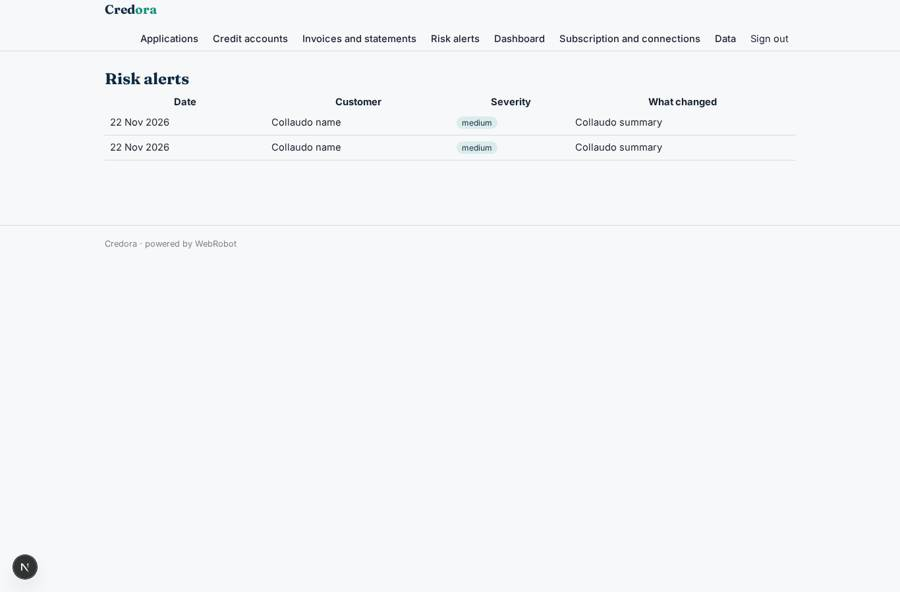

# Credora

_Trade credit automation for B2B wholesalers._

**Sector:** Fintech, proptech, insurtech · **Manifest:** valid (schema + runtime contract) · **Functional test:** passed (25 checks passed)

## Description given to the app builder

I want Credora, trade credit automation for B2B wholesalers. The wholesaler signs up and connects its accounting ledger (Xero, QuickBooks or Sage via OAuth) so invoices and payment history flow in. Its trade customers apply for a credit account through a branded form: company number, trading address, directors' contact, expected monthly spend, trade references, bank details for Direct Debit. An agent looks the company up on Companies House (accounts, filing history, officers), checks The Gazette for insolvency notices, pulls credit bureau scores only if the wholesaler has a licence, and proposes a credit limit and payment terms with a short rationale. The credit controller approves, adjusts or declines; the applicant gets an email with the outcome. Afterwards the app monitors accounts every week: overdue invoices, limit usage, new Companies House filings or Gazette notices, and alerts the credit controller when risk rises. Scheduled reminder emails chase overdue invoices with escalating tone, and payment is collected by card or Direct Debit through a licensed payment partner. Roles: admin, credit controller, sales rep (sees own customers), trade customer (own account and statements). Dashboards show exposure, DSO and ageing. Pricing: monthly subscription by number of active accounts. English.

## Functional test: what did not pass

- **trigger has its effect** (trigger notify_controller): email to role:credit_controller: no such recipient in the test (role nobody holds or empty field) _(warning)_

## Navigation recording

Signed in as the app's admin, the recorder opened 6 menu page(s): Applications, Credit accounts, Invoices and statements, Risk alerts, Dashboard, Subscription and connections.
No issue found.

Empty data pages are mostly expected on the local runtime: agents are mocked there, so the collections they fill stay empty.

## Features not expressible today (spec.extensions)

- **ledger_oauth**: OAuth connection to Xero, QuickBooks or Sage is not available yet. Interim: invoices and payments arrive through the ledger_invoice webhook (POST /api/hooks/ledger_invoice, e.g. from the ledger's own automation) or by CSV upload on /admin/data.
- **payment_collection**: Card and Direct Debit collection through a licensed payment partner (mandates, payment links, reconciliation) is not available yet. Bank details are captured on the application for the partner to set up the mandate.
- **multi_tenant_wholesalers**: This design assumes one deployment per wholesaler (the owner is the wholesaler; the credit controller and sales reps are invited; the trade customer's login email is the account's customer_email). Sales reps are set through rep_email on each account (admin data page). A SaaS serving many wholesalers in one deployment needs per-wholesaler separation not expressible here.
- **account_quota**: The plan limit on active accounts (25/100/500) is described in the plans but not enforced automatically, because accounts are created by a trigger rather than by a user tool.

## Screenshots (interpretive runtime, test data)

### home-anon

### home-mobile

### review

### accounts

### statements

### alerts

