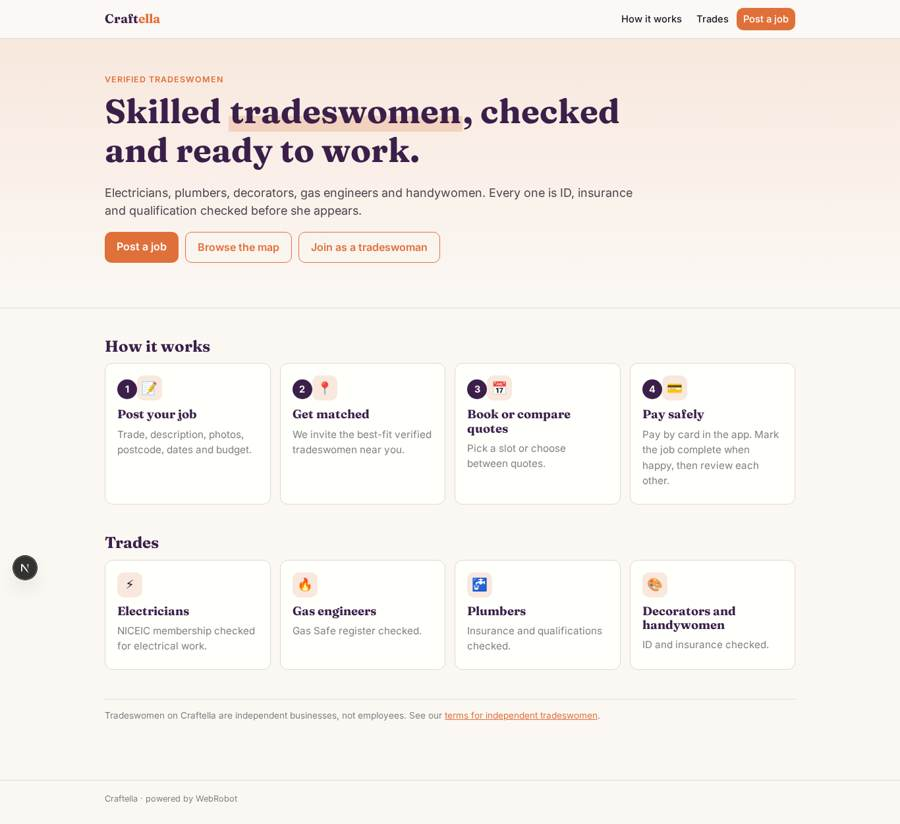
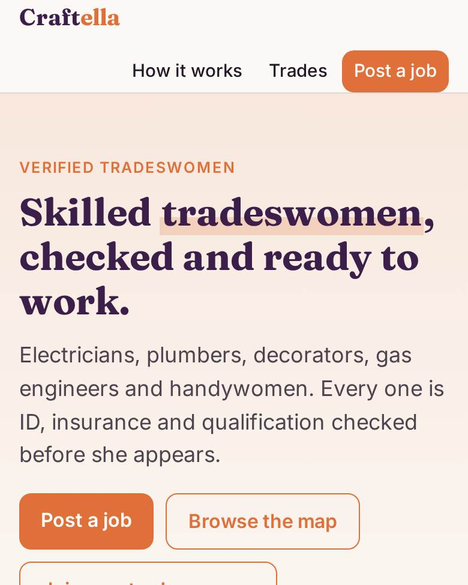
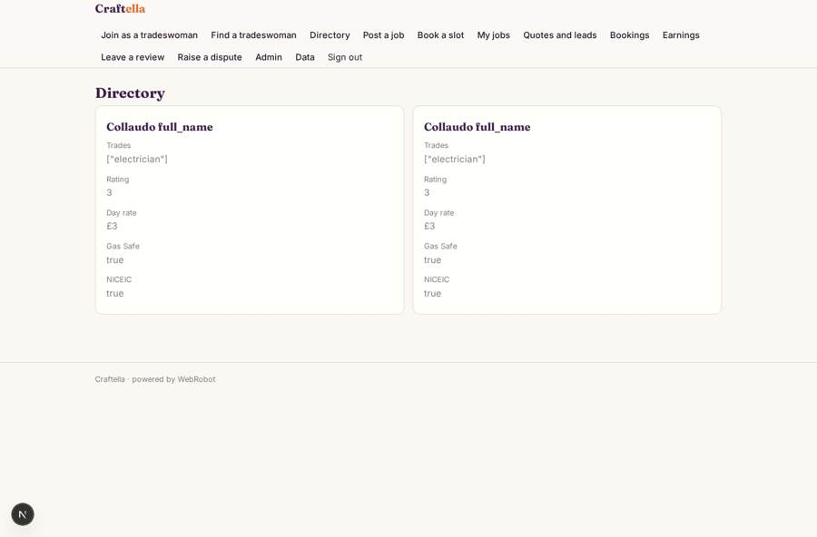
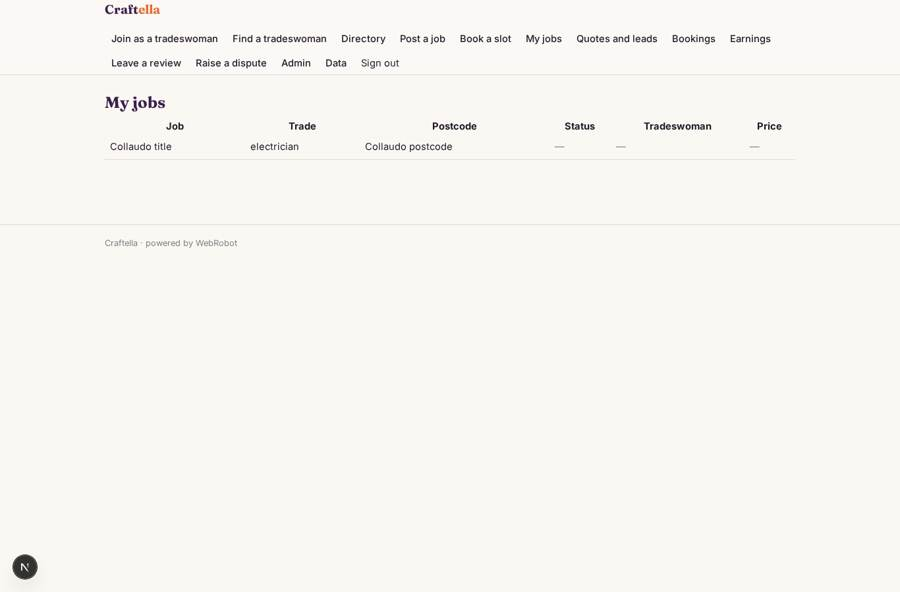
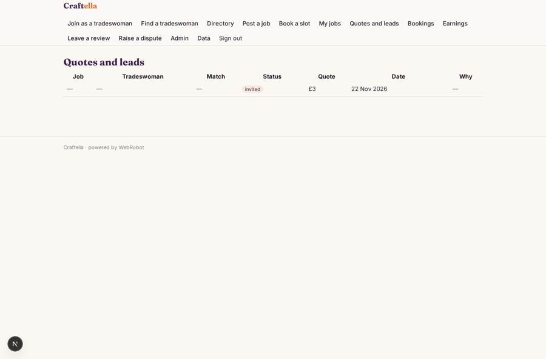
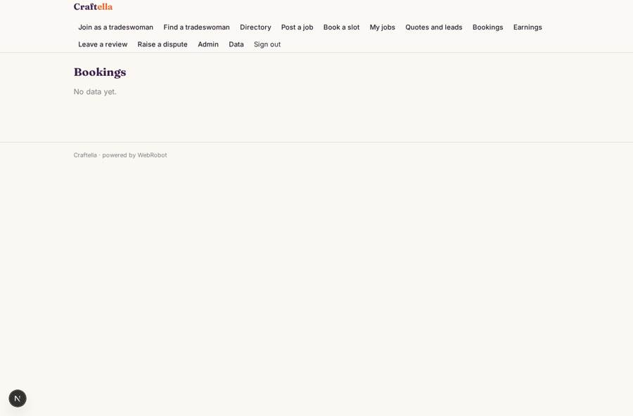

# Craftella

_Book verified tradeswomen you can trust._

**Sector:** Consumer, travel, retail · **Manifest:** valid (schema + runtime contract) · **Functional test:** passed (39 checks passed)

## Description given to the app builder

We need an app called Craftella for booking verified tradeswomen: electricians, plumbers, decorators, gas engineers and handywomen. Customers sign up and post a job through a form (trade, description, photos, postcode, preferred dates, budget). Tradeswomen sign up with their trades, service area, day rates and availability, and upload ID, insurance certificate and qualifications; for gas work we check the public Gas Safe register and for electrical work NICEIC membership. An agent pre-checks the documents and an admin approves each tradeswoman before she appears. The directory shows verified tradeswomen on a map with ratings. Customers book a slot or request quotes; the agent matches the job with the best-fit nearby tradeswomen and notifies them. Customers pay by card through the app, the money is held until the job is complete, and we pay out to each tradeswoman minus a commission. Both sides review each other. Tradeswomen are independent, not employees, so contracts must reflect UK worker-status rules. Customers see their jobs, tradeswomen their bookings and earnings, admins everything including vetting queue and disputes. English.

## Functional test: what did not pass

- **trigger has its effect** (trigger lead_invited): email to record.pro_email: no such recipient in the test (role nobody holds or empty field) _(warning)_
- **saved record shown where its collection is read** (view leads): a record was saved in matches (by admin) but the page does not show it (as user) _(warning)_

## Navigation recording

Signed in as the app's admin, the recorder opened 7 menu page(s): Join as a tradeswoman, Find a tradeswoman, Directory, Post a job, Book a slot, My jobs, Quotes and leads.
No issue found.

Empty data pages are mostly expected on the local runtime: agents are mocked there, so the collections they fill stay empty.

## Features not expressible today (spec.extensions)

- **escrow_hold**: Card payment is taken through Stripe Connect with a 12% commission. Holding the money until the customer marks the job complete, then releasing the payout, is not expressible in the manifest yet; the payments collection tracks held/due/released manually via admin.
- **accept_quote_button**: A one-click Accept quote button on the leads table, linking each row to the respond form, is not available; customers and tradeswomen update records through the edit form.
- **booking_staff_access**: Tradeswomen seeing their own slot bookings needs the booking's resource to be linked to her email; today admins see all bookings and tradeswomen see jobs and leads.
- **sms_push**: SMS, WhatsApp and push alerts to matched tradeswomen are not available; email notifications are used.

## Screenshots (interpretive runtime, test data)

### home-anon

### home-mobile

### directory

### my_jobs

### leads

### my_bookings

