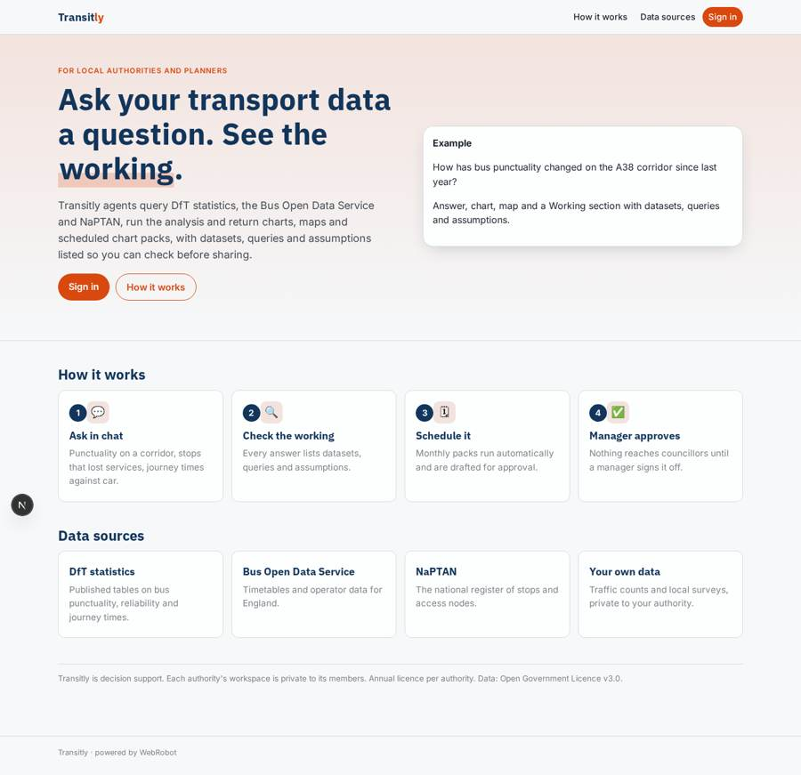
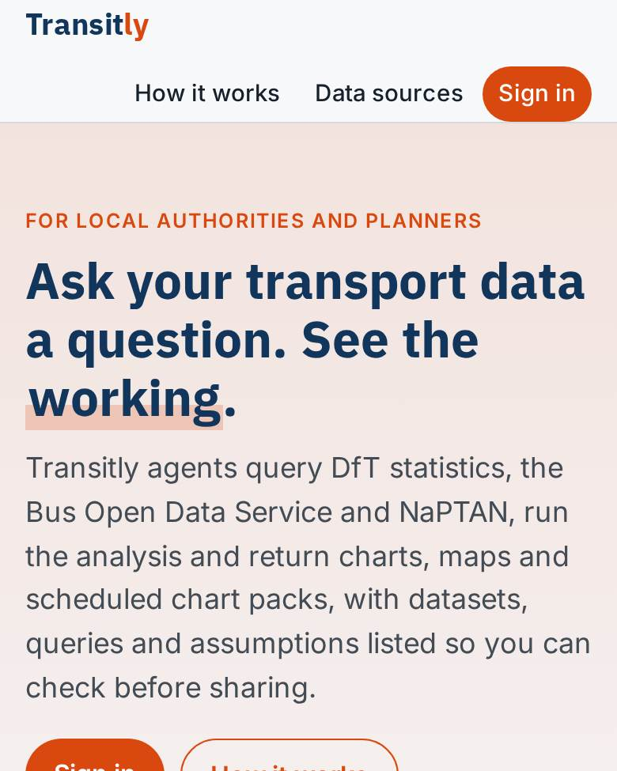
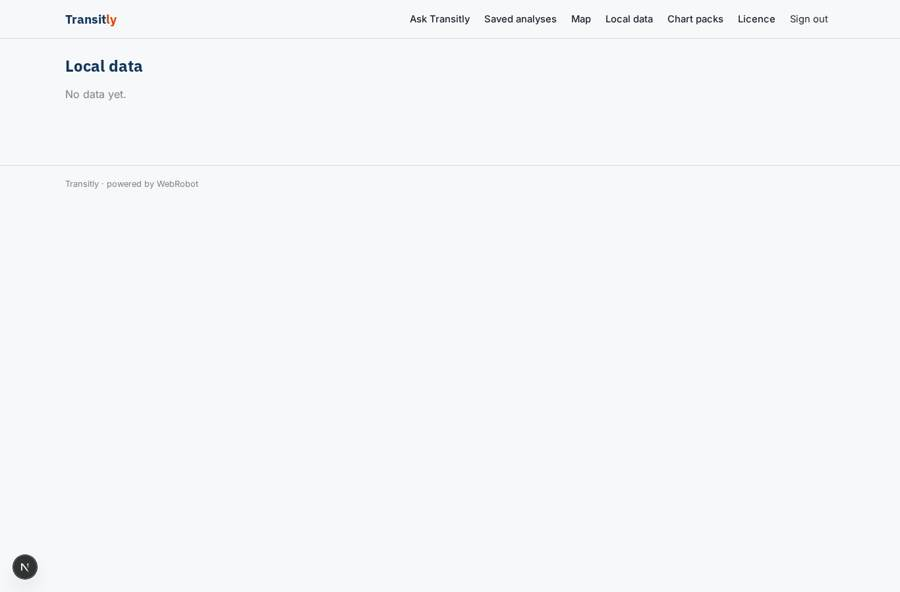
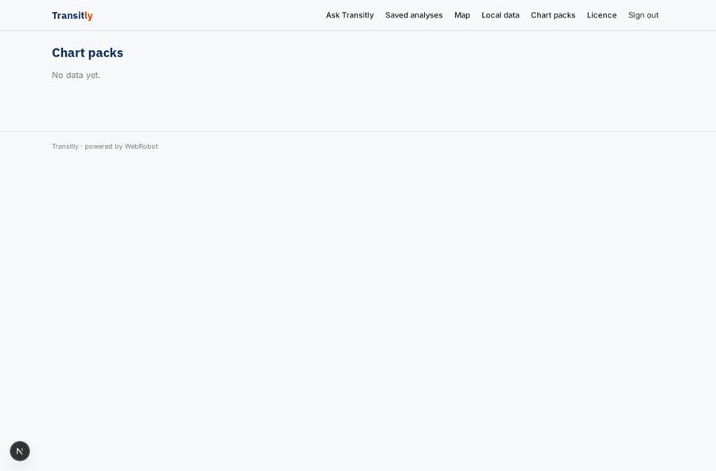
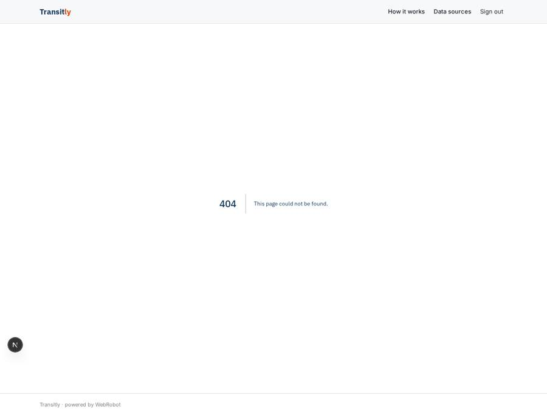

# Transitly

_Transport data analysis for local authorities, with the working shown._

**Sector:** Sanità, istruzione, energia, gov · **Manifest:** valid (schema + runtime contract) · **Functional test:** passed (14 checks passed)

## Description given to the app builder

We need Transitly, an agentic platform for transport data analysis for local authorities and planners. Analysts ask questions in chat; agents query DfT statistics, Bus Open Data Service and NaPTAN, run analyses, and produce charts, maps and scheduled reports by email. Roles: analyst, manager. Annual licence. Analysts can also schedule a recurring analysis, for example monthly punctuality by operator, which runs automatically and emails the chart pack to a distribution list. Typical questions are how bus punctuality changed on a corridor, which stops lost services, or how journey times compare with car. The agent shows its working: the datasets, queries and assumptions, so an analyst can check before sharing results. Each authority has its own workspace with saved analyses and uploaded local data such as traffic counts; nobody outside sees them. Managers approve reports before they are sent to councillors. Dashboards and maps can be shared by link. Pricing around £20,000 per authority per year. English only.

## Functional test: what did not pass

- **form saves a record** (form upload_data): only role analyst may fill it, and the test cannot hold that role _(warning)_
- **form saves a record** (form review_pack): only role manager may fill it, and the test cannot hold that role _(warning)_
- **template instance created and run** (template recurring_analysis): reserved to analyst/manager _(warning)_
- **page opened by a role allowed to** (view upload_data): only role analyst/manager may open it, the test cannot hold it _(warning)_
- **page opened by a role allowed to** (view schedules): only role analyst/manager may open it, the test cannot hold it _(warning)_
- **page opened by a role allowed to** (view review_pack): only role manager may open it, the test cannot hold it _(warning)_

## Navigation recording

Signed in as the app's admin, the recorder opened 6 menu page(s): Ask Transitly, Saved analyses, Map, Local data, Chart packs, Licence.
- data page empty: saved (table)
- data page empty: my_data (table)
- data page empty: packs (table)

Empty data pages are mostly expected on the local runtime: agents are mocked there, so the collections they fill stay empty.

## Features not expressible today (spec.extensions)

- **share_by_link**: Sharing dashboards and maps by public link is not available yet; for now they are viewable by signed-in members of the authority workspace.
- **distribution_lists**: Email distribution lists are not available; each scheduled analysis takes up to three recipient emails, who receive the pack only after a manager approves it.
- **workspace_membership**: Authority workspaces are modelled as the members list on each record; there is no dedicated multi-authority tenant admin yet. Deploy one app per authority or maintain members per record.

## Screenshots (interpretive runtime, test data)

### home-anon

### home-mobile

### saved

### my_data

### packs

### upload_data

