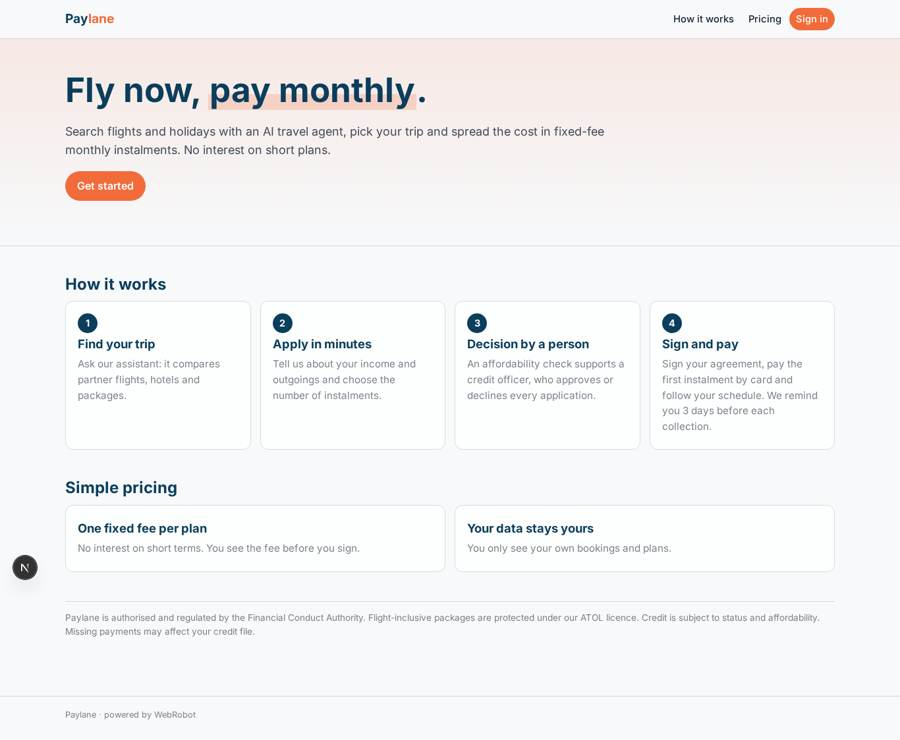
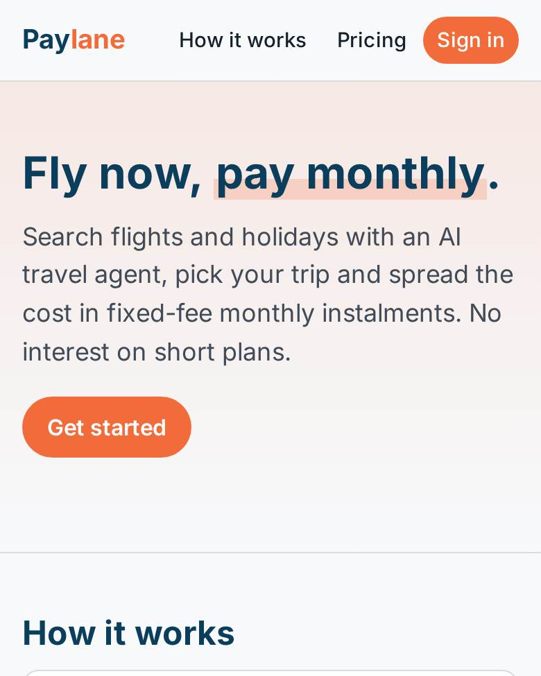
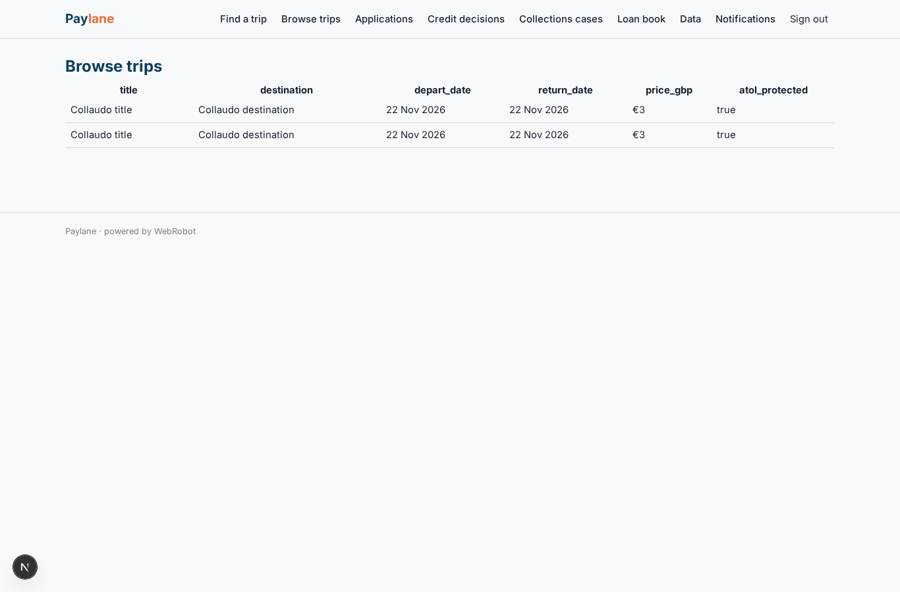
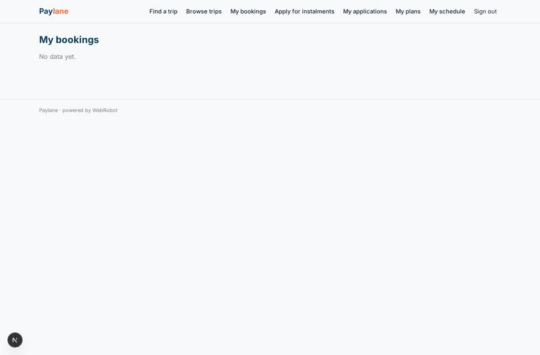
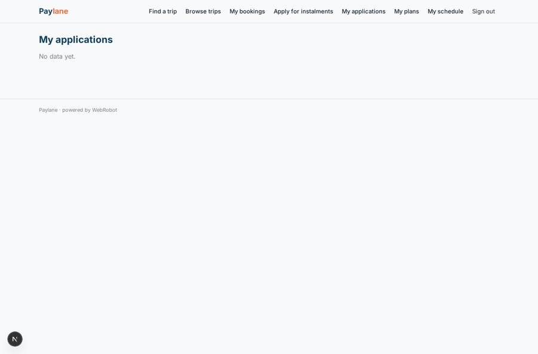
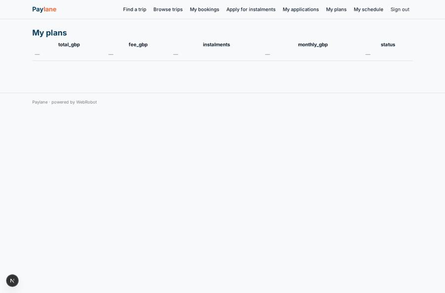

# Paylane

_Fly now, pay monthly._

**Sector:** Consumer, travel, retail · **Manifest:** valid (schema + runtime contract) · **Functional test:** 1 failure(s) (17 checks passed)

## Description given to the app builder

We are building Paylane, a travel booking app where customers can spread the cost of flights and holidays in monthly instalments. The lending itself is outside the software: we hold FCA consumer-credit authorisation, run our own loan book and fund it with debt, and flight-inclusive packages also sit under our ATOL licence; I need the software around it. Customers sign up, search trips through an AI agent that compares options from airline and hotel inventory we access by partnership only, and choose a trip. At checkout they fill an instalment application: name, date of birth, address history, employment, income, monthly outgoings and the number of instalments. An agent runs an affordability check using credit bureau data, only if we have a licence, and produces a recommendation; a credit officer approves or declines every application, with reasons recorded. Approved customers sign the credit agreement, pay a first instalment by card and get a schedule; reminders go by email three days before each collection, and missed payments open a collections case. Customers see only their own bookings and plans; credit officers see applications; admins see the loan book dashboard with arrears, approval rates and revenue. Pricing is a fixed fee per plan with no interest for short terms. English only, and I want it as a phone app as well as web.

## Functional test: what did not pass

- **form can be filled (options, uploads)** (form apply): required booking (options from collection:bookings) has no option to choose
- **saved record shown where its collection is read** (view plans): a record was saved in plans (by user) but the page does not show it (as user) _(warning)_

## Navigation recording

Signed in as the app's admin, the recorder opened 6 menu page(s): Find a trip, Browse trips, Applications, Credit decisions, Collections cases, Loan book.
- data page empty: queue (table)

Empty data pages are mostly expected on the local runtime: agents are mocked there, so the collections they fill stay empty.

## Features not expressible today (spec.extensions)

- **partner_inventory**: Airline and hotel inventory is partnership-only, so live partner APIs cannot be called from the manifest. The assistant searches the trips catalogue the admins keep (data page, or CSV import). A live feed would need a partner connector.
- **credit_bureau**: Credit bureau data is not connected: the affordability agent works from declared income and outgoings and tells the officer what to verify. It needs the bureau's API host and an org-level API key credential, and a licence gate, before it can use bureau data.
- **credit_agreement_esign**: Signing is a typed-name acceptance recorded on the plan; a legally compliant e-signature and the pre-contract credit information (SECCI) document are not available yet.
- **card_collection**: Card payment of the first instalment and recurring card collections are not available yet. Instalment statuses (paid, missed) are updated by officers or admins; setting an instalment to missed opens the collections case and alerts staff.

## Screenshots (interpretive runtime, test data)

### home-anon

### home-mobile

### trips

### bookings

### applications

### plans

