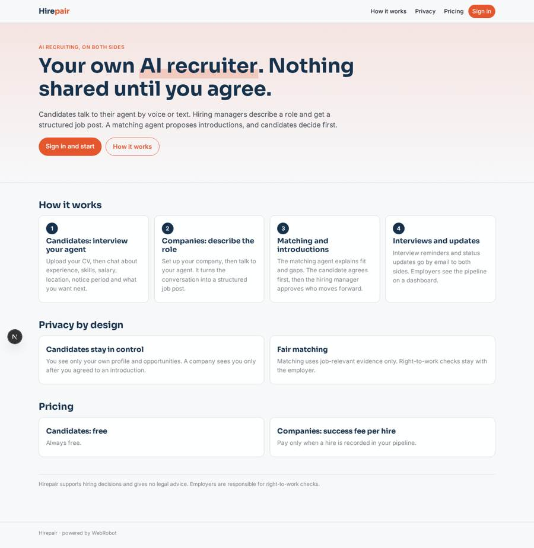
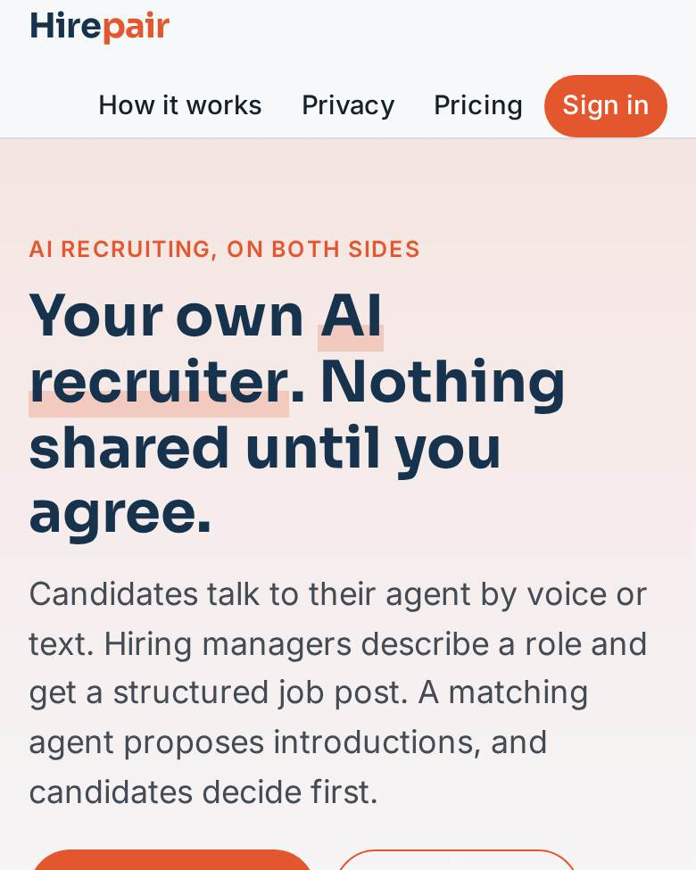
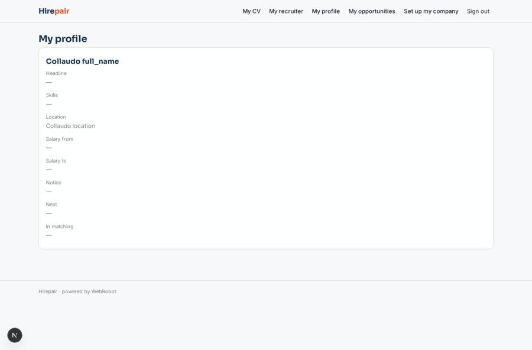
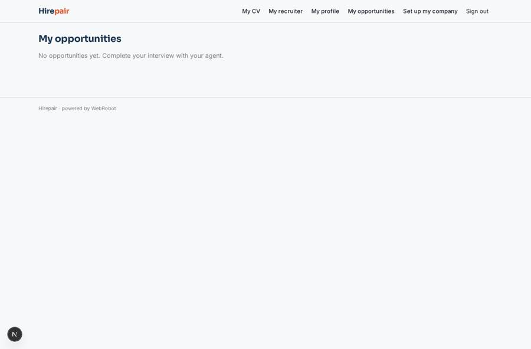
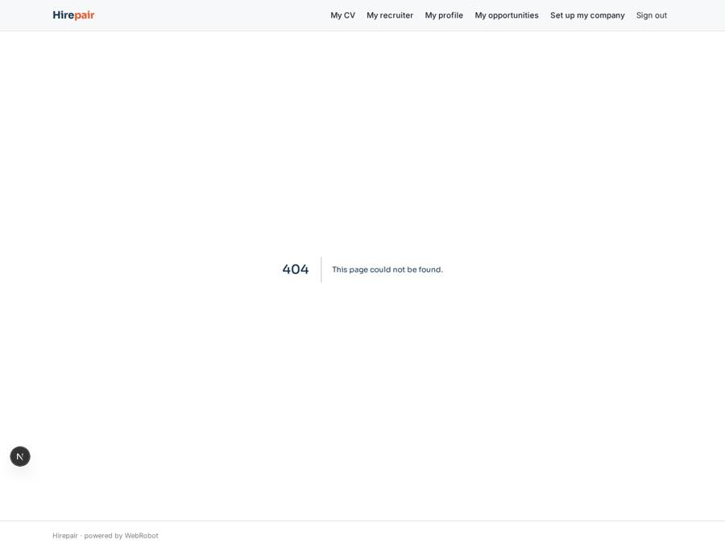
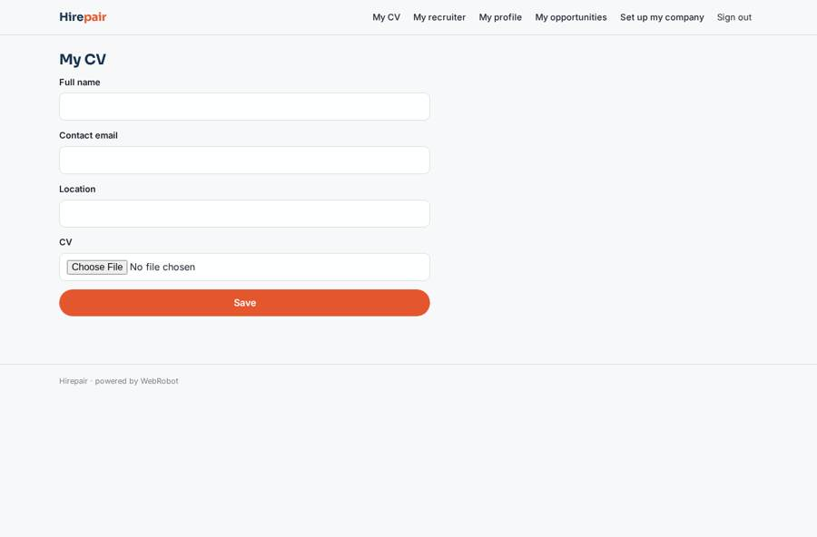

# Hirepair

_Two AI recruiters, one for you and one for the company. Nothing is shared until you agree._

**Sector:** B2B AI and SaaS · **Manifest:** valid (schema + runtime contract) · **Functional test:** passed (17 checks passed)

## Description given to the app builder

I want Hirepair, with two AI recruiting agents: one works for candidates and one for companies. Candidates sign up, upload their CV and have a conversational interview with their agent by voice in the browser or by text: experience, skills, salary expectations, location, notice period, what they want next. Companies sign up, hiring managers describe the role in a voice or text conversation and the agent turns it into a structured job post. A matching agent compares candidates with roles, explains the fit and the gaps, and proposes introductions; nothing is shared until the candidate agrees, and the hiring manager then approves which candidates move forward. Candidates see only their own profile and opportunities, companies see only candidates who have agreed to be introduced. The agents schedule interviews by email and send reminders and status updates to both sides. The real product also holds phone calls with candidates, and much of its value is a large two-sided network of candidates and employers, which is a business problem as much as a software one. Right-to-work checks stay with the employer. Dashboards for companies show the pipeline. Pricing: free for candidates, success fee per hire for companies. English.

## Functional test: what did not pass

- **saved record shown where its collection is read** (view opportunities): a record was saved in matches (by admin-data, admin-data) but the page does not show it (as user) _(warning)_

## Navigation recording

Signed in as the app's admin, the recorder opened 0 menu page(s): .
- menu missing after sign-in: no menu after signing in

Empty data pages are mostly expected on the local runtime: agents are mocked there, so the collections they fill stay empty.

## Design checks (linter)

- role admin: the admins see no page in the menu (every menu page names other roles) — add admin to the roles of the pages they run, such as the queues, dashboards and approvals

## Features not expressible today (spec.extensions)

- **phone_calls**: Phone calls with candidates are not included in this version. Candidates talk to their agent by voice or text in the browser.
- **interview_negotiation**: Interview scheduling is date-based: the hiring manager sets the date through the agent, and both sides get email notifications and a reminder. Two-way negotiation of times by replying to emails is not available yet.
- **network_effects**: The value of a large two-sided network of candidates and employers is a business and growth problem, not something this manifest can solve. It needs supply and demand to be acquired outside the app.
- **right_to_work**: Right-to-work checks are not performed by the app. They stay with the employer.

## Screenshots (interpretive runtime, test data)

### home-anon

### home-mobile

### my_profile

### opportunities

### jobs

### candidate_cv

