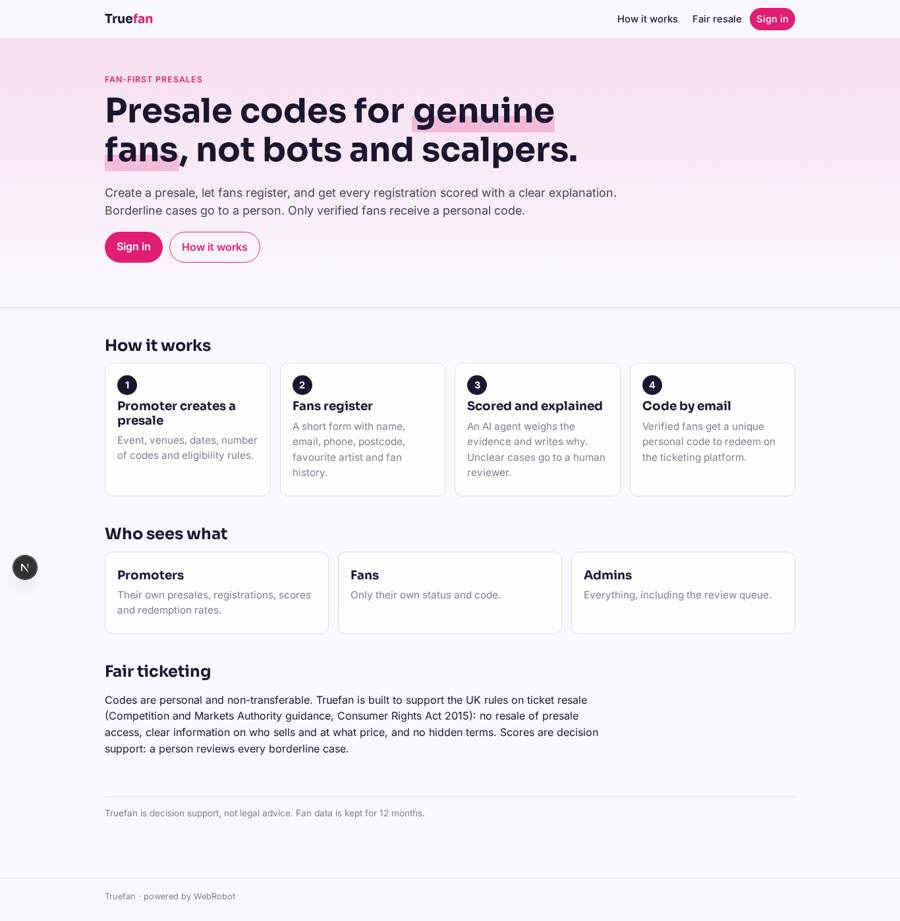
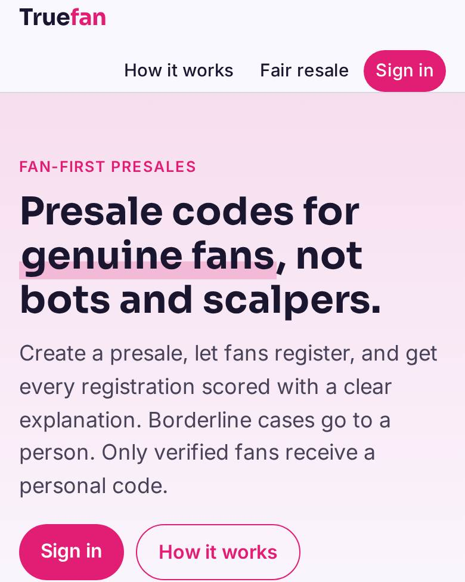
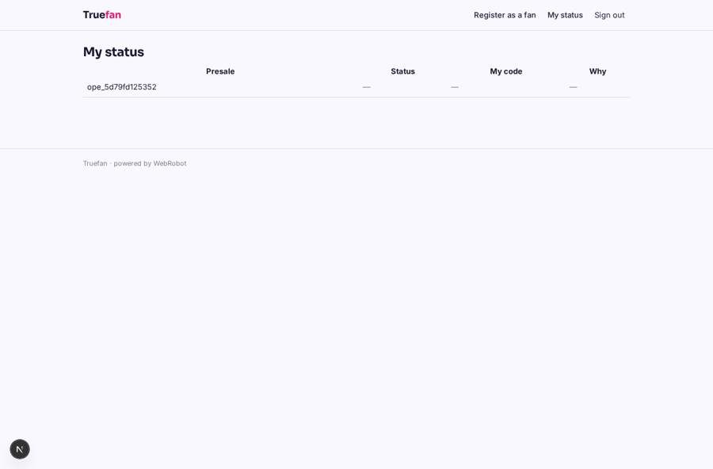
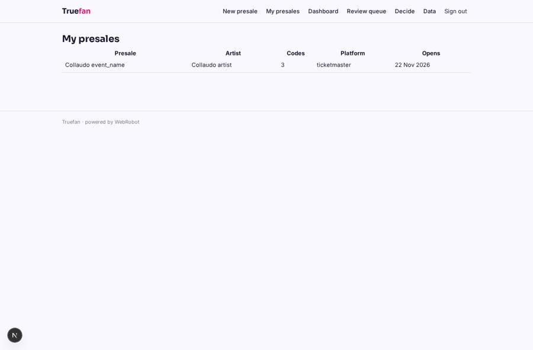
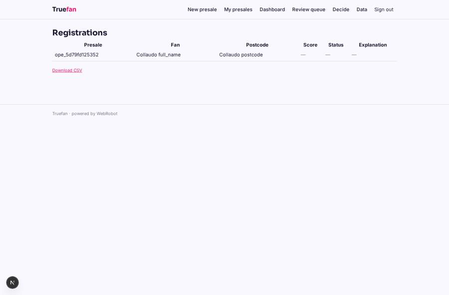
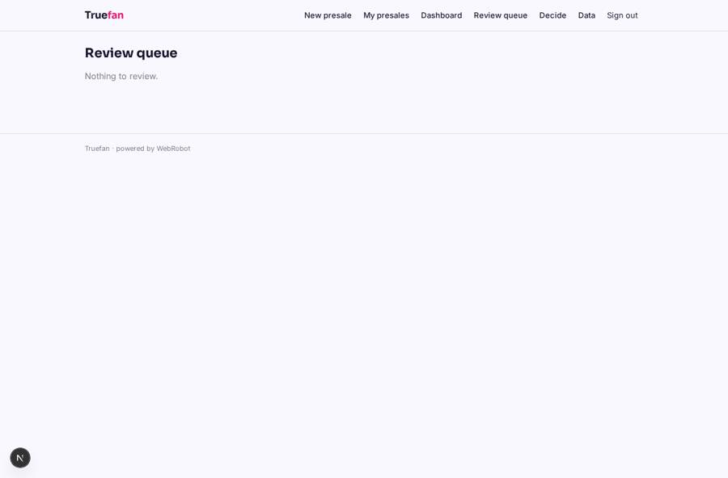

# Truefan

_Presale codes for genuine fans, not bots and scalpers._

**Sector:** Consumer, travel, retail · **Manifest:** valid (schema + runtime contract) · **Functional test:** passed (22 checks passed)

## Description given to the app builder

We need an app called Truefan that verifies genuine fans for ticket presales and keeps out bots and scalpers. Artists' teams and promoters sign up and create a presale: event, venues, dates, number of codes, eligibility rules. Fans register through a form (name, email, phone, postcode, favourite artist, how long they have been a fan) and can connect their music streaming account with OAuth (Spotify-type API) so we can see listening history as a fan signal. A scoring agent combines listening signals, account age, past purchase behaviour and anti-bot checks (device and network signals) into a fan score with an explanation; borderline cases go to a human reviewer. Verified fans get a unique presale code by email; codes must be redeemed on the ticketing platforms, which needs partnerships with Ticketmaster-type, AXS-type and Eventim-type sellers. The app must respect UK ticket resale rules from the CMA and the Consumer Rights Act. Promoters see their presales, registrations, scores and redemption rates on a dashboard; fans see only their own status; admins see everything. Pricing: fee per presale plus per verified fan. English.

## Functional test: what did not pass

- **page opened by a role allowed to** (view account): only role promoter may open it, the test cannot hold it _(warning)_

## Navigation recording

Signed in as the app's admin, the recorder opened 5 menu page(s): New presale, My presales, Dashboard, Review queue, Decide.
No issue found.

Empty data pages are mostly expected on the local runtime: agents are mocked there, so the collections they fill stay empty.

## Features not expressible today (spec.extensions)

- **streaming_oauth**: Connecting a Spotify-type streaming account with OAuth to read listening history is not available yet. Fans can give a self-reported profile name, which the scorer treats as unverified.
- **device_network_signals**: Device and network anti-bot signals (IP reputation, device fingerprint) and past purchase history are not available to agents yet. The scorer uses form consistency only and says so in each explanation.
- **ticketing_partnerships**: Redeeming codes on Ticketmaster-, AXS- and Eventim-type platforms needs commercial partnerships and their code-import APIs. For now codes are exported and redemptions arrive by webhook or admin CSV import (redemptions collection).
- **per_verified_fan_fee**: The per-verified-fan fee cannot yet be charged to the promoter, because the scoring run belongs to the fan. Only the per-presale fee (100 credits) is charged automatically; verified-fan fees are invoiced from the dashboard counts.
- **code_cap**: A hard cap on codes issued per presale (codes_count) is not enforced by the runtime; promoters see the counts on the dashboard.
- **uk_compliance_review**: The CMA and Consumer Rights Act wording on the home page and email must be checked by a lawyer before launch; GDPR notice for automated scoring is also needed.

## Screenshots (interpretive runtime, test data)

### home-anon

### home-mobile

### my_status

### my_presales

### registrations

### review_queue

