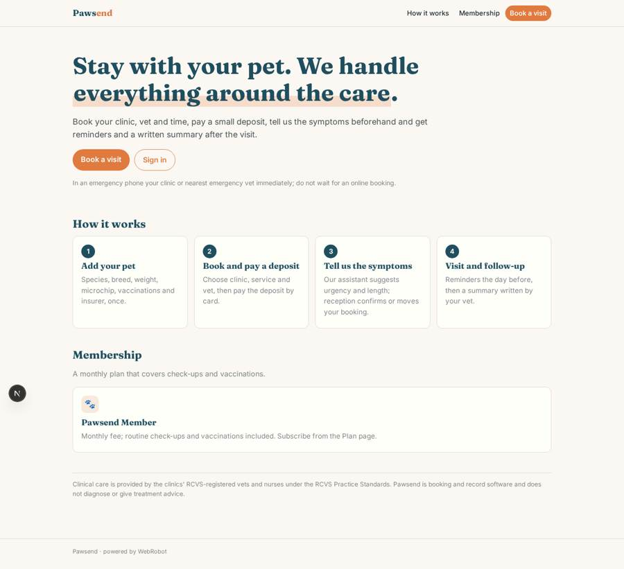
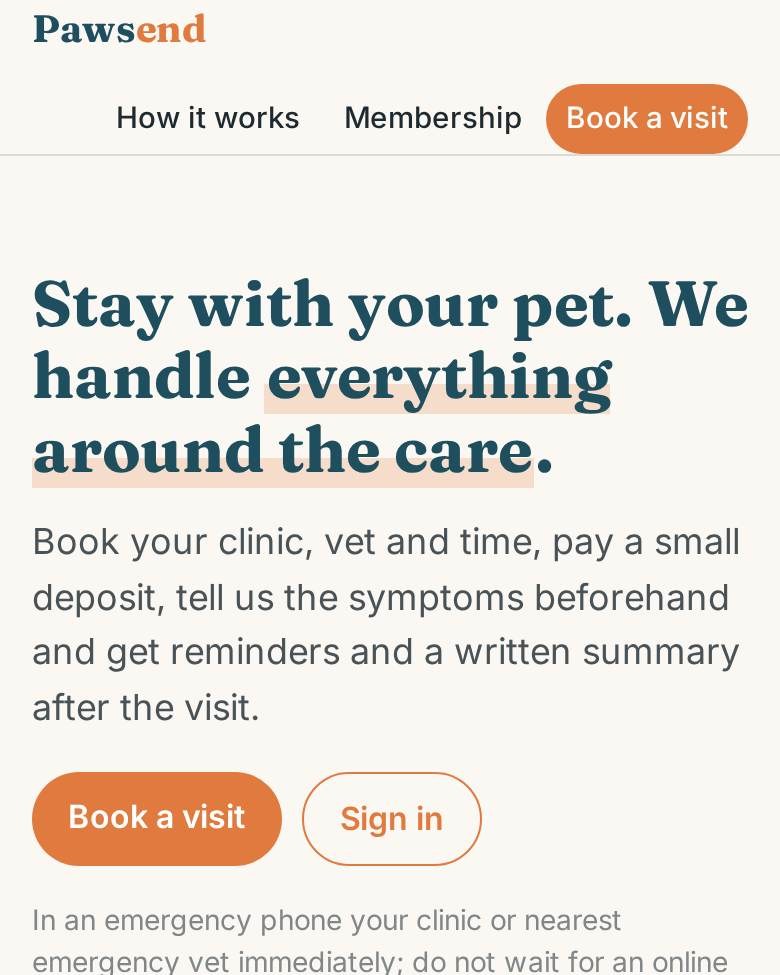
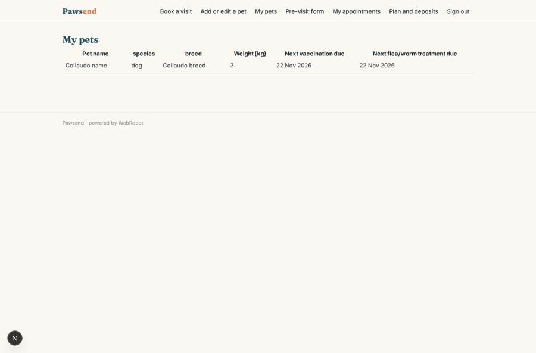
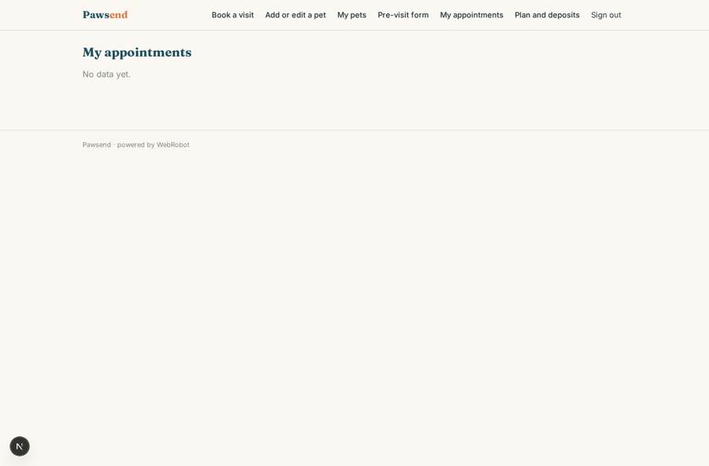
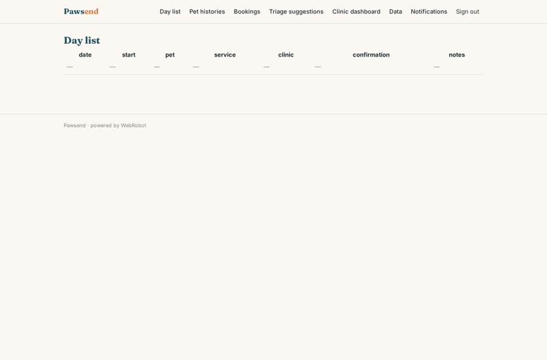
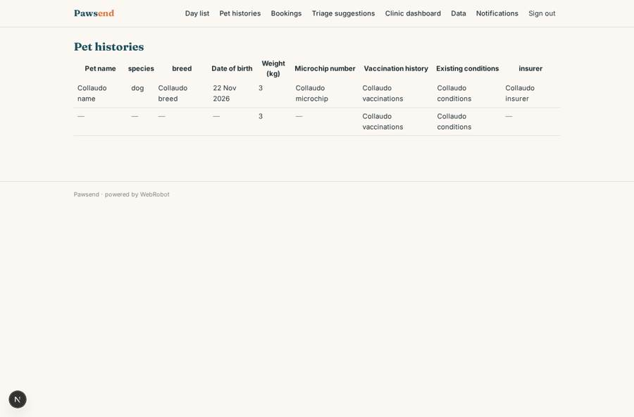

# Pawsend

_Veterinary care where you stay with your pet._

**Sector:** Consumer, travel, retail · **Manifest:** valid (schema + runtime contract) · **Functional test:** 1 failure(s) (28 checks passed)

## Description given to the app builder

I want an app called Pawsend for our chain of veterinary clinics, where owners can stay with their pet during treatment. The clinics, vets and nurses and all regulated veterinary practice are outside the software, under RCVS registration and Practice Standards; I need the software around it. Owners sign up and register each pet (species, breed, date of birth, weight, microchip, vaccinations, insurer, existing conditions). They book appointments online by clinic, service and vet, pay a deposit by card and fill a pre-visit form about symptoms. An agent reads the symptoms and suggests urgency and appointment length; a receptionist confirms or moves the booking. Owners get confirmations, reminders the day before, vaccination and flea treatment reminders, and after the visit a summary written by the vet. Vets see the day list and pet histories for their clinic; reception sees bookings; clinic managers see their clinic dashboard with appointments, no-shows and revenue; head office sees all clinics. A membership plan with a monthly fee covers check-ups and vaccinations. Phone app and web. English.

## Functional test: what did not pass

- **form can be filled (options, uploads)** (form previsit): required appointment (options from collection:appointments) has no option to choose
- **saved record shown where its collection is read** (view my_appointments): a record was saved in appointments (by admin, admin) but the page does not show it (as user) _(warning)_

## Navigation recording

Signed in as the app's admin, the recorder opened 5 menu page(s): Day list, Pet histories, Bookings, Triage suggestions, Clinic dashboard.
- data page empty: triage_list (table)

Empty data pages are mostly expected on the local runtime: agents are mocked there, so the collections they fill stay empty.

## Features not expressible today (spec.extensions)

- **clinic_scoping**: Staff roles see records of every clinic, not only their own: access rules cannot yet be limited to one clinic. Clinic managers and vets for a single clinic need per-clinic filtering; head office (admin) sees all.
- **deposit_credits**: Deposits are charged as credits (1 credit = GBP 1) bought by card; a member's covered visits are not yet exempted from the deposit automatically, and refunds for no-shows are handled by head office.
- **no_sms**: SMS, WhatsApp and campaign messages are not available; reminders go by email and phone push.

## Screenshots (interpretive runtime, test data)

### home-anon

### home-mobile

### my_pets

### my_appointments

### day_list

### pet_records

