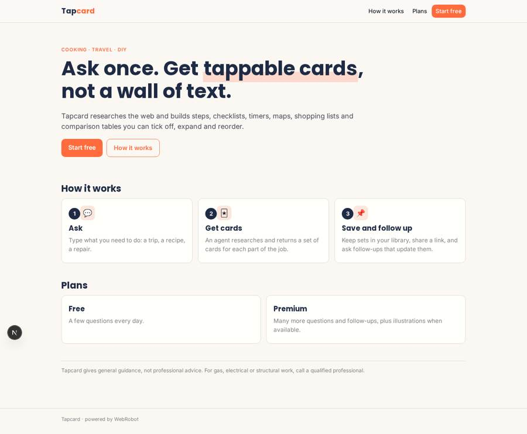
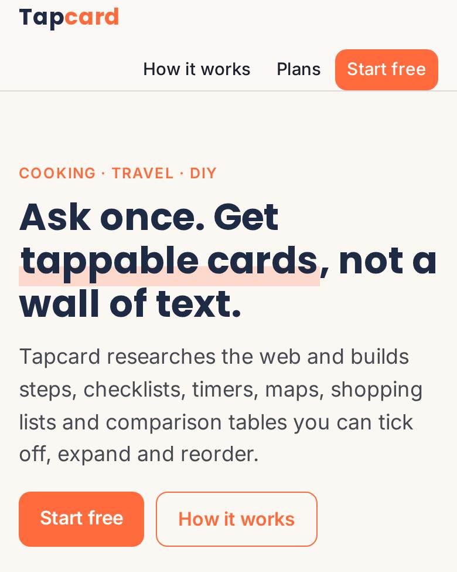
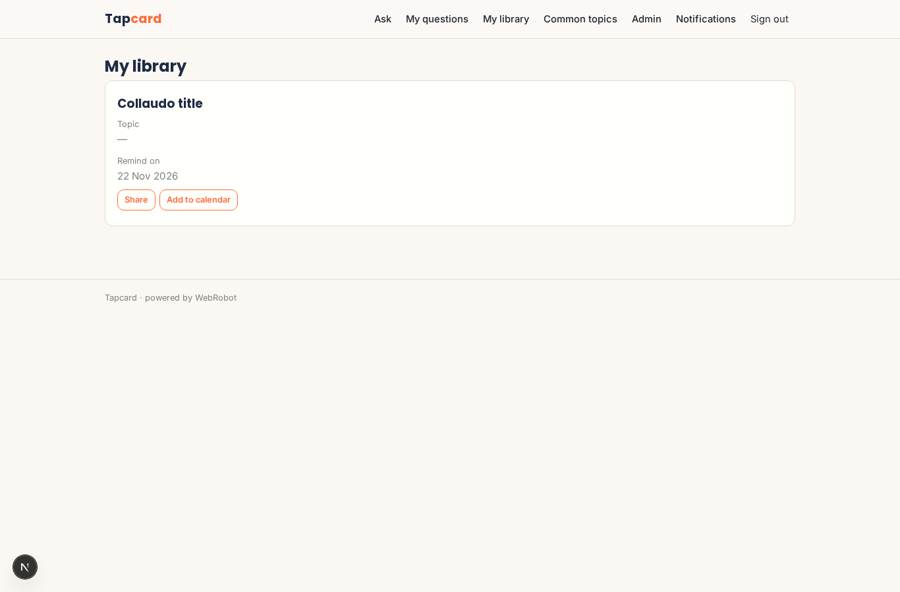
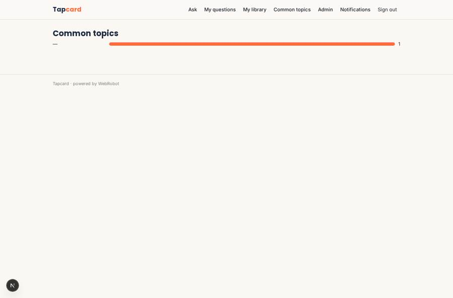
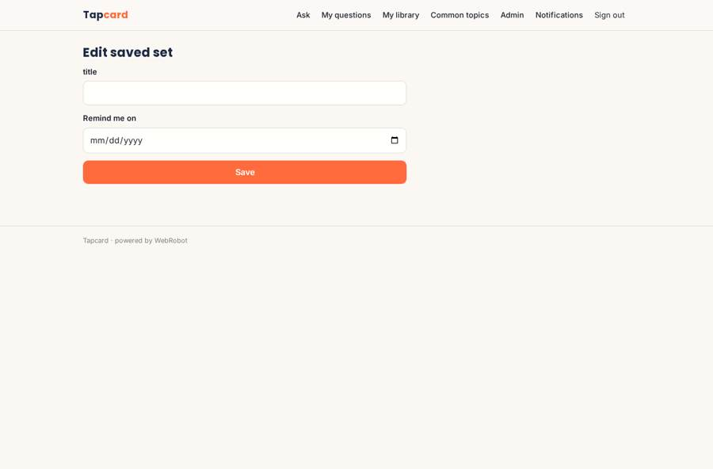
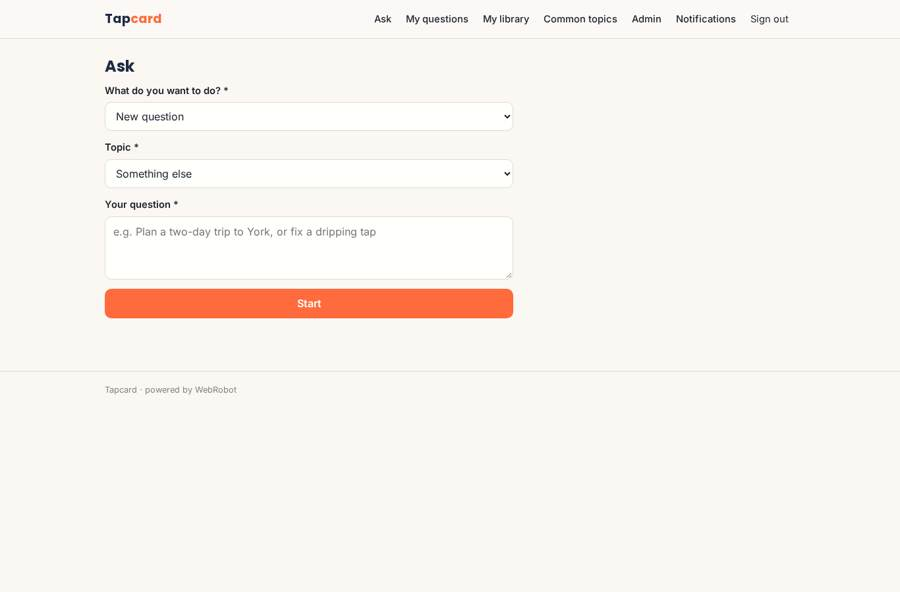

# Tapcard

_Ask anything for everyday life. Get tappable cards, not a wall of text._

**Sector:** Consumer, travel, retail · **Manifest:** valid (schema + runtime contract) · **Functional test:** passed (16 checks passed)

## Description given to the app builder

We need a phone app called Tapcard that turns AI answers into tappable visual cards for everyday tasks like cooking, travel and DIY. Users sign up and ask a question by text or voice, for example "plan a two-day trip to York" or "fix a dripping tap". An agent researches with web search APIs and returns not a block of text but a set of cards: steps with images, checklists, timers, maps, shopping lists and comparison tables, which the user can tap to expand, tick off or reorder. Generating this interface on the fly, with a rendering engine for the cards and generated illustrations, is the core of the product. Users can save card sets to collections, share them by link and ask follow-up questions that update the cards. Push notifications for timers and saved plans. Users see only their own collections unless shared; admins see usage and the most common topics. Free with a premium subscription for more questions and image generation. English.

## Functional test: what did not pass

- **saved record shown where its collection is read** (view topics): a record was saved in card_sets (by user) but the page does not show it (as admin) _(warning)_

## Navigation recording

Signed in as the app's admin, the recorder opened 5 menu page(s): Ask, My questions, My library, Common topics, Admin.
- agent run did not open: ask: the run did not open

Empty data pages are mostly expected on the local runtime: agents are mocked there, so the collections they fill stay empty.

## Design checks (linter)

- mobile.capabilities: a share button (view library) needs 'share' in the phone app
- mobile.capabilities: an add-to-calendar button (view library) needs 'calendar' in the phone app

## Features not expressible today (spec.extensions)

- **card_renderer**: Interactive card rendering engine (tap to expand, tick off, reorder, live timers, maps). The runtime shows the agent's cards as formatted Markdown and chart blocks; the full interactive renderer is not available yet.
- **image_generation**: Generated illustrations for cards (premium) are not available yet; the agent only uses real image URLs it finds.
- **timer_push**: Push notifications that fire when a card timer ends are not available; push works for saved-plan reminders on a date.
- **voice_input**: Voice questions need a chat view for microphone capability; the question form relies on the phone keyboard dictation.
- **share_by_link**: Public share links for a card set are not available; sets are shared with invited viewers (sharing: viewer) and via the share button.

## Screenshots (interpretive runtime, test data)

### home-anon

### home-mobile

### library

### topics

### plan_form

### ask

