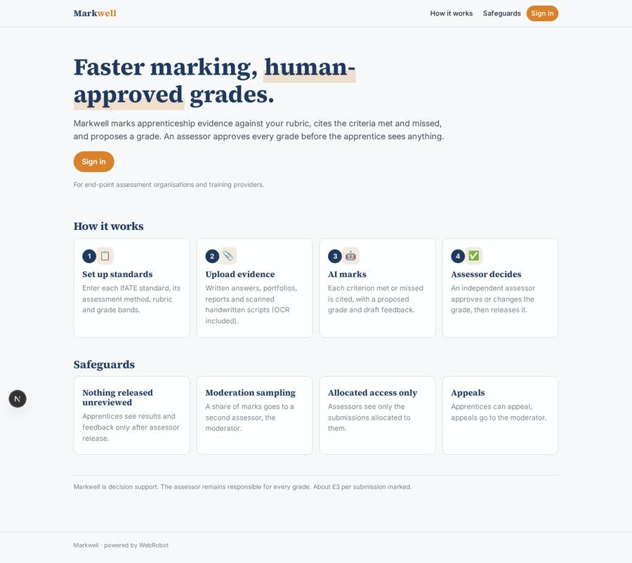
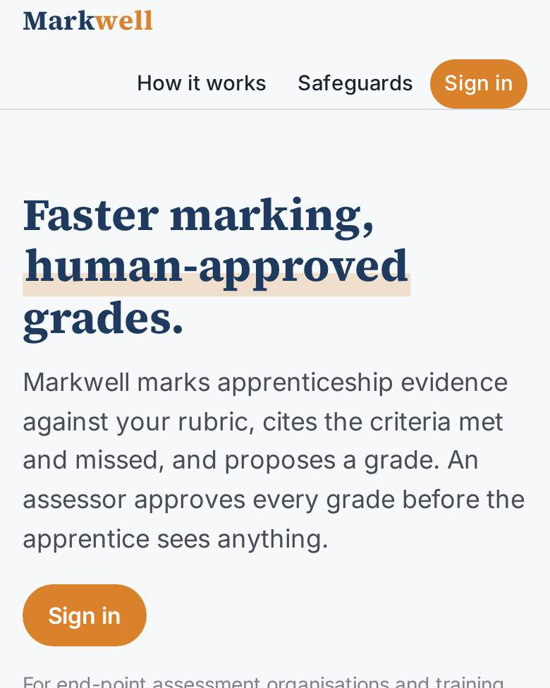
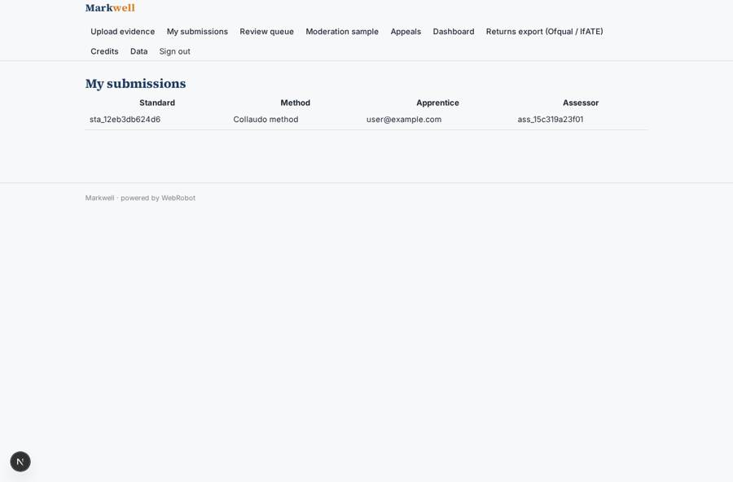
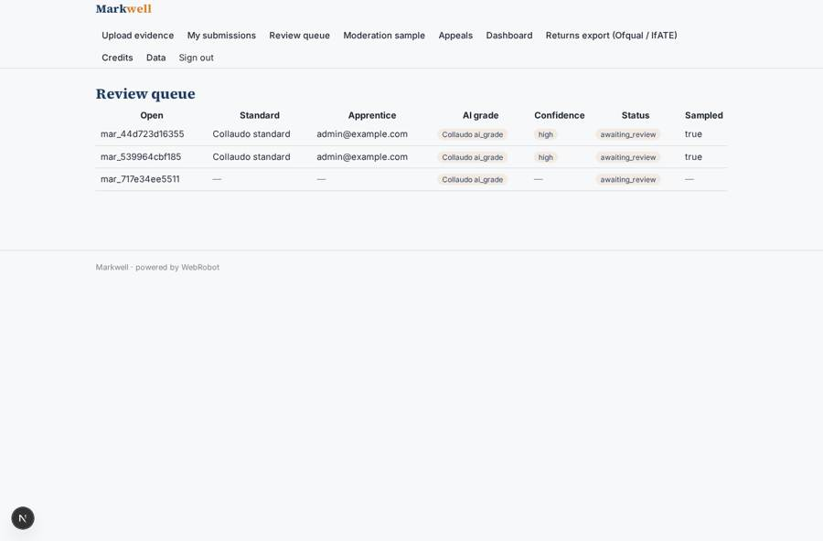
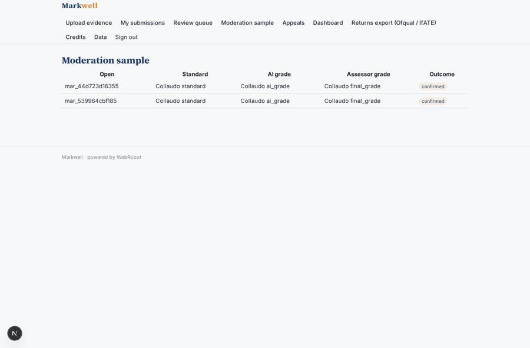
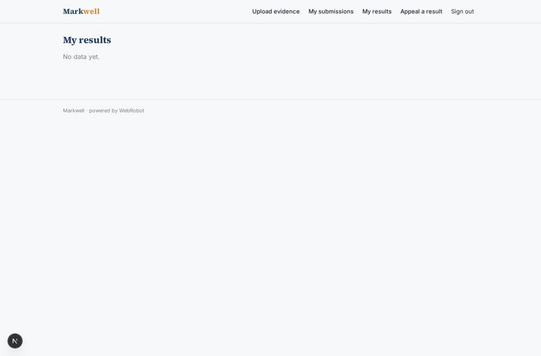

# Markwell

_AI-assisted marking for apprenticeship and vocational assessment._

**Sector:** Sanità, istruzione, energia, gov · **Manifest:** valid (schema + runtime contract) · **Functional test:** 1 failure(s) (27 checks passed)

## Description given to the app builder

I want Markwell, AI-assisted marking for apprenticeship and vocational assessment. End-point assessment organisations and training providers sign up and set up standards, assessment methods and grading rubrics, using the IfATE apprenticeship standards and assessment plans. Apprentices or assessors upload evidence: written answers, portfolios, project reports, and scanned handwritten scripts that need OCR. An agent marks each submission against the rubric, cites the criteria met and missed, proposes a grade and writes feedback. An independent assessor reviews every grade and approves or changes it; nothing is released to the apprentice without that approval, and a second assessor samples a percentage for moderation. Roles: organisation admin, assessor, moderator, apprentice; assessors see only their allocated submissions. Dashboards show grade distributions, agreement rate between AI and assessor and turnaround, with CSV export for Ofqual and IfATE returns. Email notifications when results are released. Pricing per submission marked, about £3. Apprentices see only their own results and feedback once released, with an appeal form that routes back to the moderator. English only.

## Functional test: what did not pass

- **form can be filled (options, uploads)** (form appeal): required mark (options from collection:marks) has no option to choose
- **trigger has its effect** (trigger appeal_received): email to role:moderator: no such recipient in the test (role nobody holds or empty field) _(warning)_
- **saved record shown where its collection is read** (view results): a record was saved in marks (by admin-data, admin-data, admin, admin) but the page does not show it (as apprentice) _(warning)_
- **saved record shown where its collection is read** (view appeals): a record was saved in appeals (by admin) but the page does not show it (as admin) _(warning)_

## Navigation recording

Signed in as the app's admin, the recorder opened 7 menu page(s): Upload evidence, My submissions, Review queue, Moderation sample, Appeals, Dashboard, Returns export (Ofqual / IfATE).
No issue found.

Empty data pages are mostly expected on the local runtime: agents are mocked there, so the collections they fill stay empty.

## Features not expressible today (spec.extensions)

- **turnaround_average**: Average turnaround (upload to release) needs a computed duration; the dashboard shows results released per week instead.
- **ifate_live_data**: Standards and assessment plans are entered by the admins from the IfATE website (or a CSV on /admin/data); there is no live IfATE API connection.
- **assessor_open_links**: Assessors open a mark from the queue through the Open link; allocation is set by the uploader choosing an assessor from the assessors list.

## Screenshots (interpretive runtime, test data)

### home-anon

### home-mobile

### my_submissions

### queue

### moderation

### results

