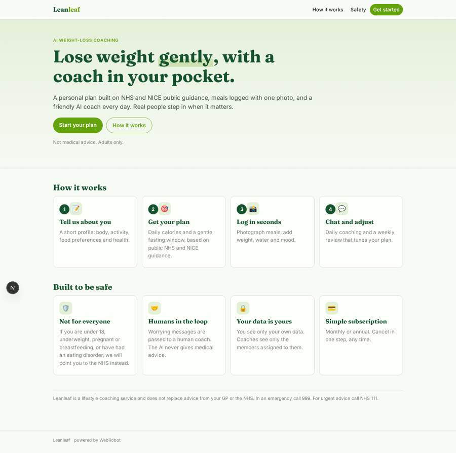
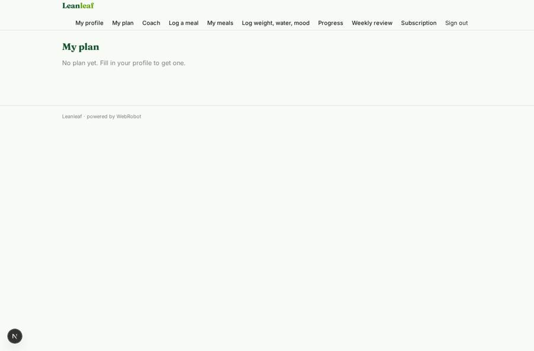
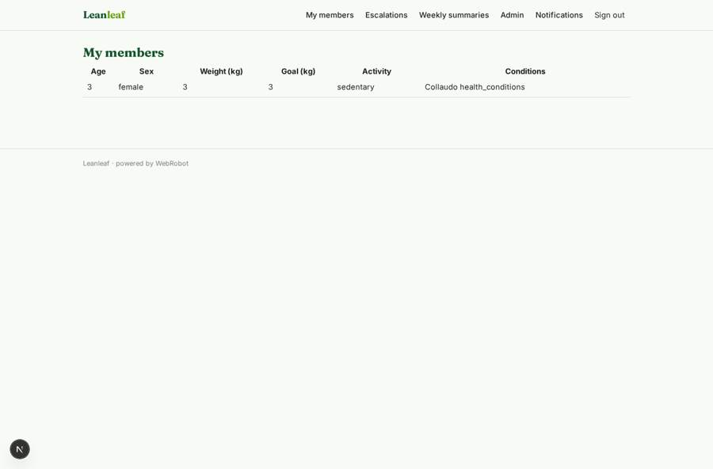
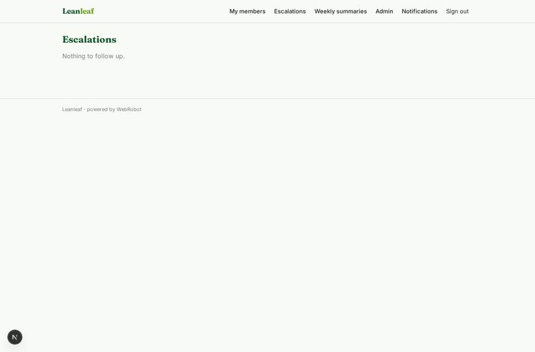
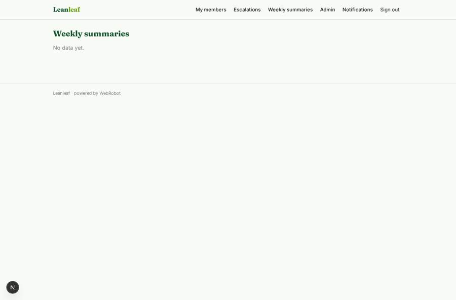

# Leanleaf

_Gentle, guided weight loss with an AI coach in your pocket._

**Sector:** Consumer, travel, retail · **Manifest:** valid (schema + runtime contract) · **Functional test:** passed (29 checks passed)

## Description given to the app builder

I want a phone app, also on the web, called Leanleaf for AI weight-loss coaching. Users sign up and fill a profile: age, sex, height, weight, goal weight, activity, dietary preferences, health conditions and eating habits; anyone with risk flags (very low BMI, eating disorder history, pregnancy) is told the plan is not for them and pointed to the NHS. The app builds a personalised plan based on NHS and NICE public guidance, with daily calorie targets and fasting windows. Users log meals by photo with the phone camera, and an agent estimates the nutrition using open databases such as CoFID; they also log weight, water and mood. An AI coach chats with them daily, gives tips, reviews the week and adjusts the plan; it never gives medical advice and escalates worrying messages to a human coach. Push reminders for meals, fasting windows and weigh-ins. Users see only their own data; human coaches see their assigned users; admins see aggregate dashboards. Monthly or annual subscription with a clear one-step cancel and renewal reminders, as UK subscription rules require. English.

## Functional test: what did not pass

- **saved record shown where its collection is read** (view admin_weight): a record was saved in weigh_ins (by user) but the page does not show it (as admin) _(warning)_
- **saved record shown where its collection is read** (view admin_intake): a record was saved in meals (by user) but the page does not show it (as admin) _(warning)_

## Navigation recording

Signed in as the app's admin, the recorder opened 4 menu page(s): My members, Escalations, Weekly summaries, Admin.
- data page empty: member_weeks (table)

Empty data pages are mostly expected on the local runtime: agents are mocked there, so the collections they fill stay empty.

## Features not expressible today (spec.extensions)

- **cofid_lookup**: CoFID is published as spreadsheets, not an API. Meal estimates use the agent's knowledge of CoFID plus Open Food Facts. Loading CoFID as a shared collection (admin CSV import on the data page) would let the agent read it directly.
- **per_user_reminder_times**: Meal, fasting-window and weigh-in reminders are sent at fixed times to all members as notifications. Reminders at each member's own times, from their personal fasting window, are not available yet.
- **renewal_reminder_and_cancel**: UK rules need a reminder before each renewal and a one-step cancel. The Account page provides plan management; a reminder a set number of days before each renewal charge is not available yet and must be handled in Stripe settings. Check the cancel flow on the Account page before launch.
- **coach_assignment**: Admins assign a human coach by setting coach_email on a member's profile in the data page. Plans, escalations and weekly summaries carry the coach email from the profile at the time they are written, so a coach assigned later sees only newer records.

## Screenshots (interpretive runtime, test data)

### home-anon

### home-mobile

### plan

### clients

### escalations

### member_weeks

