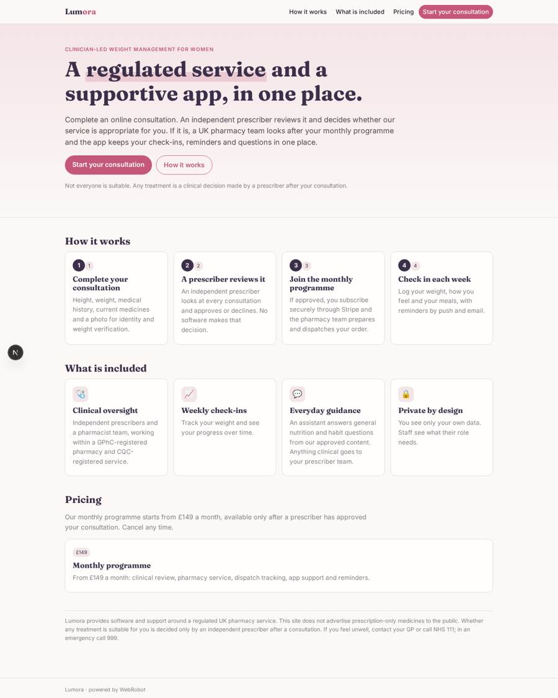
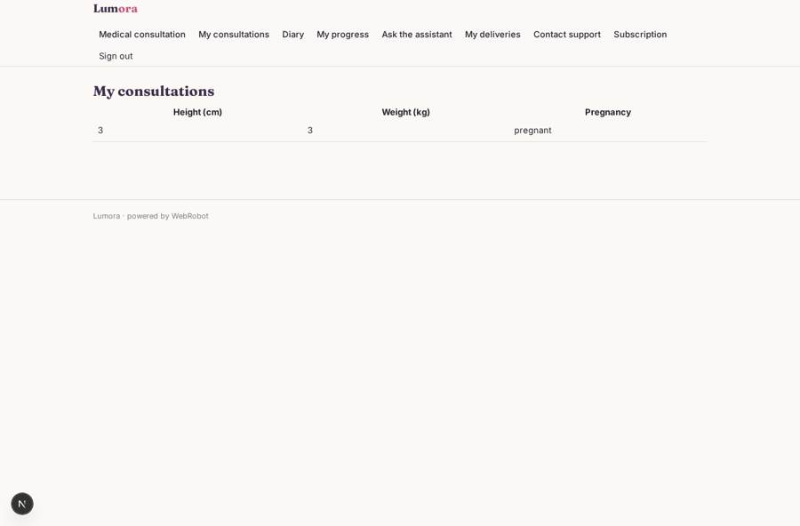
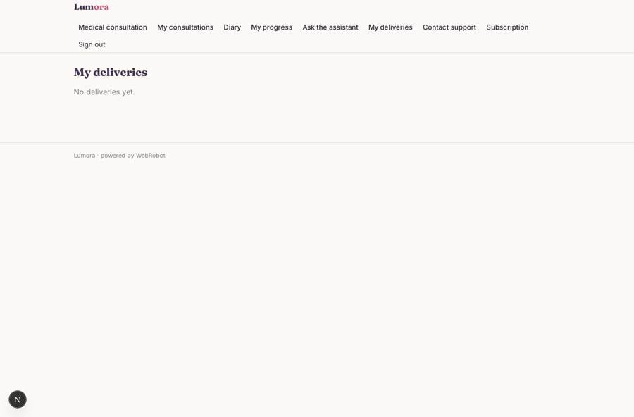
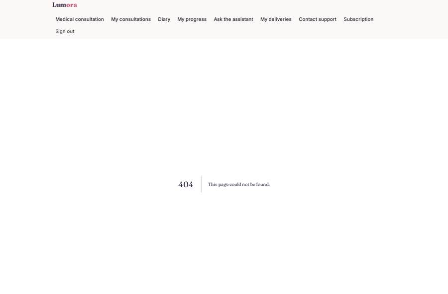
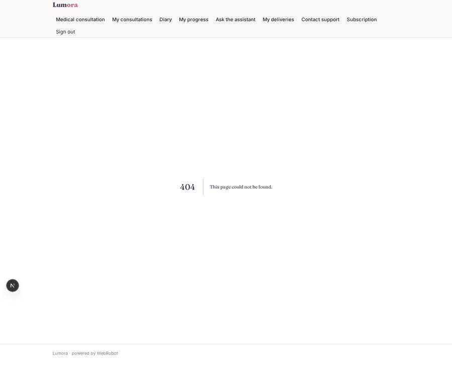

# Lumora

_Clinician-led weight management for women, with a pharmacy and support behind you._

**Sector:** Sanità, istruzione, energia, gov · **Manifest:** valid (schema + runtime contract) · **Functional test:** passed (26 checks passed)

## Description given to the app builder

I want Lumora, an online weight-management service for women using GLP-1 medication. A woman signs up, completes a medical consultation form (height, weight, BMI calculation, medical history, current medications, contraindications, pregnancy plans) and uploads a photo for identity and weight verification. The prescribing and pharmacy are the product: they need a GPhC-registered pharmacy, CQC registration and independent prescribers, and those are ours; I need the software around them. A prescriber reviews each consultation and approves or declines; the agent never decides eligibility. Once approved, patients get a monthly subscription through Stripe, with dispatch tracked by the pharmacy team. In the app they log weekly weight check-ins, side effects and meals, and an assistant answers general questions on nutrition and habits from our approved content, escalating anything clinical to the prescriber. Reminders for injections and check-ins by push and email. Roles: patient, prescriber, pharmacist, support; patients see only their own data. Marketing pages must respect the ban on advertising prescription-only medicines. Pricing from £149 a month. English only, mobile app and web.

## Functional test: what did not pass

- **form saves a record** (form escalation_reply): only role prescriber may fill it, and the test cannot hold that role _(warning)_
- **form saves a record** (form dispatch_edit): only role pharmacist may fill it, and the test cannot hold that role _(warning)_
- **trigger has its effect** (trigger ticket_new): email to role:support: no such recipient in the test (role nobody holds or empty field) _(warning)_
- **page opened by a role allowed to** (view reviews): only role prescriber may open it, the test cannot hold it _(warning)_
- **page opened by a role allowed to** (view consult_list): only role prescriber may open it, the test cannot hold it _(warning)_
- **page opened by a role allowed to** (view escalation_inbox): only role prescriber may open it, the test cannot hold it _(warning)_
- **page opened by a role allowed to** (view escalation_reply): only role prescriber may open it, the test cannot hold it _(warning)_
- **page opened by a role allowed to** (view dispatch_queue): only role pharmacist/support may open it, the test cannot hold it _(warning)_
- **page opened by a role allowed to** (view dispatch_edit): only role pharmacist may open it, the test cannot hold it _(warning)_
- **page opened by a role allowed to** (view ticket_inbox): only role support may open it, the test cannot hold it _(warning)_

## Navigation recording

Signed in as the app's admin, the recorder opened 0 menu page(s): .
- menu missing after sign-in: no menu after signing in

Empty data pages are mostly expected on the local runtime: agents are mocked there, so the collections they fill stay empty.

## Design checks (linter)

- role admin: the admins see no page in the menu (every menu page names other roles) — add admin to the roles of the pages they run, such as the queues, dashboards and approvals

## Features not expressible today (spec.extensions)

- **approval_gated_checkout**: The subscription is not technically blocked until a prescriber approves the consultation; the pharmacy must verify the approval in the Consultations to review page before dispatching. Gating checkout on approval needs a platform change.
- **regulatory_review**: Marketing copy avoids naming or promoting prescription-only medicines. Have it reviewed against MHRA and ASA/CAP rules, and complete a DPIA and medical-records retention policy under UK GDPR before launch.
- **sms_whatsapp**: SMS and WhatsApp reminders are not available yet; reminders go by email and push.
- **recurring_reminders**: Reminders fire on the next check-in and next injection dates the patient enters at each check-in; automatic weekly recurrence is not available yet.

## Screenshots (interpretive runtime, test data)

### home-anon

### home-mobile

### my_consultations

### orders

### consult_list

### escalation_inbox

