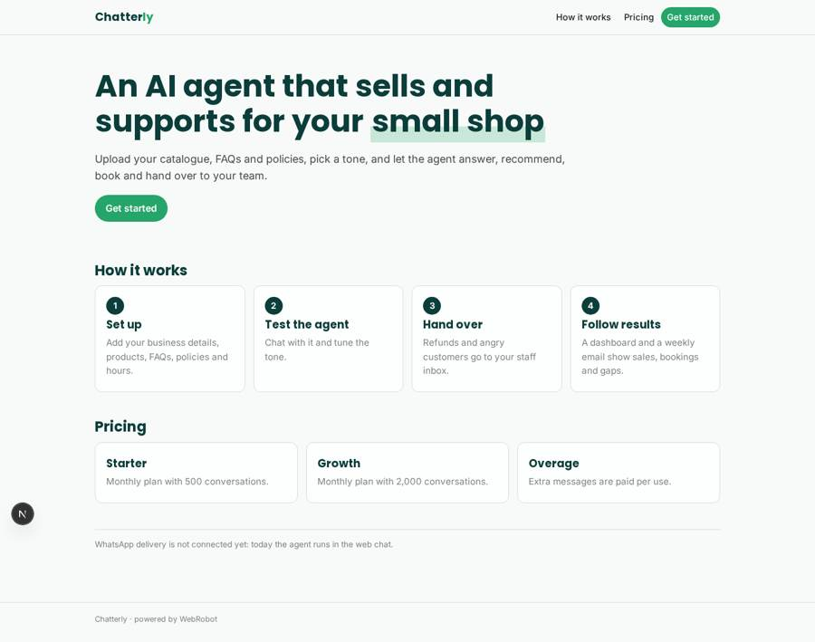
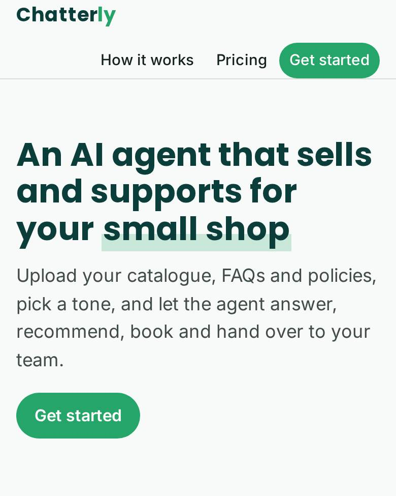
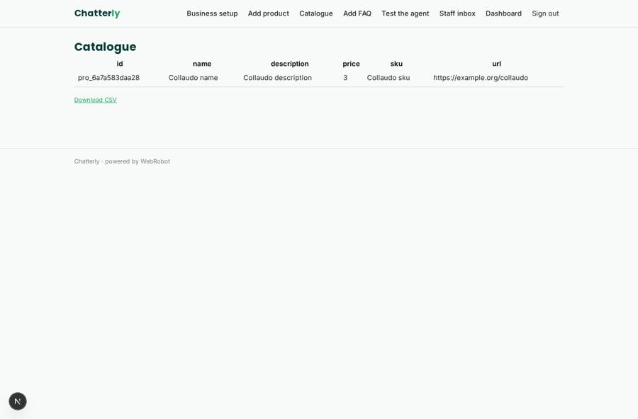
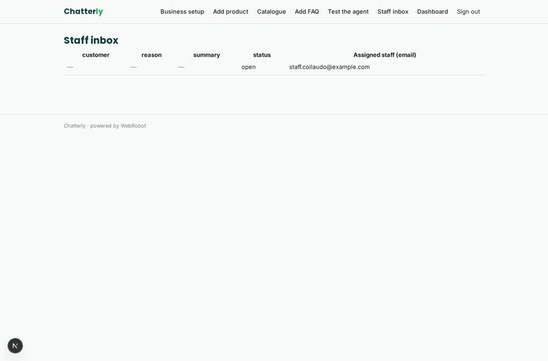
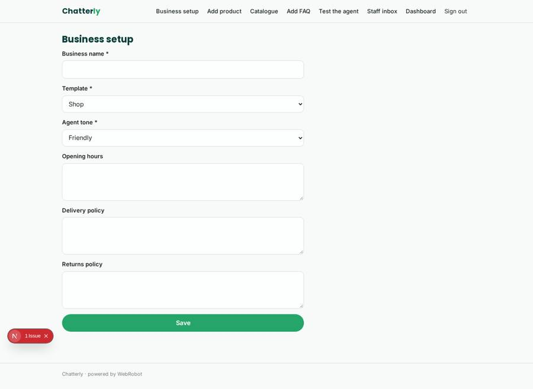
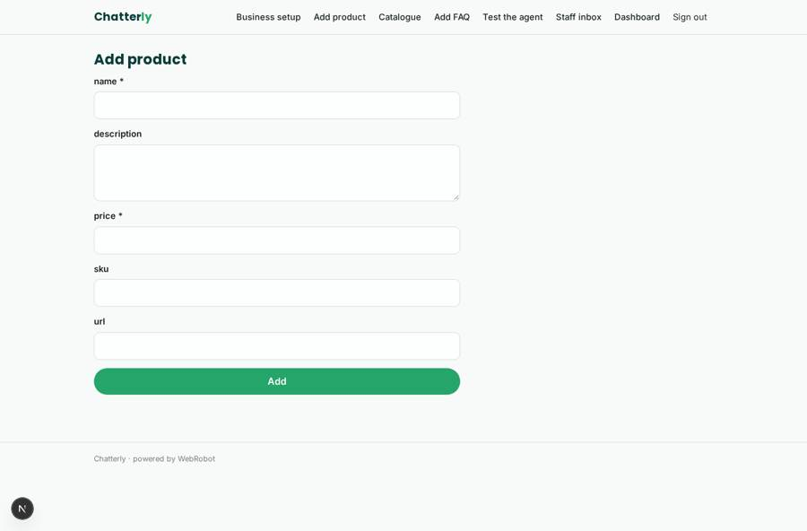

# Chatterly

_An AI sales and support agent for your shop, set up without code._

**Sector:** Consumer, travel, retail · **Manifest:** valid (schema + runtime contract) · **Functional test:** passed (19 checks passed)

## Description given to the app builder

I want a no-code app called Chatterly where small shops set up AI sales and support agents that talk to customers on WhatsApp. A business signs up, uploads its catalogue (or connects Shopify with OAuth), FAQs, delivery and returns policy and opening hours, picks a template (shop, salon, restaurant) and sets the agent's tone. The WhatsApp channel is the product: we need the WhatsApp Business Platform, with Meta approval and paid messaging, to receive and send messages. The agent answers questions from the catalogue, recommends products, takes bookings into time slots, sends payment links by card, and follows up abandoned carts with an approved message template. When a customer asks for a refund or is angry, the agent hands over to a human staff member, who replies from an inbox in the app. Owners see conversations, sales attributed to the agent, bookings and unanswered questions on a dashboard; staff see only their assigned chats; admins see all businesses. A weekly email summarises results. Pricing: monthly plan with a conversation allowance, plus pay-per-message overage. English.

## Navigation recording

Signed in as the app's admin, the recorder opened 7 menu page(s): Business setup, Add product, Catalogue, Add FAQ, Test the agent, Staff inbox, Dashboard.
No issue found.

Empty data pages are mostly expected on the local runtime: agents are mocked there, so the collections they fill stay empty.

## Design checks (linter)

- collection sales: a data block of dashboard, tool week_sales of reporter read it, but nothing writes it — add a form view on it (the users fill their own records), an agent tool that writes or appends to it, or a trigger write; or, for a list the admins keep, make it ownedBy shared (admins fill it on the data page)

## Features not expressible today (spec.extensions)

- **whatsapp_channel**: The WhatsApp Business Platform channel (Meta approval, paid messaging, receiving and sending customer messages) is not available yet. The agent runs in the web chat; channels support only web, phone, telegram, email.
- **shopify_oauth**: OAuth sign-in to Shopify is not available; the business pastes a Shopify API token on the account page instead.
- **payment_links**: Sending card payment links from the agent to the customer's chat is not available yet; staff send them.
- **abandoned_cart_followup**: Follow-ups of abandoned carts with an approved WhatsApp message template need the WhatsApp channel and cart events; not available yet.
- **per_message_overage**: Overage is sold as credit packs (1 credit per agent message), not billed per message in arrears.

## Screenshots (interpretive runtime, test data)

### home-anon

### home-mobile

### catalogue

### inbox

### setup

### add_product

