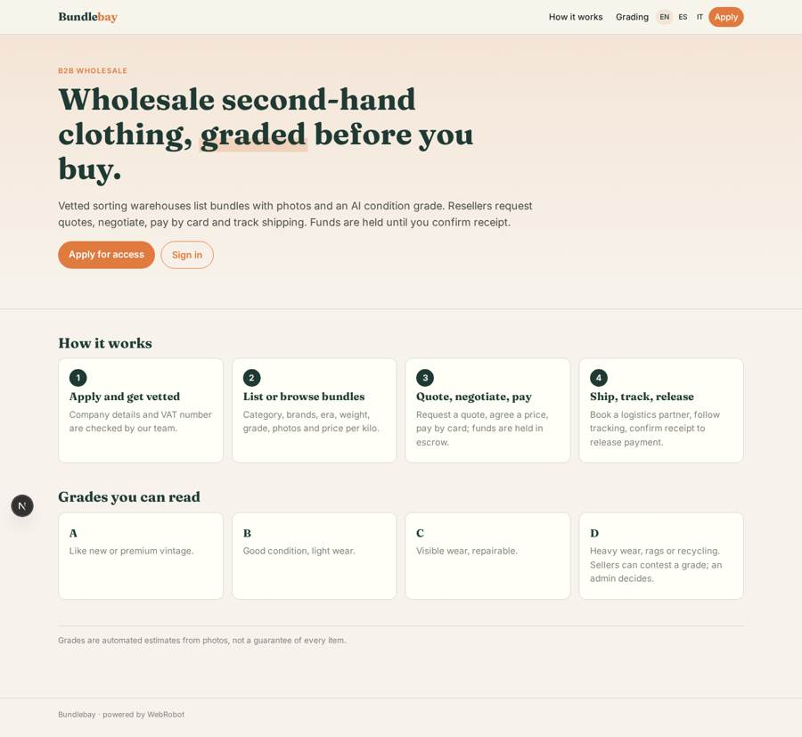
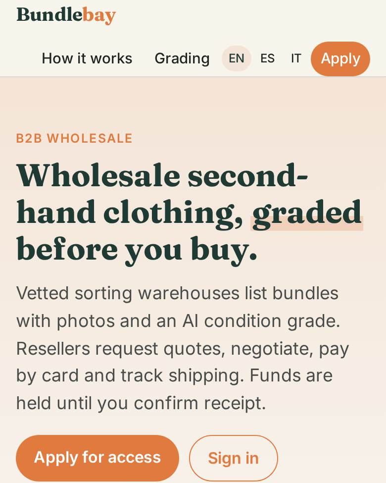
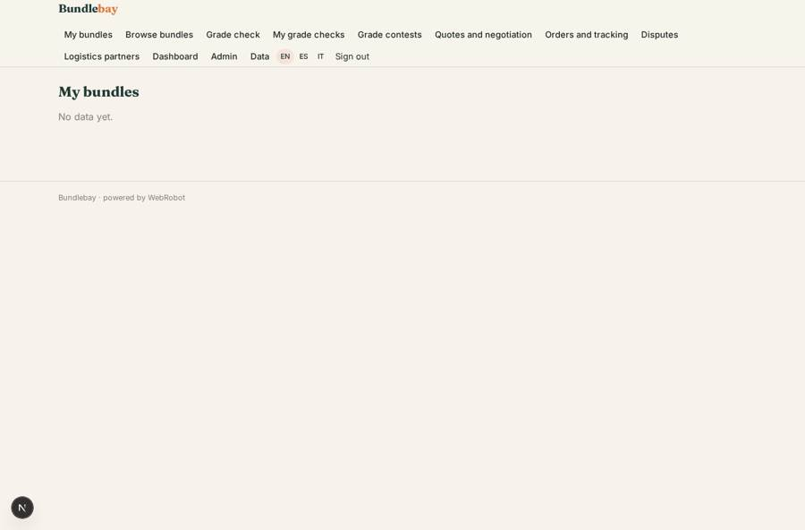
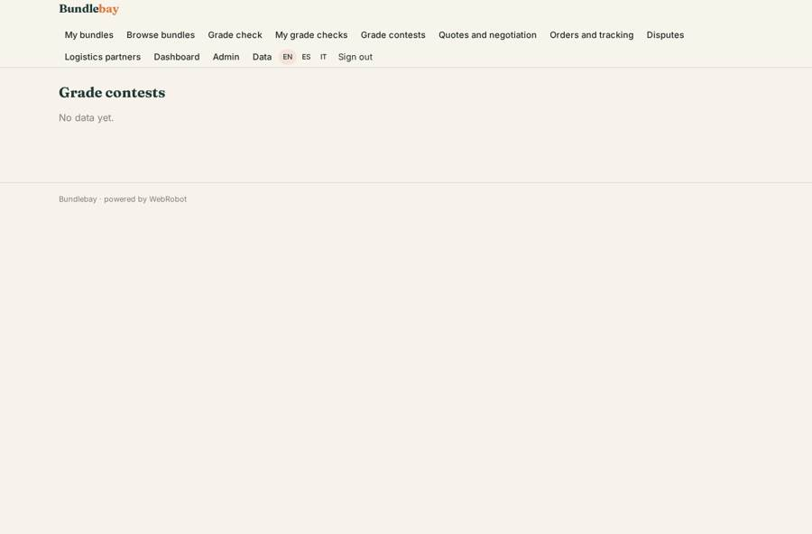
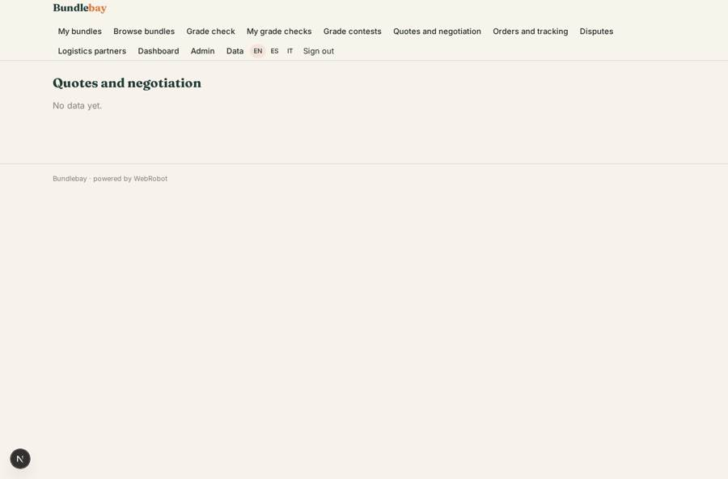

# Bundlebay

_Wholesale second-hand clothing, graded and traded with confidence._

**Sector:** Consumer, travel, retail · **Manifest:** valid (schema + runtime contract) · **Functional test:** 1 failure(s) (35 checks passed)

## Description given to the app builder

I want an app called Bundlebay, a B2B marketplace for wholesale second-hand clothing. The two-sided global network, logistics, escrow payouts and our proprietary vision model that grades garments are the core and outside what I expect from software alone; I need the software around them. Sellers (sorting warehouses) sign up with company details and VAT number and are vetted by an admin. They list bundles: category, brands, era, number of items, weight, grade, photos and price per kilo. Grading should come from an image model that scores condition from photos; buyers see the grade and the seller can contest it, with an admin deciding. Buyers (resellers and vintage shops) browse with filters, send requests for quotes through a form, negotiate, then pay by card; funds are held until the buyer confirms receipt, then released to the seller minus our commission. Shipping is booked with our logistics partners, with tracking shown. Sellers see only their listings and orders, buyers only their orders, admins everything including disputes. Email updates at each step. Dashboards: GMV, take rate, top categories, dispute rate. English, with the interface also in Spanish and Italian.

## Functional test: what did not pass

- **visitor sends a form** (form apply): visitor: 401 sign in to attach files
- **form saves a record** (form company): only role seller may fill it, and the test cannot hold that role _(warning)_
- **form saves a record** (form new_bundle): only role seller may fill it, and the test cannot hold that role _(warning)_
- **form saves a record** (form contest): only role seller may fill it, and the test cannot hold that role _(warning)_
- **form saves a record** (form rfq): only role buyer may fill it, and the test cannot hold that role _(warning)_
- **form saves a record** (form reply): only role seller may fill it, and the test cannot hold that role _(warning)_
- **form saves a record** (form respond): only role buyer may fill it, and the test cannot hold that role _(warning)_
- **form saves a record** (form new_order): only role seller may fill it, and the test cannot hold that role _(warning)_
- **form saves a record** (form book_shipping): only role seller may fill it, and the test cannot hold that role _(warning)_
- **form saves a record** (form confirm_receipt): only role buyer may fill it, and the test cannot hold that role _(warning)_
- **form saves a record** (form dispute): only role buyer may fill it, and the test cannot hold that role _(warning)_
- **page opened by a role allowed to** (view company): only role seller may open it, the test cannot hold it _(warning)_
- **page opened by a role allowed to** (view new_bundle): only role seller may open it, the test cannot hold it _(warning)_
- **page opened by a role allowed to** (view contest): only role seller may open it, the test cannot hold it _(warning)_
- **page opened by a role allowed to** (view rfq): only role buyer may open it, the test cannot hold it _(warning)_
- **page opened by a role allowed to** (view reply): only role seller may open it, the test cannot hold it _(warning)_
- **page opened by a role allowed to** (view respond): only role buyer may open it, the test cannot hold it _(warning)_
- **page opened by a role allowed to** (view new_order): only role seller may open it, the test cannot hold it _(warning)_
- **page opened by a role allowed to** (view book_shipping): only role seller may open it, the test cannot hold it _(warning)_
- **page opened by a role allowed to** (view confirm_receipt): only role buyer may open it, the test cannot hold it _(warning)_
- **page opened by a role allowed to** (view dispute): only role buyer/seller may open it, the test cannot hold it _(warning)_

## Navigation recording

Signed in as the app's admin, the recorder opened 7 menu page(s): My bundles, Browse bundles, Grade check, My grade checks, Grade contests, Quotes and negotiation, Orders and tracking.
- data page empty: my_bundles (table)
- agent run did not open: grade_check: the run did not open
- data page empty: grade_history (history)
- data page empty: contests (table)
- data page empty: quotes (table)
- data page empty: orders (table)

Empty data pages are mostly expected on the local runtime: agents are mocked there, so the collections they fill stay empty.

## Features not expressible today (spec.extensions)

- **escrow_payouts**: Card payment, holding funds until the buyer confirms receipt, release to the seller minus commission, and refunds on disputes are done by the payment and escrow partner. In the app admins set order status (paid_held, released, refunded) on the data page.
- **logistics_partners_api**: Shipping is booked with partners by the admins from the booking request; live carrier tracking via their API is not connected yet, so tracking number, link and ETA are entered on the order.
- **vision_model**: Grading here uses the platform's image reading by an agent. The proprietary Bundlebay vision model can replace it later, writing the same ai_grade, ai_score and ai_notes fields.
- **quote_prefill**: The quote form asks for the seller's email, which is shown on each listing; automatic prefill from the chosen bundle and automatic order creation from an accepted quote are not available yet.

## Screenshots (interpretive runtime, test data)

### home-anon

### home-mobile

### browse

### my_bundles

### contests

### quotes

