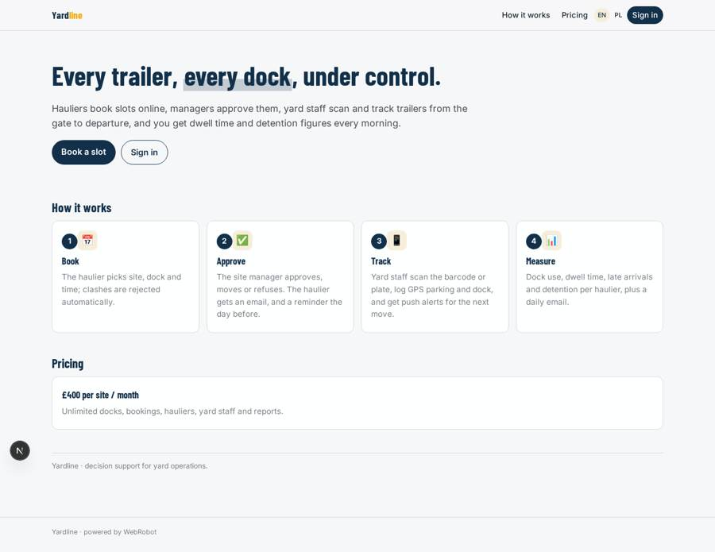
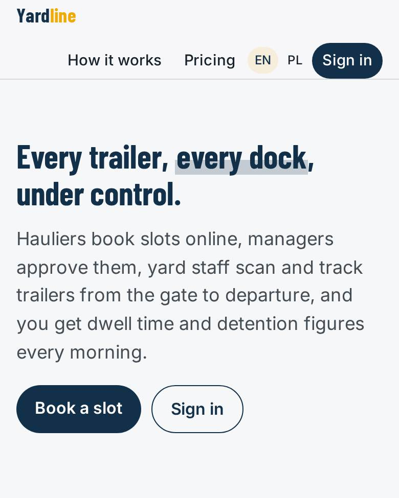
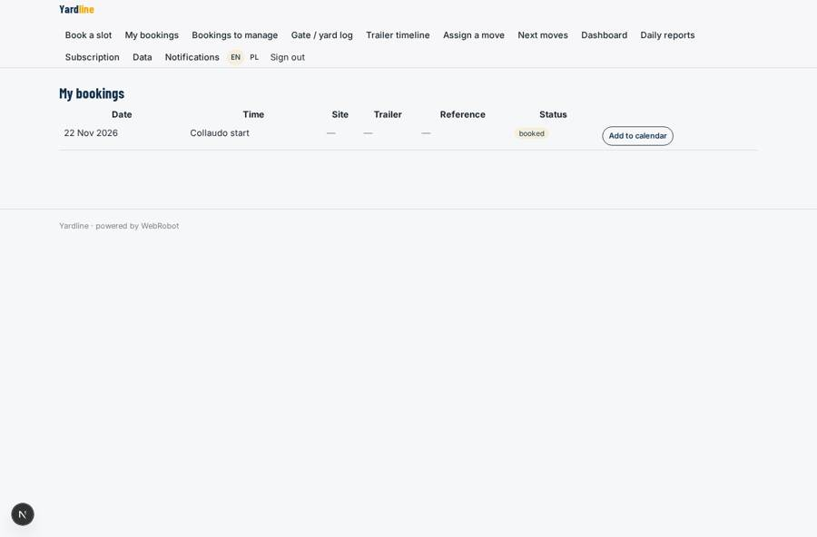
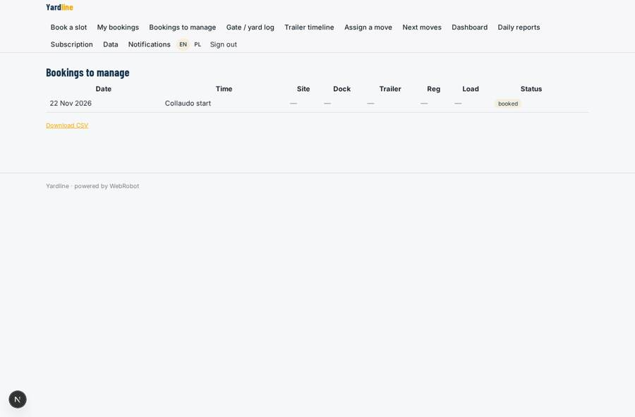
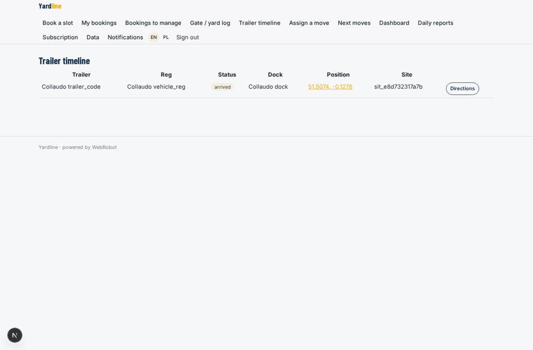
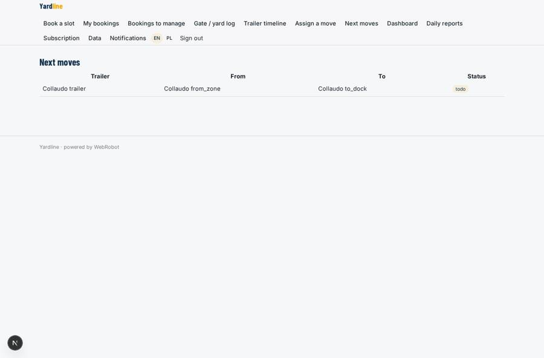

# Yardline

_Yard and dock management for FMCG warehouses and logistics hubs._

**Sector:** Data, media, cyber, devtools · **Manifest:** valid (schema + runtime contract) · **Functional test:** passed (24 checks passed)

## Description given to the app builder

I want an app called Yardline for yard and dock management at FMCG warehouses and logistics hubs. A company signs up and sets up its sites with docks, yard zones, opening hours and slot length. Hauliers register and book delivery or collection slots through a form: site, date, time, trailer and vehicle registration, load type, reference and driver phone number; the app checks capacity and rejects clashes. Site managers can approve, move or refuse bookings, and the haulier gets an email confirmation and reminder the day before. A mobile app for yard staff scans the trailer barcode or reads the plate with the camera at the gate, records GPS position when a trailer is parked, and assigns it to a dock. Push notifications tell yard drivers which trailer to move next. Each trailer has a status timeline: arrived, parked, at dock, loading, departed. Dashboards show dock use, average dwell time, late arrivals and detention costs per haulier. A daily email reports yesterday's performance to site managers. Roles: company admin, site manager, yard operator, haulier; each site sees only its own data, hauliers only their own bookings. Pricing: £400 a month per site. English and Polish.

## Functional test: what did not pass

- **template instance created and run** (template daily_report): reserved to manager/admin _(warning)_
- **saved record shown where its collection is read** (view my_bookings): a record was saved in bookings (by admin) but the page does not show it (as haulier) _(warning)_
- **saved record shown where its collection is read** (view manage): a record was saved in bookings (by admin) but the page does not show it (as manager) _(warning)_
- **saved record shown where its collection is read** (view timeline): a record was saved in yard_events (by admin) but the page does not show it (as manager) _(warning)_
- **saved record shown where its collection is read** (view moves): a record was saved in yard_moves (by admin) but the page does not show it (as manager) _(warning)_

## Navigation recording

Signed in as the app's admin, the recorder opened 7 menu page(s): Book a slot, My bookings, Bookings to manage, Gate / yard log, Trailer timeline, Assign a move, Next moves.
No issue found.

Empty data pages are mostly expected on the local runtime: agents are mocked there, so the collections they fill stay empty.

## Design checks (linter)

- mobile.capabilities: an add-to-calendar button (view my_bookings) needs 'calendar' in the phone app

## Features not expressible today (spec.extensions)

- **multi_company**: This design serves one company's sites (the admin fills sites and docks on the data page). Separate companies each signing up and managing their own sites, charging £400 per site automatically, and reading the plate text by OCR are not expressible yet; per-site billing is a single plan to be bought once per site.
- **site_scoping_yard_staff**: Site managers and hauliers are scoped by manager_email / haulier_email stamped on records. Yard operators see only their own entries and the moves assigned to them; sharing one site's timeline between several operators needs a shared-site access rule.

## Screenshots (interpretive runtime, test data)

### home-anon

### home-mobile

### my_bookings

### manage

### timeline

### moves

